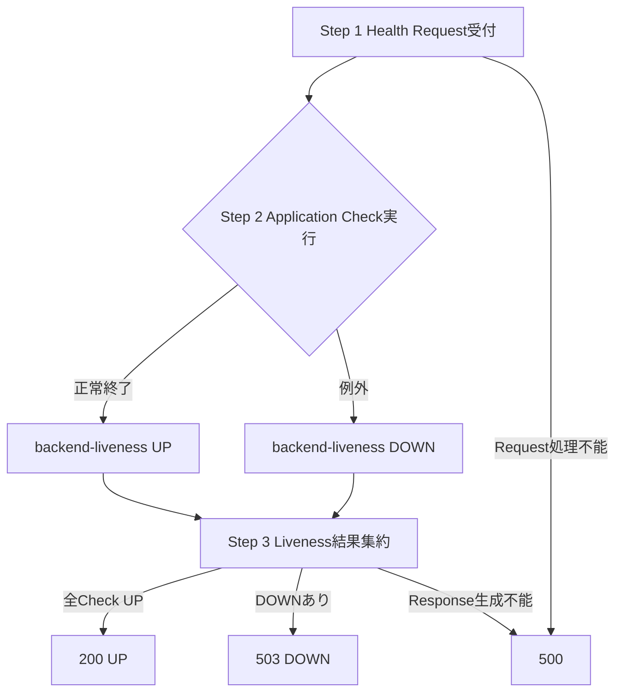
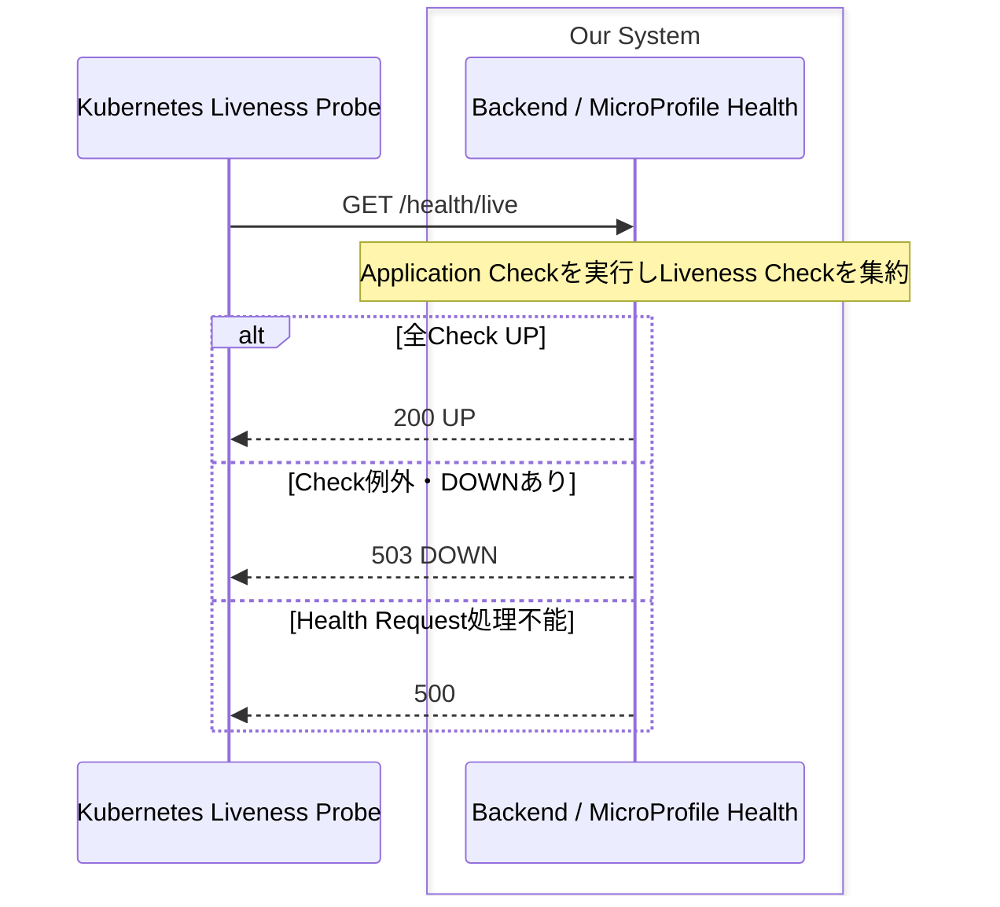

# API Specification

## 変更履歴

| Change | Date | Train | Summary |
| --- | --- | --- | --- |
| Initial Design | 2026-10-15 | 20260915-initial-implementation | 初回API仕様を確定 |

## **1. Summary**

| Item | Value |
| --- | --- |
| Physical Name | `backend-liveness` |
| Logical Name | Backend Liveness API |
| Service | Backend Application（運用・横断機能） |
| API Type | Internal |
| (HTTP Method) Endpoint | `(GET) /health/live` |
| Description | Backendの継続動作状態を公開し、Kubernetes Liveness Probeおよび許可された運用確認に使用する。 |

MicroProfile Health標準Endpointを利用する。認証不要だが一般利用者向けの公開Routingには含めず、`/api/v1`配下へ配置しない。初回TrainのApplication Checkは、`backend-liveness`のCheck処理を正常に実行できる場合を`UP`、Check実行時の例外を`DOWN`とする。Application独自のFatal Stateは定義・保持しない。

Process停止、Deadlock、Thread枯渇その他の無応答はKubernetesのProbe Timeoutへ委ねる。MySQL、Amazon Bedrockその他の外部Dependencyを能動確認せず、外部接続失敗、業務RequestのError、生成不成立、履歴保存失敗だけを理由にLivenessをDOWNにしない。起動完了はStartup、利用者Trafficの受付可否はReadinessの責務とする。

標準契約は[MicroProfile Health仕様](https://download.eclipse.org/microprofile/microprofile-health-4.0.1/microprofile-health-spec-4.0.1.pdf)を参照し、実装時に採用するPayara Microとの互換性を確認する。

## **2. Dependencies**

| No. | Property | Type | Required | Property Value / Reference | Purpose |
| ---: | --- | --- | :---: | --- | --- |
| 1 | MicroProfile Health Runtime／Liveness Check登録 | Configuration | ● | Payara Microの標準機能、Application Check `backend-liveness`。System Architecture 5.4、6.5、IAD-002 | 継続動作の判定・集約・標準Response生成 |
| 2 | Liveness Probe／到達制御 | Configuration | ● | Backend Deployment、IAD-003、Infrastructure Architecture 13.5 | 内部経路からの監視と一般公開の防止 |

本API専用の外部接続情報やSecretは追加しない。判定はProcess内で軽量に行う。独自の復旧処理や再起動処理をAPI内で実行しない。

Backend Liveness Probeは既存Infrastructure設計に従い、30秒間隔、Failure Threshold 3、Timeout 3秒とする。HTTP応答が得られない場合の失敗判定・再起動はKubernetesが担う。Startup Probeとの設定をDeploymentで整合させる。

## **3. Request Definition**

Path Parameter、Query ParameterおよびRequest Bodyは定義しない。

| No. | Field | Type | Required | Size | Min / Max | Pattern | Validation | Description | Note |
| ---: | --- | --- | :---: | --- | --- | --- | --- | --- | --- |
| - | - | - | - | - | - | - | - | 入力項目なし | BodyのないGET |

## **4. Response Definition**

判定結果を返せる場合は`application/json`でMicroProfile Health標準Responseを返す。全Liveness Checkが`UP`なら`200 OK`、一つでも`DOWN`なら`503 Service Unavailable`とする。

応答可能な正常・異常Responseには、BackendがRequestごとに生成したUUID v4の`X-Request-ID`をResponse Headerとして設定する。Client指定のRequest IDは採用せず、MicroProfile Health標準Bodyは変更しない。Process停止や応答不能によりHTTP Response自体を返せない場合、Headerの返却は保証しない。

| No. | Field | Type | Required | Description | Note |
| ---: | --- | --- | :---: | --- | --- |
| 1 | `status` | String | ● | Liveness Checkの集約状態 | `UP`または`DOWN` |
| 2 | `checks` | Array | ● | Runtimeが集約したLiveness Check結果 | Application Check登録後は`backend-liveness`を含む |
| 3 | `checks[].name` | String | ● | Check名 | Applicationが提供するCheckは`backend-liveness` |
| 4 | `checks[].status` | String | ● | 個別Checkの状態 | `UP`または`DOWN` |

ApplicationのLiveness Checkを登録する。Runtime提供Checkが存在する場合も、本APIの外部Dependency非依存方針との整合性を実装時に確認する。

業務APIの`errorCode`／`errorMessage`や共通EnvelopeでWrapしない。Credential、設定実値、接続先、Stack Trace等の詳細情報を含めない。

Health Request自体を処理できない場合は`500 Internal Server Error`とし、判定結果のJSON Bodyの存在は保証しない。Process停止や応答不能時にはHTTP Response自体が返らないことがある。

## **5. Data Access**

| No. | Table | C | R | U | D | Purpose | Note |
| ---: | --- | :---: | :---: | :---: | :---: | --- | --- |
| - | - | - | - | - | - | Table Accessなし | DB接続確認・業務処理・外部API呼出しは実行しない |

## **6. Logic Flow**



## **7. Sequence**



## **8. Transaction Overview**

| No. | Transaction | Processing Scope | Commit | Rollback | Description |
| ---: | --- | --- | --- | --- | --- |
| - | - | Step 1〜3 | - | - | JTA Transactionを開始しない |

## **9. Processing Details**

#### **Step 1. Health Request受付**

**1.1** MicroProfile Health Runtimeが`GET /health/live`を受け付ける。

**1.2** BackendでUUID v4のRequest IDを生成し、Log Contextへ関連付ける。ClientがRequest IDを指定していても採用しない。

**1.3** 登録されたLiveness Checkを評価する。Applicationの業務API用Exception MappingおよびResponse Wrapperを適用しない。

**Transaction**: Outside

#### **Step 2. Backend継続動作判定**

**2.1** `backend-liveness`のApplication Checkを実行する。Check処理が正常終了した場合は`UP`とする。初回TrainではApplication独自のFatal Stateを定義・保持・参照しない。

**2.2** Check実行時の例外はMicroProfile Healthの失敗Checkとして`DOWN`とし、詳細な例外情報をResponseへ露出させない。Check名と状態をStep 3へ渡す。

**2.3** 外部Dependencyの疎通、業務Tableの参照、Bedrock生成Requestは実行しない。直近の業務ErrorやReadinessのDOWNを、そのままLivenessのDOWNへ転用しない。

**2.4** Process停止、Deadlock、Thread枯渇その他の無応答はKubernetesのProbe Timeoutで検知する。独自の障害監視基盤やError回数閾値は本APIへ追加しない。

**Transaction**: Outside

#### **Step 3. 結果集約・返却**

**3.1** RuntimeがLiveness Checkの結果を集約する。StartupやReadinessの結果を混在させない。

**3.2** 全Checkが`UP`なら`200 / UP`、`DOWN`があれば`503 / DOWN`とし、4章のBodyを返す。

**3.3** Health Requestの処理自体が成立しない場合は標準契約に従い`500`とする。業務Error Codeへ変換しない。

**3.4** HTTP Responseを返せる場合は、Step 1で生成したRequest IDを`X-Request-ID`へ設定する。正常・異常を問わず処理終了時にLog Contextを削除する。

**Transaction**: Outside

## **10. Error Definition**

業務Error Codeは定義・使用しない。

| No. | Error Code | HTTP Status | Error Message | Validation Message | Description | Note |
| ---: | --- | --- | --- | --- | --- | --- |
| 1 | - | `503 Service Unavailable` | - | - | Liveness集約状態がDOWN | 標準の`status`／`checks`で表現 |
| 2 | - | `500 Internal Server Error` | - | - | Health Request自体を処理できない | 固定業務Error Bodyを要求しない |

接続失敗や応答TimeoutはHTTP Error Responseではなく、監視側で失敗として扱う。

## **11. Request / Response Samples**

##### **Request Sample**

```http
GET /health/live HTTP/1.1
Accept: application/json
```

##### **Success Response Sample**

`200 OK`。Application Checkのみの場合の例。

```json
{
  "status": "UP",
  "checks": [
    { "name": "backend-liveness", "status": "UP" }
  ]
}
```

##### **Error Response Sample**

`503 Service Unavailable`。Application Check実行時の例外を失敗Checkとして集約し、応答は可能な場合。

```json
{
  "status": "DOWN",
  "checks": [
    { "name": "backend-liveness", "status": "DOWN" }
  ]
}
```
