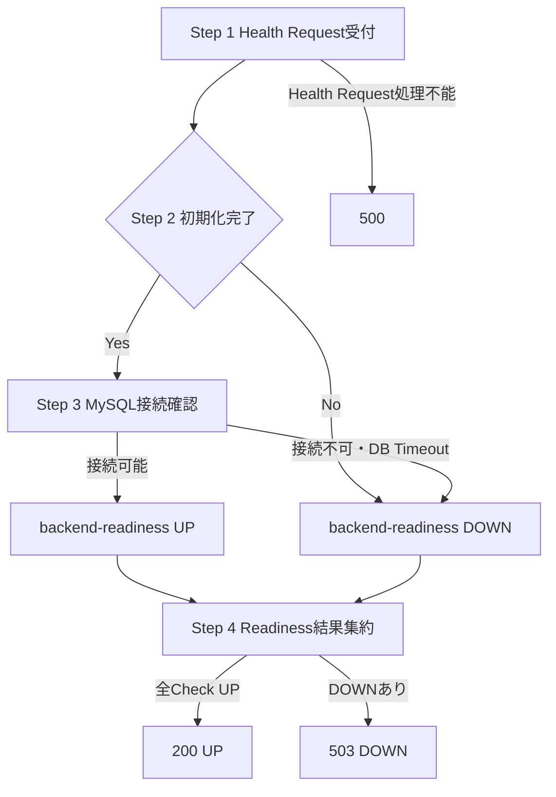
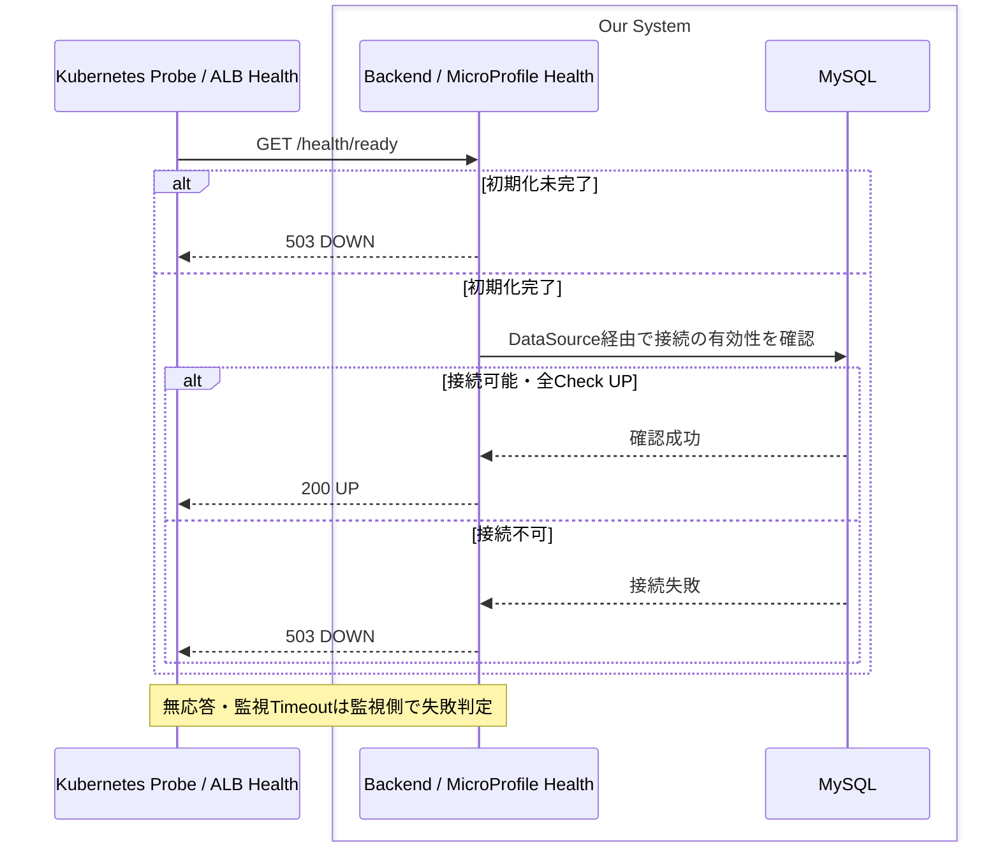

# API Specification

## 変更履歴

| Change | Date | Train | Summary |
| --- | --- | --- | --- |
| Initial Design | 2026-10-15 | 20260915-initial-implementation | 初回API仕様を確定 |
| Change 1 | 2026-11-03 | 20260915-initial-implementation | 実装に合わせてContainer-managed DataSourceのJNDI名を`jdbc/DevMenu`へ変更 |

## **1. Summary**

| Item | Value |
| --- | --- |
| Physical Name | `backend-readiness` |
| Logical Name | Backend Readiness API |
| Service | Backend Application（運用・横断機能） |
| API Type | Internal |
| (HTTP Method) Endpoint | `(GET) /health/ready` |
| Description | Backendの初期化状態とMySQL接続可能性から利用者Trafficの受付可否を判定し、Kubernetes Readiness ProbeとALB Target Healthへ公開する。 |

MicroProfile Health標準Endpointを利用する。認証不要だが一般利用者向けの公開Routingには含めず、`/api/v1`配下へ配置しない。System Architecture 6.5、Infrastructure Architecture 13.5、IAD-009およびAPI Specification Draftを前提とする。

Amazon Bedrockへ生成Requestを送信せず、Bedrockの実行時障害だけではDOWNにしない。業務Tableの内容・Schemaの完全性・業務処理成功を保証するAPIではない。

### Timeout方針

Kubernetes Readiness ProbeとBackend向けALB Health CheckのTimeoutはともに10秒とする。DB確認は共通DataSourceのTimeout設定を使用し、Readiness専用Timeoutは追加しない。Connection取得待ちの初期値は5000ミリ秒、Socket読取待ちは10000ミリ秒であり、取得と接続検証を含む応答全体の10秒以内完了は保証しない。監視側TimeoutもHealth Check失敗として受容し、Backend側の処理終了とConnection解放を実装時に検証する。

## **2. Dependencies**

| No. | Property | Type | Required | Property Value / Reference | Purpose |
| ---: | --- | --- | :---: | --- | --- |
| 1 | MicroProfile Health Runtime／Readiness Check登録 | Configuration | ● | Payara Micro標準機能、Application Check `backend-readiness` | 状態の集約・標準Response生成 |
| 2 | Backend初期化結果 | Configuration | ● | 起動時設定検証およびApplication初期化状態 | Traffic受付の前提確認 |
| 3 | `jdbc/DevMenu` | Database | ● | Container-managed DataSource。IAD-015〜IAD-018 | Applicationが使用するMySQL接続の軽量な有効性確認。TLSとServer Certificate検証 |
| 4 | `database.host`／`database.port`／`database.name` | Configuration | ● | Environment ConfigMap。Port未設定時は`3306` | Environment別接続先 |
| 5 | `database.username`／`database.password` | Secret | ● | ESOが同期するEnvironment別Kubernetes Secret。IAD-011 | Application用認証。Migration／Master Credentialと分離 |
| 6 | `database.connection-timeout-millis`／`database.socket-timeout-millis` | Configuration | ● | Environment ConfigMap。整数・ミリ秒、初期値はそれぞれ`5000`／`10000` | 共通DataSourceの取得待ち・Socket読取待ち。監視側Timeoutとの関係は1章を参照 |
| 7 | Probe／ALB Health設定 | Configuration | ● | IAD-003、IAD-009、Infrastructure Architecture 13.5 | 内部監視とTraffic制御 |

Host、Database名、Username、Passwordの未設定・空文字は設定不正としてBackendを起動可能状態にしない。接続先やCredentialをCodeへ固定しない。ConfigMap内容Hash／Secret VersionIdによるRolling Update後は新Podの設定で判定する。

Kubernetes Readiness Probeは10秒間隔、Failure Threshold 3、Timeout 10秒。Backend向けALB Healthは30秒間隔、Timeout 10秒、Healthy／Unhealthy Threshold各2とする。閾値によるTraffic制御は監視・基盤側が担う。

## **3. Request Definition**

Path Parameter、Query ParameterおよびRequest Bodyは定義しない。

| No. | Field | Type | Required | Size | Min / Max | Pattern | Validation | Description | Note |
| ---: | --- | --- | :---: | --- | --- | --- | --- | --- | --- |
| - | - | - | - | - | - | - | - | 入力項目なし | BodyのないGET |

## **4. Response Definition**

判定結果を返せる場合は`application/json`でMicroProfile Health標準Responseを返す。全Readiness CheckがUPなら`200 OK`、一つでもDOWNなら`503 Service Unavailable`とする。

応答可能な正常・異常Responseには、BackendがRequestごとに生成したUUID v4の`X-Request-ID`をResponse Headerとして設定する。Client指定のRequest IDは採用せず、MicroProfile Health標準Bodyは変更しない。無応答や監視側TimeoutによりHTTP Response自体を返せない場合、Headerの返却は保証しない。

| No. | Field | Type | Required | Description | Note |
| ---: | --- | --- | :---: | --- | --- |
| 1 | `status` | String | ● | Readiness Checkの集約状態 | `UP`または`DOWN` |
| 2 | `checks` | Array | ● | Runtimeが集約したReadiness Check結果 | Application Check登録後は`backend-readiness`を含む |
| 3 | `checks[].name` | String | ● | Check名 | Applicationが提供するCheckは`backend-readiness` |
| 4 | `checks[].status` | String | ● | 個別Checkの状態 | `UP`または`DOWN` |

業務APIの`errorCode`／`errorMessage`や共通EnvelopeでWrapしない。Credential、内部設定、接続先、Stack Trace等の詳細情報を含めない。Runtime提供Checkも含め、情報露出とBedrock非依存方針との整合性を実装時に確認する。

Application Checkを登録し、未登録の空Arrayによる正常判定を受付可能状態の代用にしない。Check登録待ちでは標準のDOWN・空のchecksになり得る。Health Request自体を処理できない場合は500とし、判定結果JSONの存在は保証しない。無応答や監視側のTimeoutはHTTP Responseと区別する。

## **5. Data Access**

| No. | Table | C | R | U | D | Purpose | Note |
| ---: | --- | :---: | :---: | :---: | :---: | --- | --- |
| - | - | - | - | - | - | MySQL接続可能性の確認のみ | Business TableをRead／Writeしない |

Applicationと同じContainer-managed DataSourceを使用し、Connectionの有効性を標準的なJDBC／Runtime機能で確認する。具体的な検証APIおよび時間制限への適用方法は採用Runtimeに合わせて実装・検証する。接続取得だけで正常とせず、使用不能な既存Connectionを検知できることを確認する。

## **6. Logic Flow**



## **7. Sequence**



## **8. Transaction Overview**

| No. | Transaction | Processing Scope | Commit | Rollback | Description |
| ---: | --- | --- | --- | --- | --- |
| - | - | Step 1〜4 | - | - | ApplicationのBusiness Transaction／JTA Transactionを開始しない |

## **9. Processing Details**

#### **Step 1. Health Request受付**

**1.1** MicroProfile Health Runtimeが`GET /health/ready`を受け付ける。

**1.2** BackendでUUID v4のRequest IDを生成し、Log Contextへ関連付ける。ClientがRequest IDを指定していても採用しない。

**1.3** 登録されたReadiness Checkを評価する。業務APIのException MappingおよびResponse Wrapperを適用しない。

**Transaction**: Outside

#### **Step 2. 初期化状態確認**

**2.1** 起動時設定検証とApplication初期化が正常終了しているか確認する。未完了または不正なら`backend-readiness`をDOWNとし、DB確認を行わずStep 4へ進む。

**2.2** 初期化完了ならStep 3へ進む。起動時の設定妥当性と、起動後のBedrock実行時障害は区別する。

**Transaction**: Outside

#### **Step 3. MySQL接続可能性確認**

**3.1** `jdbc/DevMenu`からConnectionを取得し、有効性を軽量に確認する。Business TableのQueryやBedrock呼出しは行わない。

**3.2** 接続確認に成功した場合はUP、取得失敗、Pool枯渇、認証失敗、接続無効、DB側Timeout等の場合はDOWNとする。DB失敗を`DB9999 / 500`へ変換しない。

**3.3** 取得したConnectionは成功・失敗の双方で確実に解放する。監視側がTimeoutしても、Backend側の処理が無制限に残留しないよう、採用する接続・検証機構のTimeoutとResource解放を検証する。共通DataSourceのTimeout設定を使用し、専用Timeoutは追加しない。

**3.4** Check名と状態をStep 4へ渡す。障害の詳細は内部Logで扱い、Health Responseへ含めない。

**Transaction**: Outside

#### **Step 4. 結果集約・返却**

**4.1** RuntimeがReadiness Checkだけを集約する。全CheckがUPなら`200 / UP`、DOWNがあれば`503 / DOWN`として4章のResponseを返す。

**4.2** Check実行時の例外は標準の失敗Checkとして扱う。Health Requestの処理自体が成立しない場合は500とし、業務Error Codeへ変換しない。

**4.3** HTTP Responseを返せる場合は、Step 1で生成したRequest IDを`X-Request-ID`へ設定する。正常・異常を問わず処理終了時にLog Contextを削除する。

**Transaction**: Outside

## **10. Error Definition**

業務Error Codeは定義・使用しない。

| No. | Error Code | HTTP Status | Error Message | Validation Message | Description | Note |
| ---: | --- | --- | --- | --- | --- | --- |
| 1 | - | `503 Service Unavailable` | - | - | 初期化未完了、MySQL接続不可等によりReadiness集約状態がDOWN | 標準のstatus／checksで表現 |
| 2 | - | `500 Internal Server Error` | - | - | Health Request自体を処理できない | 固定業務Error Bodyを要求しない |

接続失敗や応答Timeoutは監視側で失敗として扱う。Readiness失敗をApplication自身の再起動指示として扱わない。

## **11. Request / Response Samples**

##### **Request Sample**

```http
GET /health/ready HTTP/1.1
Accept: application/json
```

##### **Success Response Sample**

`200 OK`。Application Checkのみの場合。

```json
{
  "status": "UP",
  "checks": [
    { "name": "backend-readiness", "status": "UP" }
  ]
}
```

##### **Error Response Sample**

`503 Service Unavailable`。MySQL接続不可を検知し応答できる場合。

```json
{
  "status": "DOWN",
  "checks": [
    { "name": "backend-readiness", "status": "DOWN" }
  ]
}
```
