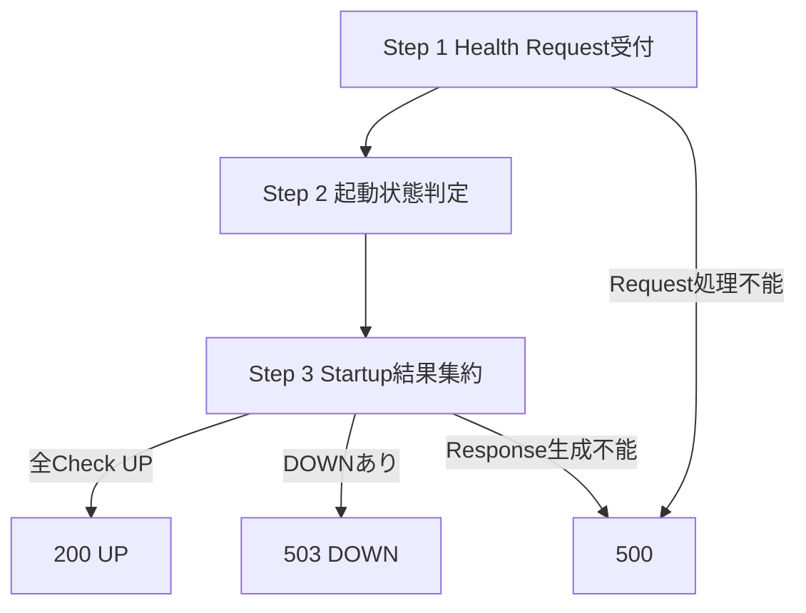
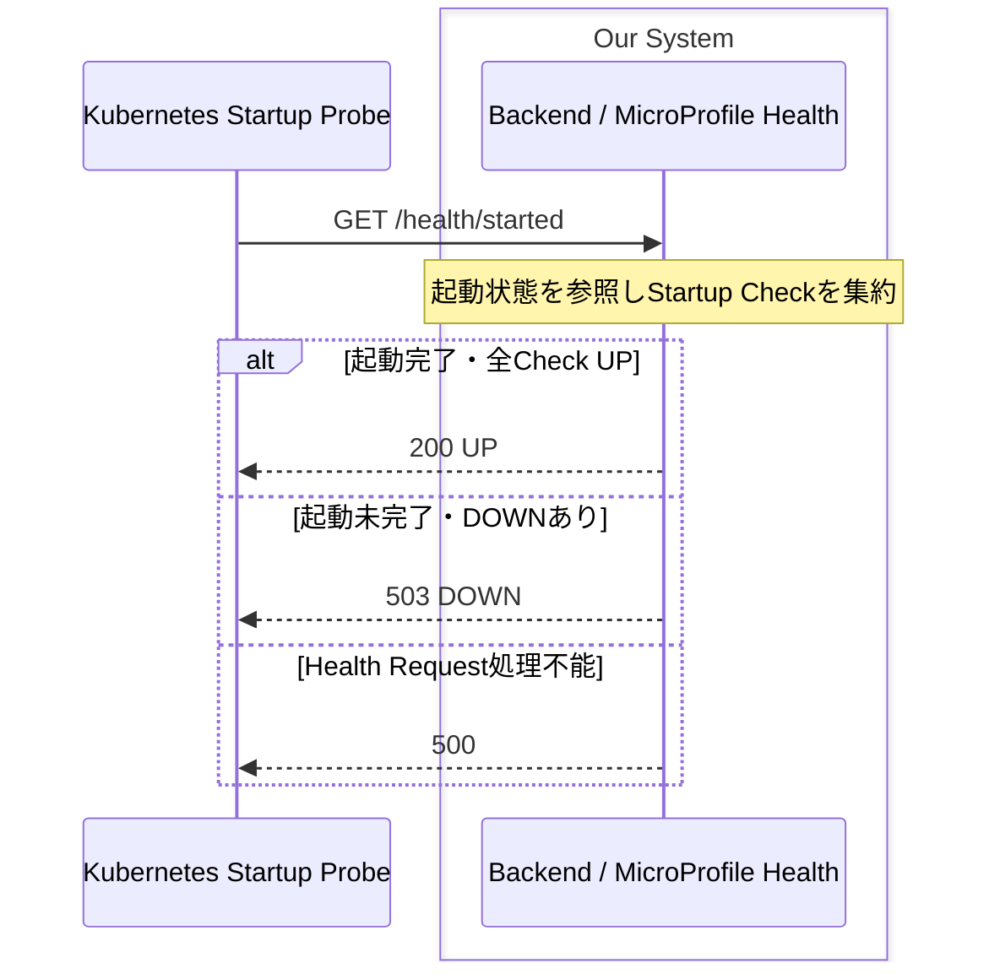

# API Specification

## 変更履歴

| Change | Date | Train | Summary |
| --- | --- | --- | --- |
| Initial Design | 2026-10-15 | 20260915-initial-implementation | 初回API仕様を確定 |

## **1. Summary**

| Item | Value |
| --- | --- |
| Physical Name | `backend-startup` |
| Logical Name | Backend Startup API |
| Service | Backend Application（運用・横断機能） |
| API Type | Internal |
| (HTTP Method) Endpoint | `(GET) /health/started` |
| Description | JVM／Payara Microを含むBackendの起動完了状態を公開し、Kubernetes Startup Probeおよび許可された運用確認に使用する。 |

MicroProfile Health標準Endpointを利用する。認証不要だが一般利用者向けの公開Routingには含めず、`/api/v1`配下へ配置しない。ALB Target Healthおよび利用者Traffic受付可否にはReadinessを使用する。

起動状態を判定し、DBやBedrockへの能動的な接続確認は実施しない。初期化時に検出した設定不正は起動完了扱いにしない。

標準契約の参照: [MicroProfile Health 4.0.1仕様](https://download.eclipse.org/microprofile/microprofile-health-4.0.1/microprofile-health-spec-4.0.1.pdf)。実装時は採用するPayara Microとの互換性を確認する。

## **2. Dependencies**

| No. | Property | Type | Required | Property Value / Reference | Purpose |
| ---: | --- | --- | :---: | --- | --- |
| 1 | MicroProfile Health Runtime／Startup Check登録 | Configuration | ● | Payara Microの標準機能、ApplicationのStartup Check `backend-startup`。System Architecture 5.4、IAD-002 | 起動状態の判定・集約・標準Response生成 |
| 2 | Backend起動時設定の検証結果 | Configuration | ● | ConfigMap／Secretから受け取る起動時設定。各Dependencyを利用する仕様の必須・許容値規則を適用 | 設定検証・Application初期化の完了状態を参照 |
| 3 | Startup Probe／到達制御 | Configuration | ● | Backend Deploymentおよび内部運用経路。IAD-003、IAD-009 | 当Endpointの監視と一般公開の防止 |

本API専用の接続情報やSecretは追加しない。起動時設定は初期化処理が読み込み、本APIはその結果を参照する。ConfigMap内容Hash／Secret VersionIdによるRolling Update後は、新Podの起動状態を判定する。

Probeの間隔・Timeout・失敗閾値はDeployment設定で具体化する。Endpointが応答できることだけで、Backend Applicationの初期化完了とは判断しない。

## **3. Request Definition**

Path Parameter、Query ParameterおよびRequest Bodyは定義しない。

| No. | Field | Type | Required | Size | Min / Max | Pattern | Validation | Description | Note |
| ---: | --- | --- | :---: | --- | --- | --- | --- | --- | --- |
| - | - | - | - | - | - | - | - | 入力項目なし | BodyのないGET |

## **4. Response Definition**

判定結果を返せる場合は`application/json`でMicroProfile Health標準Responseを返す。全Startup Checkが`UP`なら`200 OK`、一つでも`DOWN`なら`503 Service Unavailable`とする。

応答可能な正常・異常Responseには、BackendがRequestごとに生成したUUID v4の`X-Request-ID`をResponse Headerとして設定する。Client指定のRequest IDは採用せず、MicroProfile Health標準Bodyは変更しない。HTTP Listener起動前やProcess停止によりHTTP Response自体を返せない場合、Headerの返却は保証しない。

| No. | Field | Type | Required | Description | Note |
| ---: | --- | --- | :---: | --- | --- |
| 1 | `status` | String | ● | Startup Checkの集約状態 | `UP`または`DOWN` |
| 2 | `checks` | Array | ● | Runtimeが集約したStartup Check結果 | Application Check登録後は`backend-startup`を含む |
| 3 | `checks[].name` | String | ● | Check名 | Applicationが提供するCheckは`backend-startup` |
| 4 | `checks[].status` | String | ● | 個別Checkの状態 | `UP`または`DOWN` |

業務APIの`errorCode`／`errorMessage`や共通EnvelopeでWrapしない。Credential、設定実値、接続先、Stack Trace等の詳細情報を含めない。Runtime提供Checkも含め、情報露出を実装時に確認する。

ApplicationのStartup Checkを登録し、Check未登録時の空Arrayによる正常判定を起動完了の代用にしない。Check登録待ちの標準応答では`DOWN`と空の`checks`になり得る。

Health Request自体を処理できない場合は`500 Internal Server Error`とし、成功時と同じJSON Bodyの存在は保証しない。HTTP Listener起動前・Process停止時等はHTTP Response自体が返らないことがあり、架空の503 Responseへ置き換えない。

## **5. Data Access**

| No. | Table | C | R | U | D | Purpose | Note |
| ---: | --- | :---: | :---: | :---: | :---: | --- | --- |
| - | - | - | - | - | - | Table Accessなし | DB接続確認・業務処理・Bedrock生成Requestは実行しない |

## **6. Logic Flow**



## **7. Sequence**



## **8. Transaction Overview**

| No. | Transaction | Processing Scope | Commit | Rollback | Description |
| ---: | --- | --- | --- | --- | --- |
| - | - | Step 1〜3 | - | - | JTA Transactionを開始しない |

## **9. Processing Details**

#### **Step 1. Health Request受付**

**1.1** MicroProfile Health Runtimeが`GET /health/started`を受け付ける。

**1.2** BackendでUUID v4のRequest IDを生成し、Log Contextへ関連付ける。ClientがRequest IDを指定していても採用しない。

**1.3** 登録されたStartup Checkの評価へ進む。Applicationの業務API用Exception MappingおよびResponse Wrapperを適用しない。

**Transaction**: Outside

#### **Step 2. Backend起動状態判定**

**2.1** Application初期化と起動時設定検証の完了状態を参照する。JVM／Payara Micro上でApplicationが起動し、必要な初期化と設定検証が正常終了している場合、`backend-startup`を`UP`とする。

**2.2** 初期化が未完了、または設定不正等により正常終了していない場合は`DOWN`とする。Application Deploy自体が失敗してCheckを実行できない場合も、正常起動として扱わないことをRuntime設定とProbeで確認する。

**2.3** DBやBedrockの疎通を能動確認せず、業務TableへAccessしない。起動後のDB接続可否はReadinessの責務とする。

**2.4** Check名と状態だけを結果として渡し、Step 3へ進む。Check実行時の例外はMicroProfile Healthの失敗Checkとして扱い、詳細な例外情報をResponseへ露出させない。

**Transaction**: Outside

#### **Step 3. 結果集約・返却**

**3.1** RuntimeがStartup Checkの結果を集約する。対象はStartup Checkであり、ReadinessやLivenessの結果を混在させない。

**3.2** 全Checkが`UP`なら`200 / UP`、`DOWN`があれば`503 / DOWN`とし、4章のBodyを返す。

**3.3** Health Requestの処理自体が成立しない場合は標準契約に従い`500`とする。`ER9999`等の業務Error Codeへ変換しない。

**3.4** HTTP Responseを返せる場合は、Step 1で生成したRequest IDを`X-Request-ID`へ設定する。正常・異常を問わず処理終了時にLog Contextを削除する。

**Transaction**: Outside

## **10. Error Definition**

業務Error Codeは定義・使用しない。`DOWN`は判定結果であり、Health機構のRequest処理不能と区別する。

| No. | Error Code | HTTP Status | Error Message | Validation Message | Description | Note |
| ---: | --- | --- | --- | --- | --- | --- |
| 1 | - | `503 Service Unavailable` | - | - | Startup集約状態がDOWN | 標準の`status`／`checks`で表現 |
| 2 | - | `500 Internal Server Error` | - | - | Health Request自体を処理できない | 固定業務Error Bodyを要求しない |

Listener未起動等による接続失敗や応答TimeoutはHTTP Error Responseではなく、監視側で失敗として扱う。

## **11. Request / Response Samples**

##### **Request Sample**

```http
GET /health/started HTTP/1.1
Accept: application/json
```

##### **Success Response Sample**

`200 OK`。Application Checkのみの場合の例。

```json
{
  "status": "UP",
  "checks": [
    { "name": "backend-startup", "status": "UP" }
  ]
}
```

##### **Error Response Sample**

`503 Service Unavailable`。Check実行可能だが初期化が完了していない場合。

```json
{
  "status": "DOWN",
  "checks": [
    { "name": "backend-startup", "status": "DOWN" }
  ]
}
```
