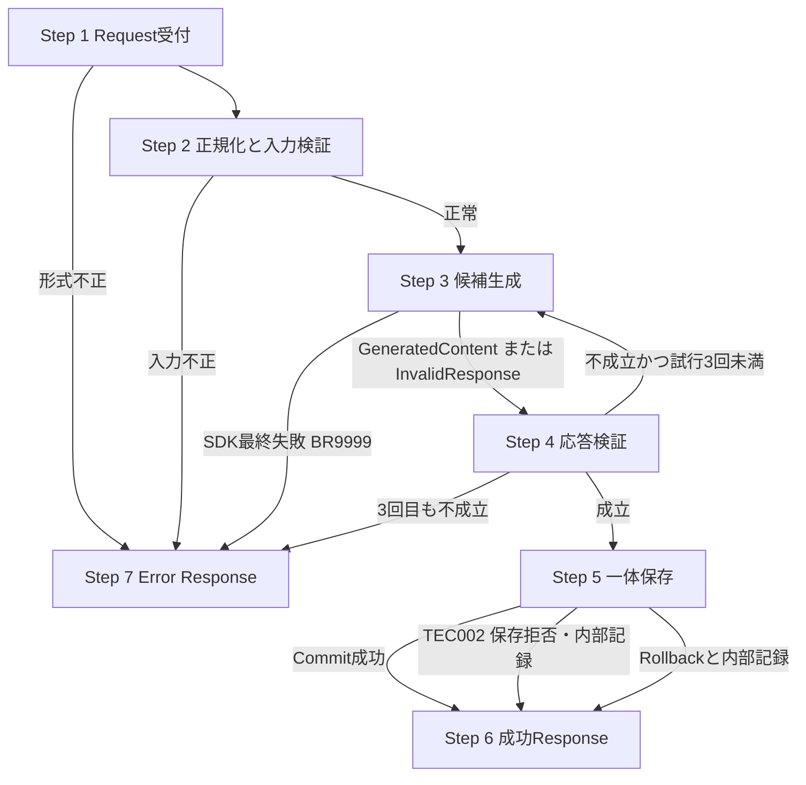
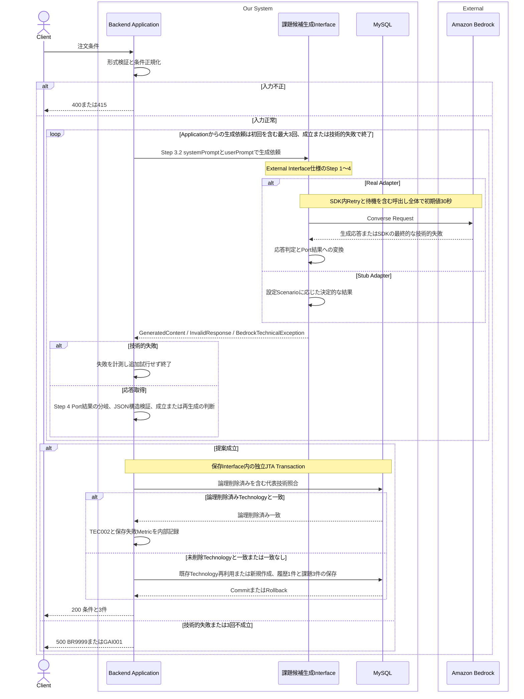

# API Specification

## 変更履歴

| Change | Date | Train | Summary |
| --- | --- | --- | --- |
| Initial Design | 2026-10-15 | 20260915-initial-implementation | 初回API仕様を確定 |
| Change 1 | 2026-10-15 07:07 UTC | 20260915-initial-implementation | External Interface仕様への参照・呼出Sequence、設定、Port Result分岐、JSON構造検証、SDK Retryを含むTimeoutおよび計測境界を具体化 |
| Change 2 | 2026-11-03 | 20260915-initial-implementation | 実装に合わせてContainer-managed DataSourceのJNDI名を`jdbc/DevMenu`へ変更 |
| Change 3 | 2026-11-03 | 20260915-initial-implementation | 論理削除済みTechnologyとの一致時に成立提案の保存全体を拒否し、既存の成功Responseを維持するPolicyを追加 |

## **1. Summary**

| Item | Value |
| --- | --- |
| Physical Name | `practice-proposal` |
| Logical Name | 課題提案API |
| Service | Backend Application（課題提案Module） |
| API Type | External |
| (HTTP Method) Endpoint | `(POST) /api/v1/practice-proposals` |
| Description | 条件を受け付け、成立した3件の課題と生成に使用した条件を同期返却する。成立提案を内部Interfaceで保存するが、保存失敗は提案成功を妨げない。 |

認証不要。Frontendは同一Originの相対URLで呼び出す。BackendのCORSは無効とし、LocalではFrontend開発ServerのProxyを使用する。公開HTTPSはALBで終端する。

本書はFunction Design BR-001〜BR-017、System ArchitectureのModule境界・Transaction・外部連携方針、およびAPI Specification Draftの合意事項を具体化する。

## **2. Dependencies**

| No. | Property | Type | Required | Property Value / Reference | Purpose |
| ---: | --- | --- | :---: | --- | --- |
| 1 | `bedrock.mode` | Configuration | ● | String。`stub`または`real`。ConfigMapから供給し、Pod起動時にMicroProfile Configで読込。System Architecture 9.5〜9.6、IAD-014 | Localは`stub`、developmentは`stub`既定で明示的に`real`へ切替可能。staging／productionは`real`必須。動的切替・障害時Fallbackなし |
| 2 | `bedrock.region` | Configuration | ● | String、初期値`ap-northeast-1`。ConfigMapから供給し、Pod起動時にMicroProfile Configで読込。IAD-019 | Real AdapterがConverse APIを呼び出すAWS Region。動的再読込は行わない |
| 3 | `bedrock.model-id` | Configuration | ● | String、初期値`amazon.nova-lite-v1:0`。ConfigMapから供給し、Pod起動時にMicroProfile Configで読込。IAD-019 | Real AdapterがConverse APIで使用するModel ID。動的再読込は行わない |
| 4 | AWS SDK Default Credential Provider Chain | Credential | ● | IAD-013、BackendのEnvironment別IRSA Role | Real Adapterの短期Credential。固定Access Keyを保持しない |
| 5 | `bedrock.call-timeout-seconds` | Configuration | ● | Integer、秒単位、初期値`30`。ConfigMapから供給し、Pod起動時にMicroProfile Configで読込。IAD-007、IAD-010、IAD-019 | 接続と応答待ちを含む1回全体の上限。動的再読込は行わない |
| 6 | `jdbc/DevMenu` | Database | ● | Container-managed DataSource。`database.host`、`database.port`、`database.name`、`database.connection-timeout-millis`、`database.socket-timeout-millis`、`database.query-timeout-millis`をEnvironment ConfigMapから供給。Portの既定値は`3306`、Connection取得待ち上限は`5000`ミリ秒、Socket読取待ち上限は`10000`ミリ秒、SQL一回の実行上限は`5000`ミリ秒。IAD-015〜IAD-018 | Jakarta EE標準JNDI参照によるMySQL利用。TLSとServer Certificate検証 |
| 7 | `database.username`／`database.password` | Secret | ● | Environment別Kubernetes SecretからContainer-managed DataSourceへ供給。IAD-011 | Migration／Master Credentialと分離した保存用Username／Password |
| 8 | `bedrock.max-tokens` | Configuration | - | Integer、1〜5000（両端含む）。未設定時`4096` | Real時の最大生成Token数 |
| 9 | `bedrock.temperature` | Configuration | - | Decimal、0.00001〜1（両端含む）。未設定時`0.5` | Real時の生成の揺らぎ。調整可能な初期目安であり品質保証条件ではない |
| 10 | `bedrock.top-p` | Configuration | - | Decimal、0〜1（両端含む）。未設定時`0.9` | Real時のSampling設定。通常は0.9を維持してtemperatureを調整する |
| 11 | `bedrock.stub.scenario` | Configuration | - | String、`success`／`invalid-response`／`technical-failure`。未設定時`success` | Stub時の決定的Scenario。正常3件／常に応答不正／技術的失敗 |

Requiredは該当Adapter／保存処理の実行依存を示し、保存依存の実行時失敗をAPI成功条件に追加しない。既定値を持つ設定は明示設定を必須としない。非機密値はConfigMap、SecretはESO経由のKubernetes Secretから供給する。Prompt本文、ConverseのWire Mapping、Model ParameterおよびAdapterの応答判定は、[課題候補生成External Interface Specification](practice-candidate-generation-external-interface-spec.md)を正とする。本書はそのPortを利用するUse Caseの成立判断、再生成、保存および公開Responseを規定する。

上記8〜11の設定もConfigMapからPod起動時にMicroProfile Configで読み込み、内容Hashを持つPod Template Annotationの変更によるRolling Updateで反映する。動的再読込は行わない。`real`では推論設定3項目の型・値域を検証し、不正な明示設定は既定値へ置き換えず、Backendを起動可能状態にしない。`stub`では推論設定を使用・検証せず、Stub Scenarioの定義外値を起動時に検知する。`real`ではStub Scenarioを使用しない。temperatureとtopPは同時に調整しない方針とする。

ApplicationはJakarta EE標準のJNDI参照を介して`jdbc/DevMenu`を取得し、接続値やCredentialをCodeへ固定しない。RDS Endpointは`database.host`、Portは`database.port`、Database名は`database.name`としてEnvironment ConfigMapから供給する。Usernameは`database.username`、Passwordは`database.password`として、ESOが同期するEnvironment別Kubernetes SecretからContainer-managed DataSourceへ供給する。ConfigMapまたはSecretの変更は、各内容Hash／Secret VersionIdを保持するPod Template Annotationの変更を契機にBackend DeploymentをRolling Updateして反映する。

`database.port`は未設定時に`3306`を使用する。`database.host`、`database.name`、`database.username`および`database.password`は必須とし、未設定または空文字の場合は設定不正としてBackendを起動可能状態にしない。

DataSourceからConnectionを取得する待ち時間の上限は`database.connection-timeout-millis`で指定する。整数・ミリ秒単位、初期値`5000`とし、Socket通信およびSQL実行のTimeoutとは区別する。

JDBC Socketの読取待ち時間の上限は`database.socket-timeout-millis`で指定する。整数・ミリ秒単位、初期値`10000`とし、Connection取得待ちおよびSQL実行のTimeoutとは区別する。

Repositoryが発行するSQL一回ごとの実行時間の上限は`database.query-timeout-millis`で指定する。整数・ミリ秒単位、初期値`5000`とし、Connection取得待ちおよびJDBC Socketの読取待ちとは区別する。

`bedrock.mode`、`bedrock.region`、`bedrock.model-id`および`bedrock.call-timeout-seconds`を含むConfigMap変更時は、内容Hashを保持するPod Template Annotationの変更を契機にBackend DeploymentをRolling Updateする。新Podは起動時に変更後の値を読み込み、Readiness成立後に旧Podから切り替える。

`bedrock.mode`が未設定、定義外、またはstaging／productionで`stub`の場合は設定不正としてBackendを起動可能状態にしない。developmentで`real`を選択した場合も、技術的失敗時に`stub`へ自動Fallbackしない。

`bedrock.mode=real`の場合、`bedrock.region`または`bedrock.model-id`が未設定もしくは空文字であれば設定不正としてBackendを起動可能状態にしない。`stub`の場合、両設定値はBedrock呼出しには使用しない。

## **3. Request Definition**

`Content-Type: application/json`。Root Object直下に以下を配置し、未知Fieldは無視する。既知Fieldの型は厳密に検証し、文字列から数値等への暗黙変換はしない。

前後空白除去および`technologyName`の連続空白判定は、Unicodeの空白を扱える標準的なPlatform／Library機能を用いる。対象Code Pointの完全な固定一覧や特定APIは拘束せず、通常の半角・全角空白、Tabおよび改行を一貫して扱うことを境界テストで確認する。文字数は正規化後のUnicode Code Point数を基準とし、UTF-16 Code Unit数には固定しない。等価なFramework機能の採用や境界文字の取扱いは、上限の意味を変えない範囲で実装時に調整できる。

| No. | Field | Type | Required | Size | Min / Max | Pattern | Validation | Description | Note |
| ---: | --- | --- | :---: | --- | --- | --- | --- | --- | --- |
| 1 | `technologyName` | String | ● | 1〜20文字 | - | - | 前後空白除去後、非空。連続空白を一つへ統一 | 学びたい技術名 | 整形後を生成へ使用 |
| 2 | `difficulty` | String | ● | 1文字 | - | `^[123]$` | 定義値のみ | 難易度 | `1`: BEGINNER／初級、`2`: INTERMEDIATE／中級、`3`: ADVANCED／上級 |
| 3 | `durationHours` | Integer | ● | - | 1 / 999 | - | 小数・非数値は不可 | 所要時間（時間） | 生成条件・保存値も時間単位 |
| 4 | `purpose` | String | ● | 1文字 | - | `^[12]$` | 定義値のみ | 目的 | `1`: LEARNING／技術習得、`2`: POC／PoC |
| 5 | `additionalPreference` | String | - | 1〜200文字 | - | - | 前後空白除去後の長さを検証 | その他の意向 | 省略・null可。空文字・空白のみはnull |

Backend境界でCode付きEnumへ変換し、内部LogicではEnum値を比較する。入力・生成内容のHTML Tag除去、HTML Entity化は行わない。JSON構造上必要なEscapeを行い、FrontendはTextとして描画する。`dangerouslySetInnerHTML`等のRaw HTML描画は禁止する。

## **4. Response Definition**

成功時は`200 OK`。全正常・異常Responseに`Content-Type: application/json`、`Cache-Control: no-store`、Backend生成UUID v4の`X-Request-ID`を設定する。Client指定のRequest IDは採用しない。

| No. | Field | Type | Required | Description | Note |
| ---: | --- | --- | :---: | --- | --- |
| 1 | `conditions` | Object | ● | 生成に実際に使用した整形済み条件 | 保存時の代表表示名への置換結果ではない |
| 2 | `conditions.technologyName` | String | ● | 整形済み入力技術名 | 1〜20文字 |
| 3 | `conditions.difficulty` | String | ● | 難易度Code | Requestと同じ定義 |
| 4 | `conditions.durationHours` | Integer | ● | 所要時間（時間） | 1〜999 |
| 5 | `conditions.purpose` | String | ● | 目的Code | Requestと同じ定義 |
| 6 | `conditions.additionalPreference` | String | ● | 整形済み意向 | 未入力はnull。Fieldは省略しない |
| 7 | `practiceProposals` | Array | ● | 成立した課題 | 必ず3件、proposalNumber昇順 |
| 8 | `practiceProposals[].proposalNumber` | Integer | ● | 組内の順序 | 1、2、3を一度ずつ使用 |
| 9 | `practiceProposals[].title` | String | ● | タイトル | 整形後1〜100文字 |
| 10 | `practiceProposals[].overview` | String | ● | 概要 | 整形後1〜500文字 |
| 11 | `practiceProposals[].achievementGoal` | String | ● | 達成目標 | 整形後1〜500文字 |
| 12 | `practiceProposals[].practiceFocus` | String | ● | 学ぶ／検証するポイント | 整形後1〜500文字。目的に応じた一つの文章 |

生成文章は前後空白除去後の同じ値を検証・保存依頼・Responseで使用し、内部の空白と改行は維持する。保存成否、履歴ID、技術IDは返さない。

## **5. Data Access**

すべて共有履歴Moduleの成立提案保存Interfaceを介して利用する。課題提案ModuleはRepository／Entityへ直接Accessしない。

| No. | Table | C | R | U | D | Purpose | Note |
| ---: | --- | :---: | :---: | :---: | :---: | --- | --- |
| 1 | `technologies` | ● | ● | - | - | 代表技術の照合・必要時作成 | 論理削除済みを含めて照合し、未削除一致時だけ再利用、一致なしの場合だけ作成する。論理削除済み一致時は書込みを拒否 |
| 2 | `shared_histories` | ● | - | - | - | 成立条件1組の保存 | 代表技術に関連付ける |
| 3 | `proposal_items` | ● | - | - | - | 成立課題3件の保存 | 一つの共有履歴に関連付ける |

## **6. Logic Flow**



## **7. Sequence**

課題候補生成InterfaceはBackend Application内のPort／Adapterを表す。別Serviceへの通信ではなく、Step 3.2からExternal Interface仕様の処理へ入る位置を示すために分けて表示する。



## **8. Transaction Overview**

| No. | Transaction | Processing Scope | Commit | Rollback | Description |
| ---: | --- | --- | --- | --- | --- |
| 1 | 成立提案保存Transaction | Step 5の保存Interface内部 | 未削除の既存Technology利用または新規Technology作成と、履歴1件・提案3件の保存成功時 | 論理削除済みTechnologyとの一致、保存中またはCommit時の失敗 | 論理削除済み一致時は書込み前に保存を拒否する。書込みが開始済みの場合を含め、部分Commitを許可しない。共有履歴Use Caseを独立した宣言的JTA境界とし、Repositoryは参加のみ |

Step 1〜4、6〜7はTransaction外。Bedrock通信中にDB Transactionを保持しない。保存Interfaceの呼出元は保存Transactionの完了・失敗を受け取ってからStep 6へ進む。

## **9. Processing Details**

#### **Step 1. Request受付**

**1.1** BackendでUUID v4を生成し、Request IDをLog ContextとResponse Headerへ関連付ける。処理終了時にContextを削除する。

**1.2** 非対応Media Typeは`REQ002`、Body欠落またはJSON構文不正は`REQ001`としてStep 7へ進む。JSONの型・必須条件はStep 2で検証する。

**1.3** 正常に解釈できたRequestをStep 2へ渡す。Idempotency Keyは導入せず、各POSTを独立した注文として扱う。Clientは通信失敗時に自動再送せず、利用者の再操作で新しい注文を送る。

**Error**: `REQ001 / 400`、`REQ002 / 415`

**Transaction**: Outside

#### **Step 2. 正規化と入力検証**

**2.1** 既知Fieldについて必須／null、型の順に確認する。Stringの値を正規化した後、文字数・値域・列挙値を検証する。型不正の値へString処理を適用しない。

**2.2** `technologyName`の前後空白を除去し、連続空白を一つへ統一する。`additionalPreference`は前後空白除去後、空ならnullにする。その他の文字内容は改変しない。

**2.3** 不正Fieldがあれば、Fieldごとに優先順位が最も高い理由1件を選び、異なるFieldの理由をまとめて`VE0001`としてStep 7へ進む。正常ならEnum変換した条件を保持し、試行数を0にしてStep 3へ進む。

**Error**: `VE0001 / 400`

**Transaction**: Outside

#### **Step 3. 課題候補生成**

**3.1** 試行数を1増やし、整形済み5条件をExternal Interface SpecificationのApplication管理Prompt Templateへ組み込む。難易度の意味を添え、所要時間は`durationHours`を時間単位として明示し、分へ変換しない。3件固定、日本語、各課題のタイトル・概要・達成目標・目的別ポイントを要求する。利用者入力はJSON Serializerで条件Dataとして扱い、命令やPrompt全体として直接使用しない。初回・再生成とも同じ条件、Template、推論設定を使用し、前回の応答や検証エラーは渡さない。

**3.2** `PracticeCandidateGenerationPort`へ`systemPrompt`と`userPrompt`を渡して同期依頼する。この依頼からPort ResultまたはExceptionを受け取るまでの処理は、[課題候補生成External Interface Specification](practice-candidate-generation-external-interface-spec.md)の9章 Step 1〜4を参照する。Real時はConverse API、Stub時は同じPort Contractを利用する。AWS SDK／Model固有表現はAdapter内に閉じる。

**3.3** `GeneratedContent`または`InvalidResponse`を受け取った場合はStep 4へ進む。SDK内の技術的Retryは許容するが、SDKが最終的に通知した通信・Timeout・Service・認証・設定の技術的失敗はAdapterから`BedrockTechnicalException`として受け取り、Applicationは追加試行せず`BR9999`でStep 7へ進む。Adapter独自の技術的Retryと自動Stub Fallbackは行わない。

**3.4** Bedrock呼出し1回全体のTimeoutを初期値30秒とし、SDK内部のRetry、待機、接続および応答待ちをすべて含める。個々の通信試行や接続・応答待ちそれぞれに30秒を割り当てない。Applicationからの総生成依頼3回の外部呼出し時間枠は最大90秒となり、ALB Idle Timeout 120秒に対して検証・保存・返却の余裕を確保する。SDK内部の通信試行数はApplicationの試行数と区別する。DB側には2章で定めたConnection取得・Socket読取・SQL実行Timeoutを適用するが、これらの設定だけでAPI全体の完了期限を保証しない。実接続で測定・調整し、外部設定変更時も全体の時間配分を再確認する。

**3.5** Portへの生成依頼ごとに呼出し数を1回計上し、Port呼出し開始からResultまたはException受領までを応答時間として計測する。Real時はSDK内部のRetry・待機を含む。再生成の依頼時は初回を除くRetry回数を1回計上する（一注文最大2回）。技術的失敗は当該依頼の失敗を1回計上する。SDK内部の通信試行数・Retry回数は独立計測せず、SDK内で回復した失敗も計上しない。

**Error**: `BR9999 / 500`

**Transaction**: Outside

#### **Step 4. 応答検証と成立判定**

**4.1** `InvalidResponse`の場合は生成内容取得不成立として4.2へ進む。`GeneratedContent`の場合は文字列全体を単一のJSON Objectとして解析し、`practiceProposals`がちょうど3件のObjectを持つArrayで、各要素の`title`、`overview`、`achievementGoal`、`practiceFocus`がStringかつ前後空白除去後に非空であり、4章のUnicode Code Point数の上限以内であることを確認する。型の暗黙変換は行わない。JSONとして許容される前後空白は受け入れるが、説明文・Code Fenceの除去、JSON部分の切出し、自動修復は行わない。構文不正、複数JSON値、Root型不正、既知Fieldの欠落・null・型・件数・文字数不正は不成立とする。Rootおよび各課題Objectの未知Fieldは無視する。

**4.2** 生成内容取得または構造検証が不成立なら、当該生成依頼の失敗を1回計上する。AdapterとApplicationで二重計上せず、後の生成が成立しても既計上分は取り消さない。試行数が3未満ならStep 3へ戻り、3回目も不成立なら`GAI001`でStep 7へ進む。不成立候補は保存・返却しない。失敗原因はLogで区別し、生成依頼単位の失敗数と最終的なAPI Error数は別Metricとする。計測・LogはIAD-021〜023の横断方針に従う。

**4.3** 成立した3件の整形済み文章と順序を保持し、Applicationが配列順にproposalNumber 1、2、3を割り当ててStep 5へ進む。生成側がproposalNumberを含めても採用しない。未知Fieldは内部の成立提案Model、保存依頼およびResponseへ含めない。外部応答から内部ModelへのMappingはExternal Interface Specificationと整合させる。入力条件との意味的適合・提案間の重複は機械判定しない。

**Error**: `GAI001 / 500`

**Transaction**: Outside

#### **Step 5. 成立提案保存**

**5.1** 整形済み条件と3件を成立提案保存Interfaceへ一回だけ同期で渡す。

| 保存依頼情報 | Source |
| --- | --- |
| 技術名・難易度・所要時間・目的・任意意向 | Step 2の条件 |
| 提案番号・タイトル・概要・達成目標・ポイント | Step 4で成立した3件 |

所要時間は`durationHours`の値を時間単位のまま`shared_histories.duration_hours`へ保存する。

**5.2** 共有履歴Moduleは、整形済み技術名を`technologies.display_name`とDatabase既定の大文字小文字を区別しない照合規則で比較し、論理削除済みRecordを含めて一致を確認する。未削除Recordと一致した場合だけ既存Technologyとその代表表示名を使用する。一致するRecordが存在しない場合だけ、整形済み技術名を持つ未削除Technologyを新規作成する。

論理削除済みRecordと一致した場合は、再利用、復活、更新および同名Technologyの新規作成を行わず、`technologies`、`shared_histories`および`proposal_items`のいずれにも書き込まない。成立提案の保存全体を`TEC002`として拒否する。Technologyの論理削除状態は他の書込みより前に確認し、書込みが開始済みの場合は保存Transaction全体をRollbackする。代表技術との関係、入力条件および3件は一体として保存し、部分Commitを許可しない。Table Column／共通監査ColumnはTable Definitionを正とし、保存側の具体処理は成立提案保存Interfaceの責務とする。

**5.3** 保存とCommitが成功した場合はStep 6へ進む。論理削除済みTechnologyとの一致による保存拒否は、`TEC002`とRequest IDを持つ内部ERRORとして記録する。DB技術的失敗は`DB9999`、分類不能の予期しない内部失敗は`ER9999`で記録し、後二者では保存Transaction全体をRollbackする。いずれも`HistorySaveFailureCount`を`value=1`、`operation=history-create`として一回だけ記録し、Repository、Use Caseその他の複数箇所で二重計上しない。その後はStep 6へ進み、Clientへ保存失敗、内部Error Code、Technology IDまたはHistory IDを返さない。

**Transaction**: 成立提案保存Transaction（Interface内部のみ）

#### **Step 6. Success Response生成**

**6.1** Step 2の生成条件を`conditions`、Step 4の成立済み3件を`practiceProposals`へMappingする。保存時の代表表示名や内部IDで生成条件を上書きしない。

**6.2** proposalNumber昇順で`200 OK`を返す。Response Headerは4章に従う。

**Transaction**: Outside

#### **Step 7. Error Response生成**

**7.1** Step 1〜4のErrorおよび公開処理中の分類不能な内部Errorを10章の固定文言へMappingする。後者は`ER9999 / 500`とする。Step 5で扱った保存失敗はこの経路に入れない。

**7.2** `errorCode`と`errorMessage`を必ず返す。`VE0001`のみField名から英文理由へのObjectである`validationMessage`を追加する。それ以外は省略する。

**7.3** 内部Exception、Stack Trace、接続先、CredentialをResponseへ含めない。Logは横断方針に従い、利用者入力・生成内容・Secretを既定で記録しない。FrontendはCodeとFieldに応じた表示文言を管理する。

**Transaction**: Outside

## **10. Error Definition**

共通定義は[Error Codes](../error-codes.md)を正とする。

| No. | Error Code | HTTP Status | Error Message | Validation Message | Description | Note |
| ---: | --- | --- | --- | --- | --- | --- |
| 1 | `REQ001` | `400 Bad Request` | `The request format is invalid.` | - | Body欠落・JSON構文不正 | Step 1 |
| 2 | `REQ002` | `415 Unsupported Media Type` | `The media type is not supported.` | - | 非対応Media Type | Step 1 |
| 3 | `VE0001` | `400 Bad Request` | `The input is invalid.` | 下表 | Field入力値不正 | Step 2 |
| 4 | `GAI001` | `500 Internal Server Error` | `Failed to generate practice proposals.` | - | 総試行後も提案不成立 | Step 4 |
| 5 | `BR9999` | `500 Internal Server Error` | `An Amazon Bedrock error occurred.` | - | Bedrock技術的失敗 | Step 3 |
| 6 | `ER9999` | `500 Internal Server Error` | `Unknown error.` | - | 分類不能な内部Error | Step 7。保存内のみの失敗は内部記録 |

`TEC002`および`DB9999`は本APIでは保存失敗の内部記録用であり、Error Responseには使用しない。`TEC002`は論理削除済みTechnologyとの一致による保存拒否、`DB9999`はDatabase技術的失敗として区別する。

| 条件 | `validationMessage` |
| --- | --- |
| 必須Field欠落・null | `Required.` |
| String Field型不正 | `Must be a string.` |
| technologyName空文字・空白のみ | `Must not be blank.` |
| technologyNameが20文字超過 | `Must not exceed 20 characters.` |
| difficulty定義外 | `Must be one of "1", "2", or "3".` |
| durationHoursがIntegerでない | `Must be an integer.` |
| durationHours範囲外 | `Must be between 1 and 999.` |
| purpose定義外 | `Must be one of "1" or "2".` |
| additionalPreference型不正 | `Must be a string or null.` |
| additionalPreferenceが200文字超過 | `Must not exceed 200 characters.` |

## **11. Request / Response Samples**

##### **Request Sample**

```json
{
  "technologyName": "React",
  "difficulty": "1",
  "durationHours": 2,
  "purpose": "1",
  "additionalPreference": null
}
```

##### **Success Response Sample**

`200 OK`。

```json
{
  "conditions": {
    "technologyName": "React",
    "difficulty": "1",
    "durationHours": 2,
    "purpose": "1",
    "additionalPreference": null
  },
  "practiceProposals": [
    {
      "proposalNumber": 1,
      "title": "カウンターを作る",
      "overview": "ボタンで数値を増減する画面を実装する。",
      "achievementGoal": "操作に応じて数値が更新される。",
      "practiceFocus": "状態とイベント処理の関係を学ぶ。"
    },
    {
      "proposalNumber": 2,
      "title": "メモ入力画面を作る",
      "overview": "入力したメモを一覧に追加する。",
      "achievementGoal": "入力内容を画面内の一覧で確認できる。",
      "practiceFocus": "フォーム入力と配列の状態管理を学ぶ。"
    },
    {
      "proposalNumber": 3,
      "title": "絞り込み一覧を作る",
      "overview": "固定の項目一覧を入力文字列で絞り込む。",
      "achievementGoal": "検索条件に一致する項目だけ表示される。",
      "practiceFocus": "状態から表示内容を導出する方法を学ぶ。"
    }
  ]
}
```

##### **Error Response Samples**

`400 Bad Request`:

```json
{
  "errorCode": "VE0001",
  "errorMessage": "The input is invalid.",
  "validationMessage": {
    "technologyName": "Must not be blank.",
    "durationHours": "Must be between 1 and 999."
  }
}
```

`500 Internal Server Error`:

```json
{
  "errorCode": "BR9999",
  "errorMessage": "An Amazon Bedrock error occurred."
}
```
