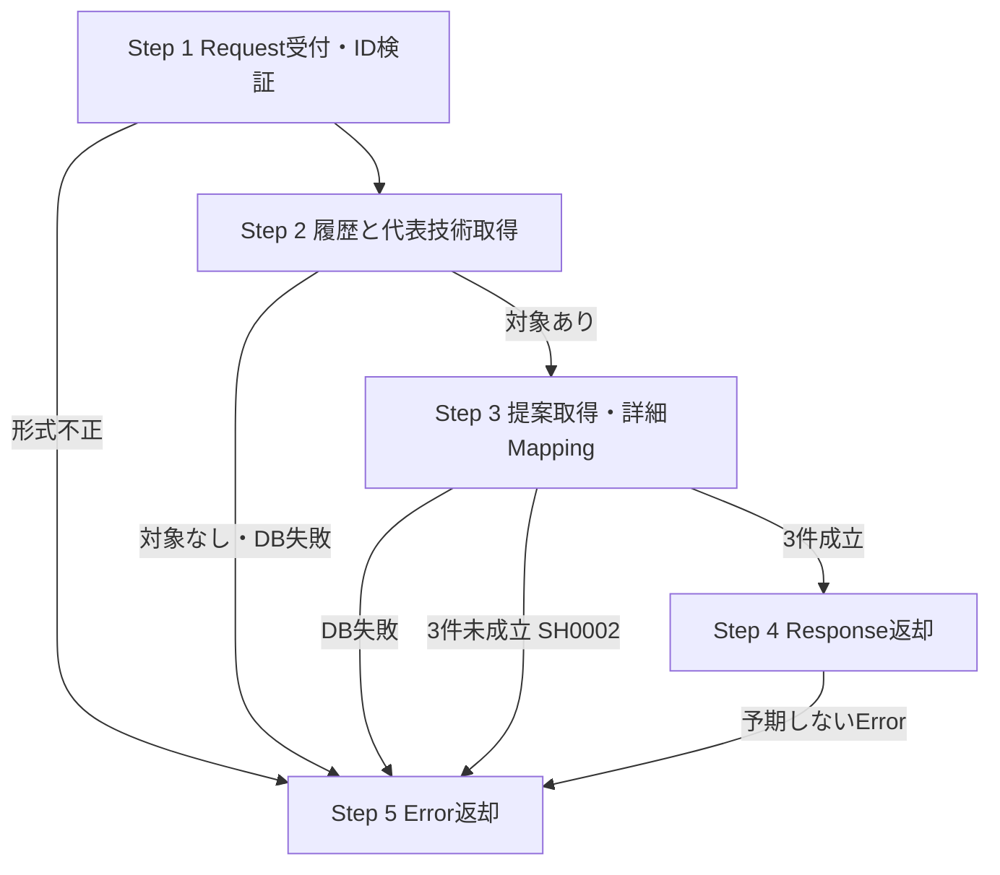
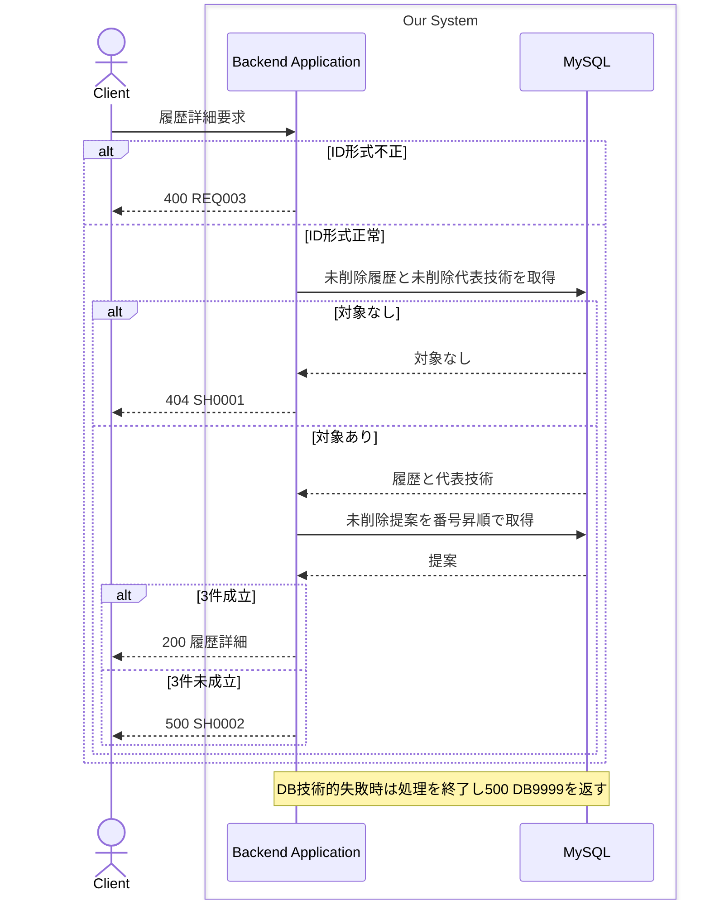

# API Specification

## 変更履歴

| Change | Date | Train | Summary |
| --- | --- | --- | --- |
| Initial Design | 2026-10-15 | 20260915-initial-implementation | 初回API仕様を確定 |
| Change 1 | 2026-11-03 | 20260915-initial-implementation | 実装に合わせてContainer-managed DataSourceのJNDI名を`jdbc/DevMenu`へ変更 |

## **1. Summary**

| Item | Value |
| --- | --- |
| Physical Name | `shared-history-detail` |
| Logical Name | 履歴詳細API |
| Service | Backend Application（共有履歴Module） |
| API Type | External |
| (HTTP Method) Endpoint | `(GET) /api/v1/shared-histories/{historyId}` |
| Description | 指定された共有履歴の保存日時、入力条件、代表技術および保存済みの3件の課題を返す。 |

認証不要。Frontendは同一Originの相対URLで呼び出す。BackendのCORSは無効とし、LocalではFrontend開発ServerのProxyを使用する。公開HTTPSはALBで終端する。

Function Designの履歴詳細閲覧Flow、System Architectureの共有履歴Module境界、およびAPI Specification Draftの合意事項を具体化する。

## **2. Dependencies**

| No. | Property | Type | Required | Property Value / Reference | Purpose |
| ---: | --- | --- | :---: | --- | --- |
| 1 | `jdbc/DevMenu` | Database | ● | Container-managed DataSource。IAD-015〜IAD-018 | 共有履歴・代表技術・提案の参照。TLSとServer Certificate検証 |
| 2 | `database.host`／`database.port`／`database.name` | Configuration | ● | Environment ConfigMap。Port未設定時は`3306`。HostとDatabase名は必須 | Environment別MySQL接続先 |
| 3 | `database.username`／`database.password` | Secret | ● | ESOが同期するEnvironment別Kubernetes Secret。IAD-011 | Migration／Master Credentialと分離したApplication用認証 |
| 4 | `database.connection-timeout-millis` | Configuration | ● | Environment ConfigMap。整数・ミリ秒、初期値`5000` | DataSourceからのConnection取得待ち上限 |
| 5 | `database.socket-timeout-millis` | Configuration | ● | Environment ConfigMap。整数・ミリ秒、初期値`10000` | JDBC Socketの読取待ち上限 |
| 6 | `database.query-timeout-millis` | Configuration | ● | Environment ConfigMap。整数・ミリ秒、初期値`5000` | Repositoryが発行するSQL一回ごとの実行上限 |

Requiredは実行依存を示す。Applicationは標準JNDI参照とJPA／JTAを利用し、接続値やCredentialをCodeへ固定しない。Host、Database名、Username、Passwordの未設定・空文字は設定不正としてBackendを起動可能状態にしない。

ConfigMap内容Hash／Secret VersionIdを保持するPod Template Annotationの変更によりRolling Updateし、新Podの起動時に設定を反映する。新PodのReadiness成立後に旧Podから切り替える。

## **3. Request Definition**

`historyId`はPath Parameter。Query ParameterおよびRequest Bodyは定義しない。

| No. | Field | Type | Required | Size | Min / Max | Pattern | Validation | Description | Note |
| ---: | --- | --- | :---: | --- | --- | --- | --- | --- | --- |
| 1 | `historyId` | String | ● | 1〜19桁 | 1 / 9223372036854775807（数値として） | `^[1-9][0-9]*$` | BackendのLong範囲内 | 共有履歴ID | 先頭ゼロ、符号、空白、小数は不可 |

形式・表現範囲の不正は`REQ003 / 400`。未削除の共有履歴・代表技術を取得できない場合は`SH0001 / 404`とする。

## **4. Response Definition**

正常時は`200 OK`。正常・異常Responseに`Content-Type: application/json`、`Cache-Control: no-store`、Backend生成UUID v4の`X-Request-ID`を設定する。Client指定Request IDは採用しない。

| No. | Field | Type | Required | Description | Note |
| ---: | --- | --- | :---: | --- | --- |
| 1 | `historyId` | String | ● | 共有履歴ID | 正の10進整数String。先頭ゼロなし |
| 2 | `createdAt` | String | ● | 保存日時 | UTC ISO 8601、末尾`Z`、小数秒最大6桁 |
| 3 | `conditions` | Object | ● | 保存済みの入力条件と代表技術 | 注文時の別表記は保持していない |
| 4 | `conditions.technologyId` | String | ● | 代表技術ID | 正の10進整数String。先頭ゼロなし |
| 5 | `conditions.technologyName` | String | ● | 代表表示名 | 1〜20文字 |
| 6 | `conditions.difficulty` | String | ● | 難易度Code | `1`: BEGINNER／初級、`2`: INTERMEDIATE／中級、`3`: ADVANCED／上級 |
| 7 | `conditions.durationHours` | Integer | ● | 所要時間（時間） | 1〜999。分へ変換しない |
| 8 | `conditions.purpose` | String | ● | 目的Code | `1`: LEARNING／技術習得、`2`: POC／PoC |
| 9 | `conditions.additionalPreference` | String | ● | その他の意向 | 未入力はnull。Fieldは省略しない。入力ありは1〜200文字 |
| 10 | `practiceProposals` | Array | ● | 保存済みの課題 | 必ず3件、proposalNumber昇順 |
| 11 | `practiceProposals[].proposalNumber` | Integer | ● | 組内の順序 | 1、2、3を一度ずつ使用 |
| 12 | `practiceProposals[].title` | String | ● | タイトル | 1〜100文字 |
| 13 | `practiceProposals[].overview` | String | ● | 概要 | 1〜500文字 |
| 14 | `practiceProposals[].achievementGoal` | String | ● | 達成目標 | 1〜500文字 |
| 15 | `practiceProposals[].practiceFocus` | String | ● | 学ぶ／検証するポイント | 1〜500文字。目的に応じた一つの文章 |

提案Fieldの契約は[課題提案API](practice-proposal-api-spec.md)と共通とし、保存済みの値を返す。内部の空白・改行を維持し、HTML Tag除去やEntity化は行わない。FrontendはTextとして描画し、保存日時を利用端末の現地時間へ変換する。共通`data`Envelopeは付加しない。

## **5. Data Access**

共有履歴Module内のRepositoryを介して参照する。Columnおよび制約は各Table定義を正とする。

| No. | Table | C | R | U | D | Purpose | Note |
| ---: | --- | :---: | :---: | :---: | :---: | --- | --- |
| 1 | [shared_histories](../table/shared-histories-table-spec.md) | - | ● | - | - | 保存日時と入力条件取得 | 未削除のみ |
| 2 | [technologies](../table/technologies-table-spec.md) | - | ● | - | - | 代表技術ID・表示名取得 | 未削除のみ |
| 3 | [proposal_items](../table/proposal-items-table-spec.md) | - | ● | - | - | 保存済み提案取得 | 未削除のみ |

## **6. Logic Flow**



## **7. Sequence**



## **8. Transaction Overview**

| No. | Transaction | Processing Scope | Commit | Rollback | Description |
| ---: | --- | --- | --- | --- | --- |
| 1 | 履歴詳細取得Transaction | Step 2〜3 | Step 3正常終了時。Step 2の対象なし判定時は参照処理を正常終了 | 範囲内のDB技術的失敗・履歴データ不整合・予期しない内部Error時 | 共有履歴Moduleの宣言的JTA境界。同一Transactionで取得・詳細Mappingを行う。Data変更なし |

Repositoryは呼出元Transactionへ参加し、自身で開始・完了しない。Step 1、4、5はTransaction外で実施する。対象なしは参照結果として境界外へ渡し、Step 5で404へMappingする。提案3件未成立時はRollback後、Step 5で`SH0002 / 500`へMappingする。

## **9. Processing Details**

#### **Step 1. Request受付・ID検証**

**1.1** UUID v4のRequest IDを生成し、共通Response Headerを準備する。

**1.2** `historyId`を3章のPatternおよびLong範囲で検証する。不正な場合は`REQ003`としてStep 5へ進み、DBへAccessしない。正常ならLongへ変換してStep 2へ進む。

**Error**: `REQ003 / 400`

**Transaction**: Outside

#### **Step 2. 履歴と代表技術取得**

**2.1** 以下の条件で履歴と代表技術を取得する。

| Table | Column | Condition | Value |
| --- | --- | --- | --- |
| `shared_histories` | `id` | `=` | Step 1で変換した`historyId` |
| `shared_histories` | `deleted_flag` | `=` | `0` |
| `technologies` | `id` | `=` | `shared_histories.technology_id` |
| `technologies` | `deleted_flag` | `=` | `0` |

**2.2** 対象があれば保存日時・入力条件・代表技術を保持し、Step 3へ進む。対象がなければ参照Transactionを終了し、`SH0001`としてStep 5へ進む。

**2.3** DB技術的失敗時はTransactionをRollbackし、`DB9999`としてStep 5へ進む。

**Error**: `SH0001 / 404`、`DB9999 / 500`

**Transaction**: 履歴詳細取得Transaction

#### **Step 3. 提案取得・詳細Mapping**

**3.1** 以下の条件で提案を`proposal_number ASC`により取得する。

| Table | Column | Condition | Value |
| --- | --- | --- | --- |
| `proposal_items` | `shared_history_id` | `=` | Step 2の`shared_histories.id` |
| `proposal_items` | `deleted_flag` | `=` | `0` |

**3.2** 未削除の提案が番号1〜3で各1件、計3件揃うことを確認する。成立しない場合は履歴データの不整合としてTransactionをRollbackし、`SH0002`としてStep 5へ進む。部分的な成功Responseは生成しない。不整合の詳細はRequest IDと関連付けて内部Logへ記録する。DB技術的失敗時はRollbackし、`DB9999`としてStep 5へ進む。

**3.3** 同一Transaction内で以下のMappingを完了する。難易度・目的は内部ではCode付きEnumとして扱い、API境界でString Codeへ変換する。

| Response Field | Source / Value |
| --- | --- |
| `historyId` | `shared_histories.id`を10進Stringへ変換 |
| `createdAt` | UTCで保存した`shared_histories.created_at`をUTC ISO 8601 Stringへ変換 |
| `conditions.technologyId` | `technologies.id`を10進Stringへ変換 |
| `conditions.technologyName` | `technologies.display_name` |
| `conditions.difficulty` | `shared_histories.difficulty`に対応するEnumのString Code |
| `conditions.durationHours` | `shared_histories.duration_hours`をIntegerとして設定 |
| `conditions.purpose` | `shared_histories.purpose`に対応するEnumのString Code |
| `conditions.additionalPreference` | `shared_histories.additional_preference`。NULLはJSONのnull |
| `practiceProposals` | 提案番号昇順の取得結果3件 |
| `practiceProposals[].proposalNumber` | `proposal_items.proposal_number` |
| `practiceProposals[].title` | `proposal_items.title` |
| `practiceProposals[].overview` | `proposal_items.overview` |
| `practiceProposals[].achievementGoal` | `proposal_items.achievement_goal` |
| `practiceProposals[].practiceFocus` | `proposal_items.practice_focus` |

**3.4** 正常終了後、Step 4へ進む。

**Error**: `SH0002 / 500`、`DB9999 / 500`

**Transaction**: 履歴詳細取得Transaction

#### **Step 4. Response返却**

**4.1** Step 3で生成した詳細を`200 OK`で返す。

**Transaction**: Outside

#### **Step 5. Error返却**

**5.1** Step 1〜3の確定済みErrorを10章へMappingする。個別分類へ安全に特定できない予期しない内部Errorは`ER9999 / 500`とする。

**5.2** `errorCode`と`errorMessage`を返し、`validationMessage`は含めない。Exception、Stack Trace、接続先、CredentialをResponseへ含めない。内部詳細は共通Logging方針に従いRequest IDと関連付ける。FrontendはError Codeから表示文言を決定する。

**Transaction**: Outside

## **10. Error Definition**

共通定義は[Error Codes](../error-codes.md)を正とする。

| No. | Error Code | HTTP Status | Error Message | Validation Message | Description | Note |
| ---: | --- | --- | --- | --- | --- | --- |
| 1 | `REQ003` | `400 Bad Request` | `The path parameter format is invalid.` | - | Path Parameterの形式・表現範囲不正 | Step 1 |
| 2 | `SH0001` | `404 Not Found` | `The specified shared history was not found.` | - | 閲覧対象の履歴なし | Step 2 |
| 3 | `SH0002` | `500 Internal Server Error` | `The shared history data is inconsistent.` | - | 履歴データの不整合 | Step 3。未削除提案が番号1〜3で各1件揃わない |
| 4 | `DB9999` | `500 Internal Server Error` | `A database error occurred.` | - | Database技術的失敗 | Step 2〜3 |
| 5 | `ER9999` | `500 Internal Server Error` | `Unknown error.` | - | 分類不能な予期しない内部Error | Step 1〜4 |

## **11. Request / Response Samples**

##### **Request Sample**

```http
GET /api/v1/shared-histories/20 HTTP/1.1
Accept: application/json
```

##### **Success Response Sample**

`200 OK`。

```json
{
  "historyId": "20",
  "createdAt": "2026-10-15T01:00:00.123456Z",
  "conditions": {
    "technologyId": "3",
    "technologyName": "React",
    "difficulty": "1",
    "durationHours": 2,
    "purpose": "1",
    "additionalPreference": null
  },
  "practiceProposals": [
    {
      "proposalNumber": 1,
      "title": "カウンターを作る",
      "overview": "ボタンで数値を増減できる画面を作る。",
      "achievementGoal": "操作に応じて表示が更新される。",
      "practiceFocus": "状態管理とイベント処理を学ぶ。"
    },
    {
      "proposalNumber": 2,
      "title": "入力内容を表示する",
      "overview": "入力欄とプレビューを持つ画面を作る。",
      "achievementGoal": "入力内容がプレビューに反映される。",
      "practiceFocus": "フォームと状態の連携を学ぶ。"
    },
    {
      "proposalNumber": 3,
      "title": "一覧を絞り込む",
      "overview": "検索語で項目を絞り込める一覧を作る。",
      "achievementGoal": "条件に一致する項目だけが表示される。",
      "practiceFocus": "配列の処理とリスト描画を学ぶ。"
    }
  ]
}
```

##### **Error Response Sample**

`404 Not Found`。

```json
{
  "errorCode": "SH0001",
  "errorMessage": "The specified shared history was not found."
}
```
