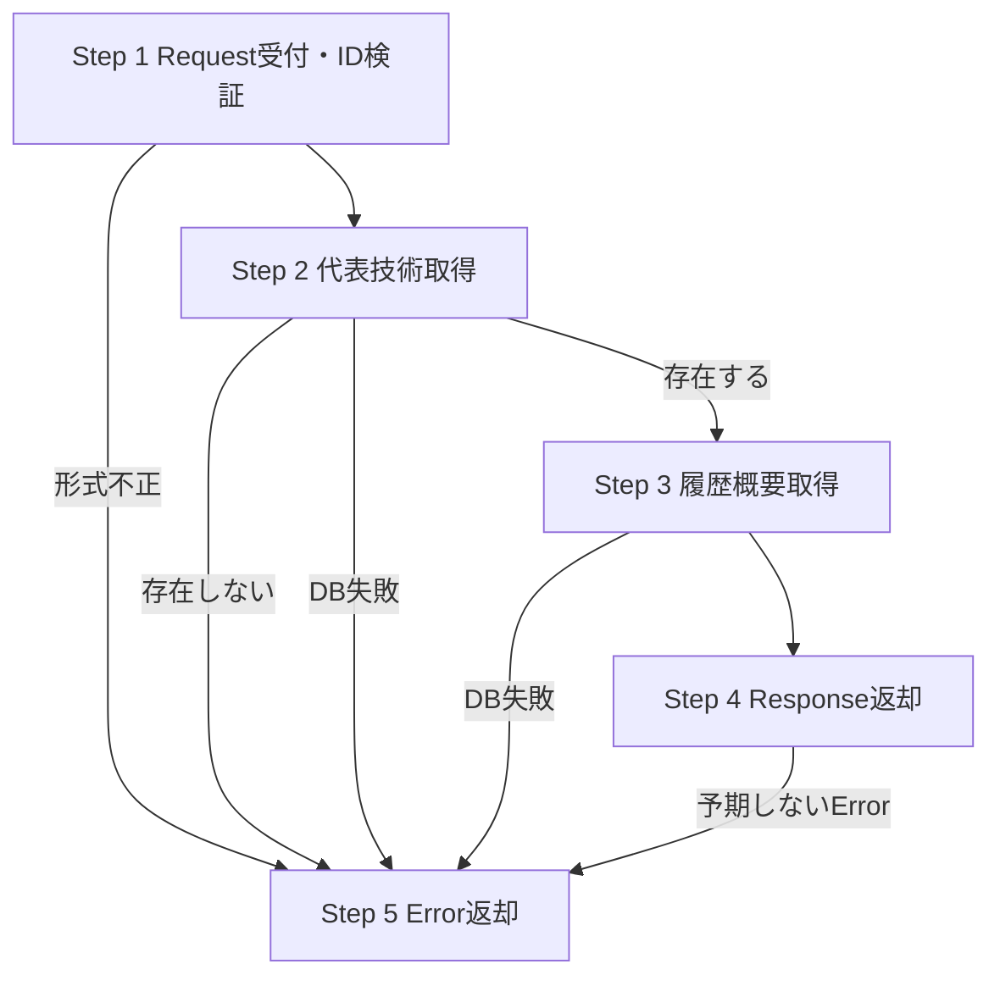
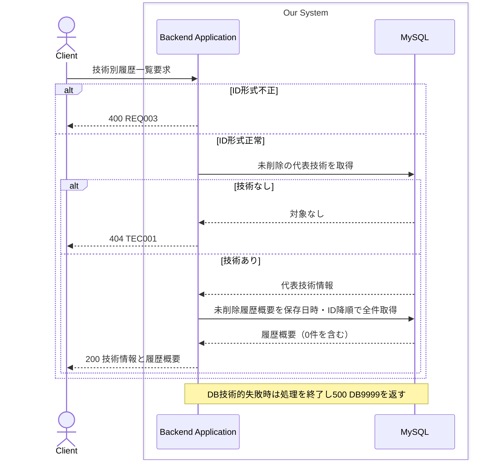

# API Specification

## 変更履歴

| Change | Date | Train | Summary |
| --- | --- | --- | --- |
| Initial Design | 2026-10-15 | 20260915-initial-implementation | 初回API仕様を確定 |
| Change 1 | 2026-11-03 | 20260915-initial-implementation | 実装に合わせてContainer-managed DataSourceのJNDI名を`jdbc/DevMenu`へ変更 |

## **1. Summary**

| Item | Value |
| --- | --- |
| Physical Name | `technology-history-list` |
| Logical Name | 技術別履歴一覧API |
| Service | Backend Application（共有履歴Module） |
| API Type | External |
| (HTTP Method) Endpoint | `(GET) /api/v1/technologies/{technologyId}/shared-histories` |
| Description | 指定した代表技術の情報と、その技術に属する共有履歴概要の全件を保存日時の新しい順で返す。 |

認証不要。Frontendは同一Originの相対URLで呼び出す。BackendのCORSは無効とし、LocalではFrontend開発ServerのProxyを使用する。公開HTTPSはALBで終端する。

Function Designの共有履歴閲覧Flow、System Architectureの共有履歴Module境界、およびAPI Specification Draftの合意事項を具体化する。

## **2. Dependencies**

| No. | Property | Type | Required | Property Value / Reference | Purpose |
| ---: | --- | --- | :---: | --- | --- |
| 1 | `jdbc/DevMenu` | Database | ● | Container-managed DataSource。IAD-015〜IAD-018 | 代表技術と共有履歴の参照。TLSとServer Certificate検証 |
| 2 | `database.host`／`database.port`／`database.name` | Configuration | ● | Environment ConfigMap。Port未設定時は`3306`。HostとDatabase名は必須 | Environment別MySQL接続先 |
| 3 | `database.username`／`database.password` | Secret | ● | ESOが同期するEnvironment別Kubernetes Secret。IAD-011 | Migration／Master Credentialと分離したApplication用認証 |
| 4 | `database.connection-timeout-millis` | Configuration | ● | Environment ConfigMap。整数・ミリ秒、初期値`5000` | DataSourceからのConnection取得待ち上限 |
| 5 | `database.socket-timeout-millis` | Configuration | ● | Environment ConfigMap。整数・ミリ秒、初期値`10000` | JDBC Socketの読取待ち上限 |
| 6 | `database.query-timeout-millis` | Configuration | ● | Environment ConfigMap。整数・ミリ秒、初期値`5000` | Repositoryが発行するSQL一回ごとの実行上限 |

Requiredは実行依存を示す。Applicationは標準JNDI参照とJPA／JTAを利用し、接続値やCredentialをCodeへ固定しない。Host、Database名、Username、Passwordの未設定・空文字は設定不正としてBackendを起動可能状態にしない。

ConfigMap内容Hash／Secret VersionIdを保持するPod Template Annotationの変更によりRolling Updateし、新Podの起動時に設定を反映する。新PodのReadiness成立後に旧Podから切り替える。

## **3. Request Definition**

`technologyId`はPath Parameter。Query ParameterおよびRequest Bodyは定義しない。初回TrainではPaginationを設けない。

| No. | Field | Type | Required | Size | Min / Max | Pattern | Validation | Description | Note |
| ---: | --- | --- | :---: | --- | --- | --- | --- | --- | --- |
| 1 | `technologyId` | String | ● | 1〜19桁 | 1 / 9223372036854775807（数値として） | `^[1-9][0-9]*$` | BackendのLong範囲内 | 代表技術ID | 先頭ゼロ、符号、空白、小数は不可 |

形式・表現範囲の不正は`REQ003 / 400`。形式が正しくても未削除の対象技術が存在しない場合は`TEC001 / 404`とする。

## **4. Response Definition**

正常時は`200 OK`。正常・異常Responseに`Content-Type: application/json`、`Cache-Control: no-store`、Backend生成UUID v4の`X-Request-ID`を設定する。Client指定Request IDは採用しない。

| No. | Field | Type | Required | Description | Note |
| ---: | --- | --- | :---: | --- | --- |
| 1 | `technologyId` | String | ● | 代表技術ID | 正の10進整数String。先頭ゼロなし |
| 2 | `technologyName` | String | ● | 保存された代表表示名 | 1〜20文字 |
| 3 | `sharedHistories` | Array | ● | 指定技術に属する未削除の共有履歴概要 | 全件。0件は`[]`、nullにしない |
| 4 | `sharedHistories[].historyId` | String | ● | 共有履歴ID | 正の10進整数String。先頭ゼロなし |
| 5 | `sharedHistories[].createdAt` | String | ● | 共有履歴の保存日時 | UTC ISO 8601。末尾`Z`、小数秒は最大6桁 |
| 6 | `sharedHistories[].difficulty` | String | ● | 難易度Code | `1`: BEGINNER／初級、`2`: INTERMEDIATE／中級、`3`: ADVANCED／上級 |
| 7 | `sharedHistories[].durationHours` | Integer | ● | 所要時間（時間） | 1〜999。分へ変換しない |
| 8 | `sharedHistories[].purpose` | String | ● | 目的Code | `1`: LEARNING／技術習得、`2`: POC／PoC |

保存日時降順、同一保存日時では共有履歴IDの数値降順とする。共通`data`Envelopeは付加しない。Frontendは保存日時を利用端末の現地時間へ変換する。代表表示名は保存表記を維持し、HTML Tag除去やEntity化は行わず、FrontendがTextとして描画する。

## **5. Data Access**

共有履歴Module内のRepositoryを介して参照する。Table定義は[代表技術](../table/technologies-table-spec.md)および[共有履歴](../table/shared-histories-table-spec.md)を正とする。

| No. | Table | C | R | U | D | Purpose | Note |
| ---: | --- | :---: | :---: | :---: | :---: | --- | --- |
| 1 | `technologies` | - | ● | - | - | 指定技術の存在確認と代表表示名取得 | 未削除のみ |
| 2 | `shared_histories` | - | ● | - | - | 指定技術の履歴概要取得 | 未削除のみ。提案本文は取得しない |

## **6. Logic Flow**



## **7. Sequence**



## **8. Transaction Overview**

| No. | Transaction | Processing Scope | Commit | Rollback | Description |
| ---: | --- | --- | --- | --- | --- |
| 1 | 技術別履歴一覧取得Transaction | Step 2〜3 | Step 3正常終了時。Step 2の対象なし判定時は参照処理を正常終了 | 範囲内のDB技術的失敗・予期しない内部Error時 | 共有履歴Moduleの宣言的JTA境界。技術確認と履歴取得を同一Transactionで行い、Data変更なし |

Repositoryは呼出元Transactionへ参加し、自身で開始・完了しない。Step 1、4、5はTransaction外で実施する。対象なしは参照結果として境界外へ渡し、Step 5で404へMappingする。

## **9. Processing Details**

#### **Step 1. Request受付・ID検証**

**1.1** UUID v4のRequest IDを生成し、共通Response Headerを準備する。

**1.2** `technologyId`を3章のPatternおよびLong範囲で検証する。不正な場合は`REQ003`としてStep 5へ進み、DBへAccessしない。

**1.3** 正常なIDをLongへ変換して保持し、Step 2へ進む。

**Error**: `REQ003 / 400`

**Transaction**: Outside

#### **Step 2. 代表技術取得**

**2.1** 以下の条件で代表技術を取得する。

| Table | Column | Condition | Value |
| --- | --- | --- | --- |
| `technologies` | `id` | `=` | Step 1で変換した`technologyId` |
| `technologies` | `deleted_flag` | `=` | `0` |

**2.2** 存在する場合は`id`と`display_name`を保持してStep 3へ進む。存在しない場合は参照Transactionを終了し、`TEC001`としてStep 5へ進む。論理削除済みの技術も対象なしとする。

**2.3** DB技術的失敗時はTransactionをRollbackし、`DB9999`としてStep 5へ進む。

**Error**: `TEC001 / 404`、`DB9999 / 500`

**Transaction**: 技術別履歴一覧取得Transaction

#### **Step 3. 履歴概要取得**

**3.1** 以下の条件で履歴概要を取得する。

| Table | Column | Condition | Value |
| --- | --- | --- | --- |
| `shared_histories` | `technology_id` | `=` | Step 2で取得した`technologies.id` |
| `shared_histories` | `deleted_flag` | `=` | `0` |

**3.2** `created_at DESC, id DESC`で全件取得する。取得対象は`id`、`created_at`、`difficulty`、`duration_hours`、`purpose`とする。提案本文およびその他の意向は本APIの取得・返却対象に含めない。

**3.3** 0件も正常とし、Transactionを正常終了してStep 4へ進む。DB技術的失敗時はTransactionをRollbackし、`DB9999`としてStep 5へ進む。

**Error**: `DB9999 / 500`

**Transaction**: 技術別履歴一覧取得Transaction

#### **Step 4. Response生成・返却**

**4.1** 取得順を維持して以下をMappingする。内部の難易度・目的はCode付きEnumとして扱い、API境界で対応するString Codeへ変換する。

| Response Field | Source / Value |
| --- | --- |
| `technologyId` | `technologies.id`を10進Stringへ変換 |
| `technologyName` | `technologies.display_name` |
| `sharedHistories` | Step 3の取得結果。0件は空Array |
| `sharedHistories[].historyId` | `shared_histories.id`を10進Stringへ変換 |
| `sharedHistories[].createdAt` | UTCで保存した`created_at`をUTC ISO 8601 Stringへ変換 |
| `sharedHistories[].difficulty` | `difficulty`に対応するEnumのString Code |
| `sharedHistories[].durationHours` | `duration_hours`をIntegerとして設定 |
| `sharedHistories[].purpose` | `purpose`に対応するEnumのString Code |

**4.2** 技術情報と一覧を`200 OK`で返す。履歴0件を404へ変換しない。

**Transaction**: Outside

#### **Step 5. Error返却**

**5.1** Step 1〜3のErrorを10章へMappingする。個別分類へ安全に特定できない予期しない内部Errorは`ER9999 / 500`とする。

**5.2** `errorCode`と`errorMessage`を返し、`validationMessage`は含めない。取得失敗を空の正常一覧へ変換せず、部分的な一覧も返さない。

**5.3** Exception、Stack Trace、接続先、CredentialをResponseへ含めない。内部詳細は共通Logging方針に従いRequest IDと関連付ける。FrontendはError Codeから表示文言を決定する。

**Transaction**: Outside

## **10. Error Definition**

共通定義は[Error Codes](../error-codes.md)を正とする。

| No. | Error Code | HTTP Status | Error Message | Validation Message | Description | Note |
| ---: | --- | --- | --- | --- | --- | --- |
| 1 | `REQ003` | `400 Bad Request` | `The path parameter format is invalid.` | - | Path Parameterの形式・表現範囲不正 | Step 1 |
| 2 | `TEC001` | `404 Not Found` | `The specified technology was not found.` | - | 未削除の対象技術なし | Step 2 |
| 3 | `DB9999` | `500 Internal Server Error` | `A database error occurred.` | - | Database技術的失敗 | Step 2〜3 |
| 4 | `ER9999` | `500 Internal Server Error` | `Unknown error.` | - | 分類不能な予期しない内部Error | Step 1〜4 |

## **11. Request / Response Samples**

##### **Request Sample**

```http
GET /api/v1/technologies/3/shared-histories HTTP/1.1
Accept: application/json
```

##### **Success Response Sample**

`200 OK`。同一保存日時ではIDが大きい履歴を先に返す。

```json
{
  "technologyId": "3",
  "technologyName": "React",
  "sharedHistories": [
    {
      "historyId": "21",
      "createdAt": "2026-10-15T01:00:00.123456Z",
      "difficulty": "2",
      "durationHours": 4,
      "purpose": "2"
    },
    {
      "historyId": "20",
      "createdAt": "2026-10-15T01:00:00.123456Z",
      "difficulty": "1",
      "durationHours": 2,
      "purpose": "1"
    }
  ]
}
```

技術が存在し、未削除履歴が0件の場合も`200 OK`。

```json
{
  "technologyId": "3",
  "technologyName": "React",
  "sharedHistories": []
}
```

##### **Error Response Sample**

`404 Not Found`。

```json
{
  "errorCode": "TEC001",
  "errorMessage": "The specified technology was not found."
}
```
