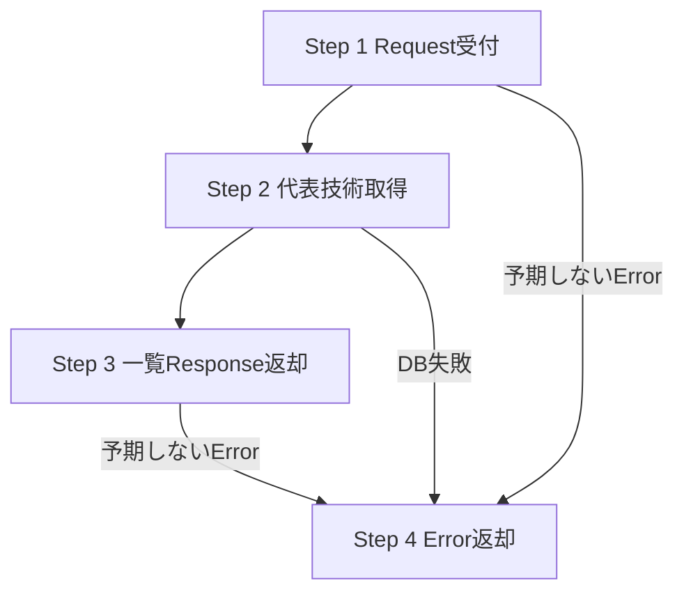
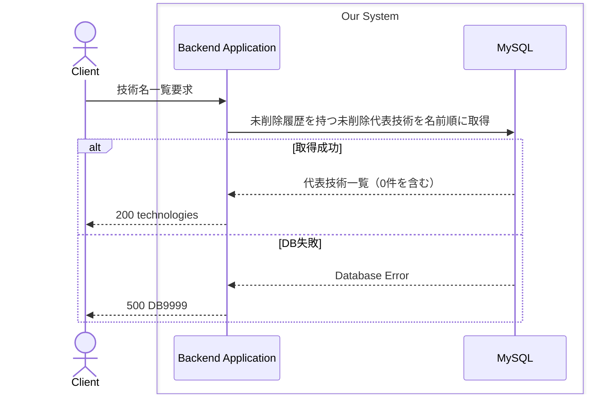

# API Specification

## 変更履歴

| Change | Date | Train | Summary |
| --- | --- | --- | --- |
| Initial Design | 2026-10-15 | 20260915-initial-implementation | 初回API仕様を確定 |
| Change 1 | 2026-11-03 | 20260915-initial-implementation | 実装に合わせてContainer-managed DataSourceのJNDI名を`jdbc/DevMenu`へ変更 |

## **1. Summary**

| Item | Value |
| --- | --- |
| Physical Name | `technology-list` |
| Logical Name | 技術名一覧API |
| Service | Backend Application（共有履歴Module） |
| API Type | External |
| (HTTP Method) Endpoint | `(GET) /api/v1/technologies` |
| Description | 閲覧可能な共有履歴を持つ代表技術を名前順で返し、履歴閲覧の技術選択に使用する。 |

認証不要。Frontendは同一Originの相対URLで呼び出す。BackendのCORSは無効とし、LocalではFrontend開発ServerのProxyを使用する。公開HTTPSはALBで終端する。

Function Designの共有履歴閲覧Flow、System Architectureの共有履歴Module境界、およびAPI Specification Draftの合意事項を具体化する。

## **2. Dependencies**

| No. | Property | Type | Required | Property Value / Reference | Purpose |
| ---: | --- | --- | :---: | --- | --- |
| 1 | `jdbc/DevMenu` | Database | ● | Container-managed DataSource。IAD-015〜IAD-018 | 代表技術と共有履歴の参照。TLSとServer Certificate検証 |
| 2 | `database.host`／`database.port`／`database.name` | Configuration | ● | Environment ConfigMap。Port未設定時は`3306`。HostとDatabase名は必須 | Environment別MySQL接続先 |
| 3 | `database.username`／`database.password` | Secret | ● | ESOが同期するEnvironment別Kubernetes Secret。IAD-011 | Migration／Master Credentialと分離したApplication用認証 |
| 4 | `database.connection-timeout-millis` | Configuration | ● | Environment ConfigMap。整数・ミリ秒、初期値`5000` | DataSourceからのConnection取得待ち上限 |
| 5 | `database.socket-timeout-millis` | Configuration | ● | Environment ConfigMap。整数・ミリ秒、初期値`10000` | JDBC Socketの読取待ち上限 |
| 6 | `database.query-timeout-millis` | Configuration | ● | Environment ConfigMap。整数・ミリ秒、初期値`5000` | Repositoryが発行するSQL一回ごとの実行上限 |

Requiredは実行依存を示す。Applicationは標準JNDI参照とJPA／JTAを利用し、接続値やCredentialをCodeへ固定しない。Host、Database名、Username、Passwordの未設定・空文字は設定不正としてBackendを起動可能状態にしない。

ConfigMap内容Hash／Secret VersionIdを保持するPod Template Annotationの変更によりRolling Updateし、新Podの起動時に設定を反映する。新PodのReadiness成立後に旧Podから切り替える。

## **3. Request Definition**

Path Parameter、Query ParameterおよびRequest Bodyは定義しない。

| No. | Field | Type | Required | Size | Min / Max | Pattern | Validation | Description | Note |
| ---: | --- | --- | :---: | --- | --- | --- | --- | --- | --- |
| - | - | - | - | - | - | - | - | 入力項目なし | BodyのないGET |

## **4. Response Definition**

正常時は`200 OK`。正常・異常Responseに`Content-Type: application/json`、`Cache-Control: no-store`、Backend生成UUID v4の`X-Request-ID`を設定する。Client指定Request IDは採用しない。

| No. | Field | Type | Required | Description | Note |
| ---: | --- | --- | :---: | --- | --- |
| 1 | `technologies` | Array | ● | 共有履歴を持つ代表技術の一覧 | 0件は`[]`。nullにしない |
| 2 | `technologies[].technologyId` | String | ● | 代表技術ID | 正の10進整数String。先頭ゼロなし、`^[1-9][0-9]*$`。DBのBIGINT値 |
| 3 | `technologies[].technologyName` | String | ● | 保存された代表表示名 | 1〜20文字。大文字小文字を区別しない名前昇順 |

全対象を返し、共有履歴件数等の派生情報や共通`data`Envelopeは付加しない。代表表示名の表記を維持し、HTML Tag除去やEntity化は行わない。FrontendはTextとして描画する。

## **5. Data Access**

共有履歴Module内のRepositoryを介して参照する。Table定義は[代表技術](../table/technologies-table-spec.md)および[共有履歴](../table/shared-histories-table-spec.md)を正とする。

| No. | Table | C | R | U | D | Purpose | Note |
| ---: | --- | :---: | :---: | :---: | :---: | --- | --- |
| 1 | `technologies` | - | ● | - | - | 代表技術ID・表示名の取得 | 未削除の技術のみ |
| 2 | `shared_histories` | - | ● | - | - | 当該技術に属する未削除履歴の存在確認 | 履歴本文や提案を取得しない |

## **6. Logic Flow**



## **7. Sequence**



## **8. Transaction Overview**

| No. | Transaction | Processing Scope | Commit | Rollback | Description |
| ---: | --- | --- | --- | --- | --- |
| 1 | 技術名一覧取得Transaction | Step 2 | Step 2正常終了時 | Step 2失敗時 | 共有履歴Moduleの宣言的JTA境界。参照のみでData変更なし |

Repositoryは呼出元Transactionへ参加し、自身で開始・完了しない。Step 1、3、4はTransaction外で実施する。

## **9. Processing Details**

#### **Step 1. Request受付**

**1.1** RequestごとにUUID v4のRequest IDを生成する。

**1.2** 共通Response Headerを準備し、Step 2へ進む。

**Transaction**: Outside

#### **Step 2. 代表技術取得**

**2.1** 以下の条件で代表技術を取得する。

| Table | Column | Condition | Value |
| --- | --- | --- | --- |
| `technologies` | `deleted_flag` | `=` | `0` |
| `shared_histories` | `technology_id` | `=` | 対象`technologies.id` |
| `shared_histories` | `deleted_flag` | `=` | `0` |

**2.2** 条件を満たす共有履歴が1件以上存在する技術だけを返す。EXISTS等により、一つの技術を履歴件数によらず一度だけ取得する。

**2.3** `technologies.display_name`の昇順で取得する。Table定義の照合順序`utf8mb4_0900_ai_ci`を使用し、大文字小文字を区別しない名前順とする。取得対象は`id`および`display_name`とする。

**2.4** 取得成功時はTransactionを正常終了してStep 3へ進む。0件も正常とする。Connection、Query、Pool、Timeout等のDB失敗時はTransactionをRollbackし、`DB9999`としてStep 4へ進む。

**Error**: `DB9999 / 500`

**Transaction**: 技術名一覧取得Transaction

#### **Step 3. Response生成・返却**

**3.1** 取得順を維持し、以下のMappingでResponseを生成する。

| Response Field | Source / Value |
| --- | --- |
| `technologies` | Step 2の取得結果。0件は空Array |
| `technologies[].technologyId` | `technologies.id`を先頭ゼロなしの10進Stringへ変換 |
| `technologies[].technologyName` | `technologies.display_name` |

**3.2** `200 OK`で返却する。技術が存在しないことを`TEC001`へ変換しない。

**Transaction**: Outside

#### **Step 4. Error返却**

**4.1** DB技術的失敗は`DB9999`、個別分類へ安全に特定できない予期しない内部Errorは`ER9999`へMappingする。

**4.2** `errorCode`と`errorMessage`を返し、`validationMessage`は含めない。取得失敗を空の正常一覧へ変換せず、部分的な一覧も返さない。

**4.3** Exception、Stack Trace、接続先、CredentialをResponseへ含めない。内部詳細は共通Logging方針に従いRequest IDと関連付ける。FrontendはError Codeから表示文言を決定する。

**Transaction**: Outside

## **10. Error Definition**

共通定義は[Error Codes](../error-codes.md)を正とする。

| No. | Error Code | HTTP Status | Error Message | Validation Message | Description | Note |
| ---: | --- | --- | --- | --- | --- | --- |
| 1 | `DB9999` | `500 Internal Server Error` | `A database error occurred.` | - | Database技術的失敗 | Step 2 |
| 2 | `ER9999` | `500 Internal Server Error` | `Unknown error.` | - | 分類不能な予期しない内部Error | Step 1〜3 |

## **11. Request / Response Samples**

##### **Request Sample**

```http
GET /api/v1/technologies HTTP/1.1
Accept: application/json
```

##### **Success Response Sample**

`200 OK`。

```json
{
  "technologies": [
    { "technologyId": "12", "technologyName": "Java" },
    { "technologyId": "3", "technologyName": "React" }
  ]
}
```

対象が0件の場合も`200 OK`。

```json
{
  "technologies": []
}
```

##### **Error Response Sample**

`500 Internal Server Error`。

```json
{
  "errorCode": "DB9999",
  "errorMessage": "A database error occurred."
}
```
