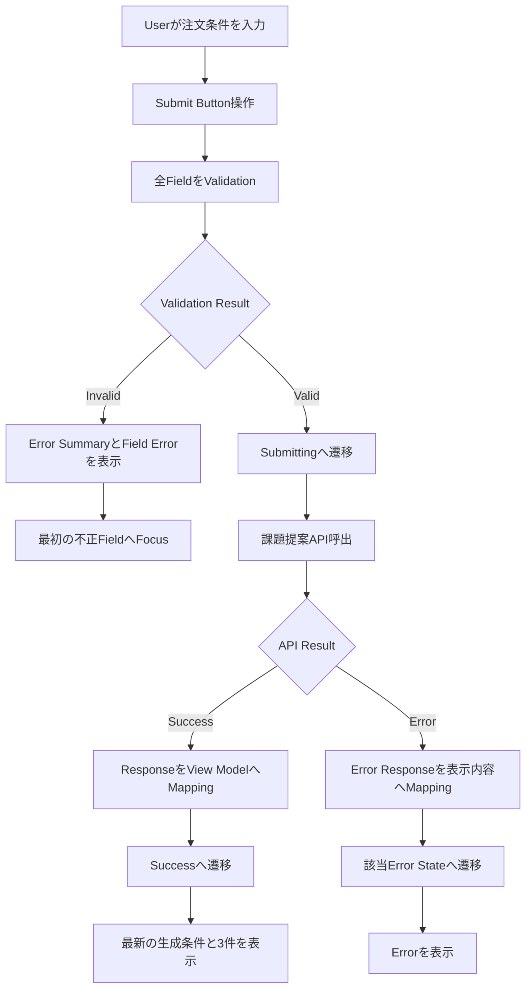
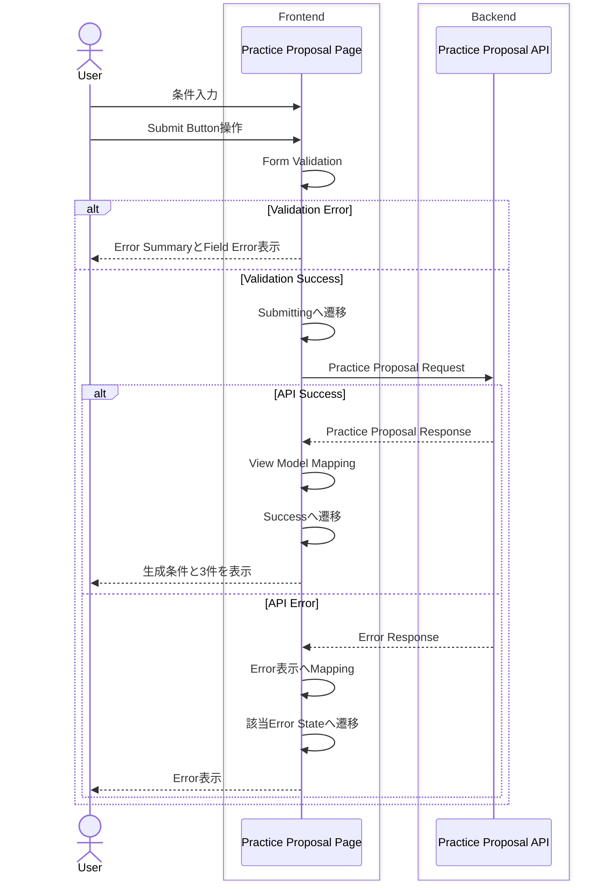

# Practice Proposal Screen Specification

## 変更履歴

| Change | Date | Train | Summary |
| --- | --- | --- | --- |
| Initial Design | 2026-10-15 | 20260915-initial-implementation | 初回UI仕様を確定 |

## **1. Summary**

| Item | Value |
| --- | --- |
| Physical Name | `PracticeProposalPage` |
| Logical Name | 注文画面 |
| Application | Web Frontend Application |
| Platform | `Web` |
| Screen Type | `Page` |
| Route / Path | `/` |
| Description | 学びたい技術と条件を入力し、生成に使用した条件と3件の実装課題を確認する画面。 |

認証は設けない。Backend APIは同一Originの相対URLで呼び出し、CORSおよびFrontend ContainerによるBackend Reverse Proxyを前提としない。LocalではFrontend開発ServerのProxyを使用する。連携Contractは[課題提案API](../api/practice-proposal-api-spec.md)、共通Error Codeは[Error Codes](../error-codes.md)を正とする。

## **2. Screen Structure**

```text
Practice Proposal Page
├─ Application Header [Top]
│  ├─ Brand Link
│  └─ Primary Navigation
│     ├─ Practice Proposal Link
│     └─ Shared History Link
└─ Main Content
   ├─ Page Header
   │  ├─ Page Title
   │  └─ Page Description
   ├─ Proposal Form
   │  ├─ Validation Error Summary
   │  ├─ Technology Name Input
   │  │  ├─ Input Example
   │  │  └─ Field Error
   │  ├─ Difficulty Select
   │  │  ├─ Difficulty Guide
   │  │  └─ Field Error
   │  ├─ Duration Hours Input
   │  │  ├─ Unit
   │  │  └─ Field Error
   │  ├─ Purpose Select
   │  │  └─ Field Error
   │  ├─ Additional Preference Textarea
   │  │  ├─ Helper Text
   │  │  ├─ Character Counter
   │  │  └─ Field Error
   │  ├─ Public Notice
   │  └─ Submit Button
   ├─ Submission Status
   │  ├─ Loading Indicator
   │  └─ API Error Message
   └─ Proposal Result
      ├─ Result Status
      ├─ Result Heading
      ├─ Result Context Label
      ├─ Conditions Summary
      └─ Proposal List
         └─ Proposal Card
```

`Proposal Result`は成功結果が存在する場合だけ表示する。再注文中または再注文失敗時に以前の成功結果を維持する場合は、`Result Context Label`で以前の結果であることを明示する。

## **3. Component Definition**

| No. | Component | Type | Label / Text | Model / Value | Required | Editable | Description | Note |
| ---: | --- | --- | --- | --- | :---: | :---: | --- | --- |
| 1 | `applicationHeader` | Header | - | - | - | - | 全画面共通のHeader | - |
| 2 | `brandLink` | Link | Dev Menu | `/` | - | - | 注文画面へ移動するBrand Link | - |
| 3 | `primaryNavigation` | Navigation | - | - | - | - | 主要画面へのNavigation | - |
| 4 | `practiceProposalNavLink` | Link | 課題を注文 | `/` | - | - | 注文画面へのNavigation | `aria-current="page"`を設定 |
| 5 | `sharedHistoryNavLink` | Link | 共有履歴 | `/shared-histories` | - | - | 共有履歴画面へのNavigation | - |
| 6 | `pageTitle` | Heading | 課題を注文 | - | - | - | 画面の`h1` | - |
| 7 | `pageDescription` | Text | 学びたい技術と条件を入力すると、3つの実装課題を提案します。 | - | - | - | 画面の目的を説明 | - |
| 8 | `proposalForm` | Form | - | `proposalForm` | - | - | 注文条件を入力してSubmitするForm | Browser固有Validation Messageは使用しない |
| 9 | `validationErrorSummary` | Error Summary | 入力内容を確認してください。 | `validationErrors` | - | - | Submit時のValidation Errorを要約 | - |
| 10 | `technologyNameInput` | Text Input | 学びたい技術（必須） | `proposalForm.technologyName` | ● | ● | 学びたい技術名を入力 | - |
| 11 | `technologyNameExample` | Helper Text | 例：React | - | - | - | 入力例を表示 | - |
| 12 | `difficultySelect` | Select | 難易度（必須） | `proposalForm.difficulty` | ● | ● | 難易度を選択 | 初期Optionは`選択してください` |
| 13 | `difficultyGuide` | Helper Text | 選択中の難易度目安 | `proposalForm.difficulty` | - | - | 選択した難易度の目安を表示 | - |
| 14 | `durationHoursInput` | Number Input | 取り組める時間（必須） | `proposalForm.durationHours` | ● | ● | 取り組める時間を時間単位で入力 | - |
| 15 | `durationHoursUnit` | Text | 時間 | - | - | - | 入力値の単位を表示 | - |
| 16 | `purposeSelect` | Select | 目的（必須） | `proposalForm.purpose` | ● | ● | 注文目的を選択 | 初期Optionは`選択してください` |
| 17 | `additionalPreferenceTextarea` | Textarea | その他の希望（任意） | `proposalForm.additionalPreference` | - | ● | その他の希望を入力 | - |
| 18 | `additionalPreferenceHelp` | Helper Text | 取り組みたい内容や条件があれば、200文字以内で入力してください | - | - | - | 入力上限と用途を説明 | - |
| 19 | `additionalPreferenceCounter` | Text | `{currentCount} / 200` | `additionalPreferenceCount` | - | - | 正規化後の文字数を表示 | 初期値は`0 / 200` |
| 20 | `fieldError` | Inline Message | Form Definition参照 | `validationErrors[field]` | - | - | 対象FieldのValidation Messageを表示 | ErrorがあるFieldごとに表示 |
| 21 | `publicNotice` | Notice | 入力した条件と生成された課題は、ログインなしで共有履歴から閲覧できます。 | - | - | - | 注文内容が公開されることを通知 | Submit Buttonより前に表示 |
| 22 | `submitButton` | Button | 課題を提案してもらう | - | - | - | 注文をSubmit | - |
| 23 | `loadingIndicator` | Status | 課題を考えています。しばらくお待ちください。 | - | - | - | 注文処理中であることを表示 | MessageをAnimationに併記 |
| 24 | `apiErrorMessage` | Inline Message | Error Presentation参照 | `submissionError` | - | - | 注文APIのErrorを表示 | Programmatic Focus用の`tabindex="-1"`を設定 |
| 25 | `proposalResult` | Region | - | `proposalResult` | - | - | 成功した生成条件と3件を表示 | 成功結果が存在する場合だけ表示 |
| 26 | `proposalResultStatus` | Status | 3件の課題を提案しました。 | - | - | - | Result更新を支援技術へ通知 | `role="status"`、`aria-live="polite"`。視覚表示は必須としない |
| 27 | `proposalResultHeading` | Heading | 提案された課題 | - | - | - | Result領域の見出し | Programmatic Focus対象 |
| 28 | `resultContextLabel` | Text | 前回成功した提案 | - | - | - | 維持中の以前の成功結果を識別 | 最新結果では表示しない |
| 29 | `conditionsSummary` | Description List | 生成条件 | `proposalResult.conditions` | - | - | 生成に実際に使用した条件を表示 | Component Detail参照 |
| 30 | `proposalList` | List | - | `proposalResult.practiceProposals` | - | - | 成立した3件を表示 | `proposalNumber`順 |
| 31 | `proposalCard` | List Item | `提案{proposalNumber}` | `proposalResult.practiceProposals[]` | - | - | 課題1件を表示 | Component Detail参照 |

### **Component Detail**

#### **conditionsSummary**

**Item Definition**

| No. | Component / Field | Label | Value | Description |
| ---: | --- | --- | --- | --- |
| 1 | `technologyName` | 技術 | `conditions.technologyName` | APIが返した整形済み技術名を表示 |
| 2 | `difficulty` | 難易度 | `conditions.difficulty` | Codeを表示名へ変換 |
| 3 | `durationHours` | 取り組める時間 | `{conditions.durationHours}時間` | 時間単位で表示 |
| 4 | `purpose` | 目的 | `conditions.purpose` | Codeを表示名へ変換 |
| 5 | `additionalPreference` | その他の希望 | `conditions.additionalPreference` | nullは`指定なし`と表示 |

#### **proposalCard**

**Item Definition**

| No. | Component / Field | Label | Value | Description |
| ---: | --- | --- | --- | --- |
| 1 | `proposalNumber` | `提案{proposalNumber}` | `proposal.proposalNumber` | 1〜3の提案番号を表示 |
| 2 | `title` | - | `proposal.title` | 課題Titleを見出しとして表示 |
| 3 | `overview` | 概要 | `proposal.overview` | 課題概要を表示 |
| 4 | `achievementGoal` | 達成目標 | `proposal.achievementGoal` | 達成目標を表示 |
| 5 | `practiceFocus` | 目的に応じたLabel | `proposal.practiceFocus` | 技術習得は`学ぶポイント`、PoCは`検証するポイント` |

## **4. Screen State**

| State | Condition | Component | Visibility | Enabled | Display / Behavior | Note |
| --- | --- | --- | :---: | :---: | --- | --- |
| `Initial` | 初期表示 | `proposalForm` | ● | ● | 初期値を表示 | - |
| `Initial` | 初期表示 | `loadingIndicator`、`apiErrorMessage`、`proposalResult` | - | - | 表示しない | - |
| `Submitting` | 課題提案API実行中 | `proposalForm` | ● | - | Form全体を操作不可 | 二重注文と条件変更を防止 |
| `Submitting` | 課題提案API実行中 | `loadingIndicator` | ● | - | Loading Messageを表示 | - |
| `Submitting` | 課題提案API実行中 | `apiErrorMessage` | - | - | 以前のAPI Errorを消去 | - |
| `Submitting` | 以前の成功結果あり | `proposalResult` | ● | - | 結果を維持し`resultContextLabel`を表示 | - |
| `Submitting` | 以前の成功結果なし | `proposalResult` | - | - | 表示しない | - |
| `Success` | API正常終了 | `proposalForm` | ● | ● | 送信時の入力値を維持 | - |
| `Success` | API正常終了 | `proposalResult` | ● | - | 最新の生成条件と3件へ置換 | `resultContextLabel`は表示しない |
| `Success` | API正常終了 | `loadingIndicator`、`apiErrorMessage` | - | - | 表示しない | - |
| `ErrorWithoutResult` | API失敗かつ成功結果なし | `proposalForm` | ● | ● | 失敗した入力値を維持 | - |
| `ErrorWithoutResult` | API失敗かつ成功結果なし | `apiErrorMessage` | ● | - | Errorを表示 | Resultは表示しない |
| `ErrorWithoutResult` | API失敗かつ成功結果なし | `loadingIndicator`、`proposalResult` | - | - | 表示しない | - |
| `ErrorWithPreviousResult` | API失敗かつ以前の成功結果あり | `proposalForm` | ● | ● | 失敗した入力値を維持 | - |
| `ErrorWithPreviousResult` | API失敗かつ以前の成功結果あり | `apiErrorMessage` | ● | - | Errorを表示 | - |
| `ErrorWithPreviousResult` | API失敗かつ以前の成功結果あり | `proposalResult` | ● | - | 以前の結果と`resultContextLabel`を表示 | - |
| `ErrorWithPreviousResult` | API失敗かつ以前の成功結果あり | `loadingIndicator` | - | - | 表示しない | - |

Form Validation Errorは非同期処理のScreen Stateを新設せず、現在のStateへValidation Presentation Rulesを重ねて表示する。

## **5. Form Definition**

| No. | Field | Component | Type | Required | Size | Min / Max | Pattern | Validation | Validation Message | Note |
| ---: | --- | --- | --- | :---: | --- | --- | --- | --- | --- | --- |
| 1 | `technologyName` | `technologyNameInput` | String | ● | 1〜20 Unicode Code Points | - | - | Unicode空白の前後除去と連続空白統一後に非空 | 未入力・空白のみ：`学びたい技術を入力してください。`<br>20文字超過：`学びたい技術は20文字以内で入力してください。` | Backendを最終判定とする |
| 2 | `difficulty` | `difficultySelect` | String | ● | 1 | - | `^[123]$` | 定義値であること | `難易度を選択してください。` | `1`: 初級、`2`: 中級、`3`: 上級 |
| 3 | `durationHours` | `durationHoursInput` | Integer | ● | - | 1 / 999 | - | 整数であること | 未入力：`取り組める時間を入力してください。`<br>整数以外・範囲外：`取り組める時間は1〜999の整数で入力してください。` | 時間単位 |
| 4 | `purpose` | `purposeSelect` | String | ● | 1 | - | `^[12]$` | 定義値であること | `目的を選択してください。` | `1`: 技術習得、`2`: PoC |
| 5 | `additionalPreference` | `additionalPreferenceTextarea` | String | - | 1〜200 Unicode Code Points | - | - | Unicode空白の前後除去後の長さを検証 | `その他の希望は200文字以内で入力してください。` | 省略・空文字・空白のみはnull |

文字数はAPI Specificationと同じ正規化後のUnicode Code Point数で判定し、UTF-16 Code Unit数には固定しない。Cross-field Validationは設けない。

## **6. Validation / Display Rules**

### **Validation Presentation Rules**

| No. | Target | Condition | Presentation | Description | Note |
| ---: | --- | --- | --- | --- | --- |
| 1 | 各入力Component | 初回表示 | Validation Errorを表示しない | 入力前のError表示を避ける | - |
| 2 | 各入力Component | Focus Out | 対象FieldをValidation | ErrorがあればComponent直下へMessageを表示 | - |
| 3 | 一度Errorとなった入力Component | 入力変更 | 変更ごとに再Validation | 解消時はField Errorを消去 | - |
| 4 | `proposalForm` | Submit時 | 全FieldをValidation | ErrorがあればAPIを呼び出さず、最初の不正FieldへFocus | - |
| 5 | `validationErrorSummary` | Submit時にErrorあり | Form上部へ`role="alert"`で表示 | `入力内容を確認してください。`と表示 | Focus Out時は表示しない |
| 6 | Error対象の入力Component | Field Errorあり | `aria-invalid="true"`を設定 | `aria-describedby`でField Errorを参照 | Helper Text等の既存参照も維持 |
| 7 | 各入力Component | `VE0001`受信 | Backend Fieldを同じFrontend MessageへMapping | Backendの英語Messageを表示しない | 未知FieldはUnmapped Error |

### **Display / Interaction Rules**

| No. | Component | Condition | Rule | Description | Note |
| ---: | --- | --- | --- | --- | --- |
| 1 | `proposalForm` | 初期表示 | 全Fieldを空または未選択にする | `technologyName`、`durationHours`、`additionalPreference`は空、Selectは未選択 | Submitは操作可能 |
| 2 | `difficultyGuide` | 難易度未選択 | Hidden | 目安を表示しない | - |
| 3 | `difficultyGuide` | 初級 | `手がかりを参照しながら、単純で明確な課題に取り組む。` | 初級の目安を表示 | 区分の意味を変えない範囲で実装時調整可 |
| 4 | `difficultyGuide` | 中級 | `複数の要素を組み合わせ、明確な課題を自力で解決する。` | 中級の目安を表示 | 同上 |
| 5 | `difficultyGuide` | 上級 | `複雑な課題で複数の選択肢を評価し、自力で設計・実施する。` | 上級の目安を表示 | 同上 |
| 6 | `technologyNameInput`、`additionalPreferenceTextarea` | 常時 | HTMLの`maxlength`を設定しない | Unicode Code Point基準との差異を避ける | Frontend Validationで上限判定 |
| 7 | `durationHoursInput` | 常時 | `type="number"`、`min="1"`、`max="999"`、`step="1"` | 入力HintをBrowserへ提供 | Frontend Validationを正とする |
| 8 | `difficultySelect`、`purposeSelect` | 未選択 | 選択不能な`選択してください`を表示 | 初期値を明示 | - |
| 9 | `additionalPreferenceCounter` | 入力中 | `{currentCount} / 200`を表示 | 正規化後Unicode Code Point数を常時表示 | Textareaの`aria-describedby`から参照 |
| 10 | `conditionsSummary.additionalPreference` | null | `指定なし`を表示 | 未指定を明示 | - |
| 11 | `conditionsSummary.difficulty` | Code `1` / `2` / `3` | `初級` / `中級` / `上級`を表示 | Enum Codeを表示名へMapping | 未知CodeはUnmapped Error |
| 12 | `conditionsSummary.purpose` | Code `1` / `2` | `技術習得` / `PoC`を表示 | Enum Codeを表示名へMapping | 未知CodeはUnmapped Error |
| 13 | `practiceFocus` | 目的が技術習得 / PoC | `学ぶポイント` / `検証するポイント`をLabel表示 | 目的に応じた意味を明示 | - |
| 14 | 利用者入力・生成文 | 表示時 | Reactの通常のText描画を使用 | Markupとして解釈しない | `dangerouslySetInnerHTML`禁止 |
| 15 | 利用者入力・生成文 | 改行・長い連続文字列あり | 改行を保持して領域内で折り返す | `white-space: pre-wrap`、`overflow-wrap: anywhere`相当 | 省略せず全文表示 |
| 16 | `proposalForm` | 注文成功後 | 送信時の入力値を維持 | 修正して再注文可能 | ResultはResponseの整形済み条件を表示 |
| 17 | 注文画面State | 画面遷移またはRefresh | FormとResultを永続化しない | 初期状態へ戻し、再POSTしない | Browser側永続状態を正にしない |
| 18 | `pageTitle` | React内の画面遷移 | Browser Titleを`課題を注文 \| Dev Menu`へ更新しFocusを移動 | `tabindex="-1"`を設定 | 初回通常LoadではFocusを強制しない |
| 19 | `proposalResultHeading` | Result更新成功 | Focusを移動 | 更新結果へ到達可能にする | `tabindex="-1"`を設定 |
| 20 | Main Content | すべてのViewport | 1Columnで表示 | Proposal Cardを縦方向に配置 | 最大幅・Breakpointは実装時調整可 |
| 21 | Form Control・主要Button | 狭いViewport | 利用可能幅まで拡張 | 画面全体の横Scrollを防止 | Header Navigationは折返し可 |
| 22 | 操作Component | 常時 | Semantic HTMLと視認可能なKeyboard Focusを使用 | 状態を色だけで伝えない | Click可能な`div`を使用しない |
| 23 | `loadingIndicator` | 表示時 | `role="status"`、`aria-live="polite"` | Loading Messageを通知 | Animationだけに依存しない |
| 24 | 入力Component・`submitButton` | `Submitting` | Native Controlの`disabled`を設定 | 見た目だけで無効化しない | - |

Application HeaderはSemanticなHeaderおよびNavigationとして構成し、Heading Levelを飛ばさず本画面の`h1`を一つとする。意味を持つIconにはAccessible Nameを設定し、装飾Iconは支援技術から除外する。

## **7. Interaction Flow**



再注文も同じFlowを通り、成功した場合だけ以前のResultを置き換える。

## **8. Sequence**



Backend内部の生成、再試行および保存処理には展開せず、課題提案API Specificationを正とする。

## **9. Processing Details**

##### **Pattern A: Practice Proposal Submission**

###### **Step 1. Form Snapshot and Validation**

**1.1.** Submit時に現在のForm値をSnapshotし、そのSnapshotをValidationおよびRequest作成の対象とする。

**1.2.** Form Definitionに従って全FieldをValidationする。不正Fieldがある場合はAPIを呼び出さず、Validation Presentation Rulesを適用して処理を終了する。

###### **Step 2. Request Mapping**

**2.1.** `technologyName`は前後のUnicode空白を除去して連続空白を一つへ統一する。`additionalPreference`は前後のUnicode空白を除去し、空になった場合はnullへ変換する。

**2.2.** `durationHours`はValidation成功後に整数へ変換し、`difficulty`および`purpose`はForm DefinitionのAPI Codeへ変換する。Form上の入力値自体は書き換えない。

###### **Step 3. API Invocation and Response Mapping**

**3.1.** `Submitting`へ遷移し、同一Originの相対URLで課題提案APIを呼び出す。Frontend独自の自動Retryは行わない。

**3.2.** Success Responseは必要な生成条件、`proposalNumber`が1〜3で各1件のProposal、および各必須Fieldが表示可能であることを確認してView ModelへMappingする。不足または未知Enum Codeがある場合は部分表示せずUnmapped Errorとして扱う。

**3.3.** Backend Validationを最終判定とする。`VE0001`はField名をFrontend Validation MessageへMappingし、それ以外はError Presentationに従う。

###### **Step 4. Screen Update and Cancellation**

**4.1.** 成功時は`Success`へ遷移し、最新の生成条件と3件へResultを置き換える。Result見出しへFocusを移し、`proposalResultStatus`で完了を通知する。

**4.2.** 失敗時は成功結果の有無に応じて`ErrorWithoutResult`または`ErrorWithPreviousResult`へ遷移し、Error領域へFocusを移す。

**4.3.** 画面遷移によって注文画面が破棄された場合は実行中Requestを中断する。中断済みRequestの結果は画面へ反映せず、中断自体を利用者向けErrorとして表示しない。

## **10. Error Presentation**

| No. | Error Type | Error / Condition | Target | Presentation Type | Display Content | User Action | Note |
| ---: | --- | --- | --- | --- | --- | --- | --- |
| 1 | API Error | `VE0001` | `validationErrorSummary`、`fieldError` | Inline Message | `入力内容を確認してください。`とForm DefinitionのField Message | 入力を修正して再Submit可能 | Backend英語Messageは表示しない |
| 2 | API Error | `GAI001` | `apiErrorMessage` | Inline Message | `条件に合う課題を提案できませんでした。条件を変えて、もう一度お試しください。` | 条件を変更して再Submit可能 | 自動Retryなし |
| 3 | API Error | `REQ001`、`REQ002`、`BR9999`、`ER9999` | `apiErrorMessage` | Inline Message | `課題を提案できませんでした。時間をおいて、もう一度お試しください。` | 再Submitまたは画面移動可能 | 技術情報は表示しない |
| 4 | Communication Error | API Responseを正常に取得できない | `apiErrorMessage` | Inline Message | `課題を提案できませんでした。時間をおいて、もう一度お試しください。` | 再Submitまたは画面移動可能 | 自動Retryなし |
| 5 | Unmapped Error | Status／Code不一致、非JSON、未知Code、必須Field欠落、Response構成不正 | `apiErrorMessage` | Inline Message | `課題を提案できませんでした。時間をおいて、もう一度お試しください。` | 再Submitまたは画面移動可能 | Response文字列を直接表示しない |

API Error領域は`role="alert"`とし、Error確定後にFocusを移す。次のSubmit開始時に以前のAPI Errorを消去する。Backendの英語`errorMessage`、Error Code、Stack TraceおよびRequest IDは画面へ表示しない。HTTP Statusと`errorCode`の組合せがAPI Specificationどおりの場合だけ既知ErrorとしてMappingする。
