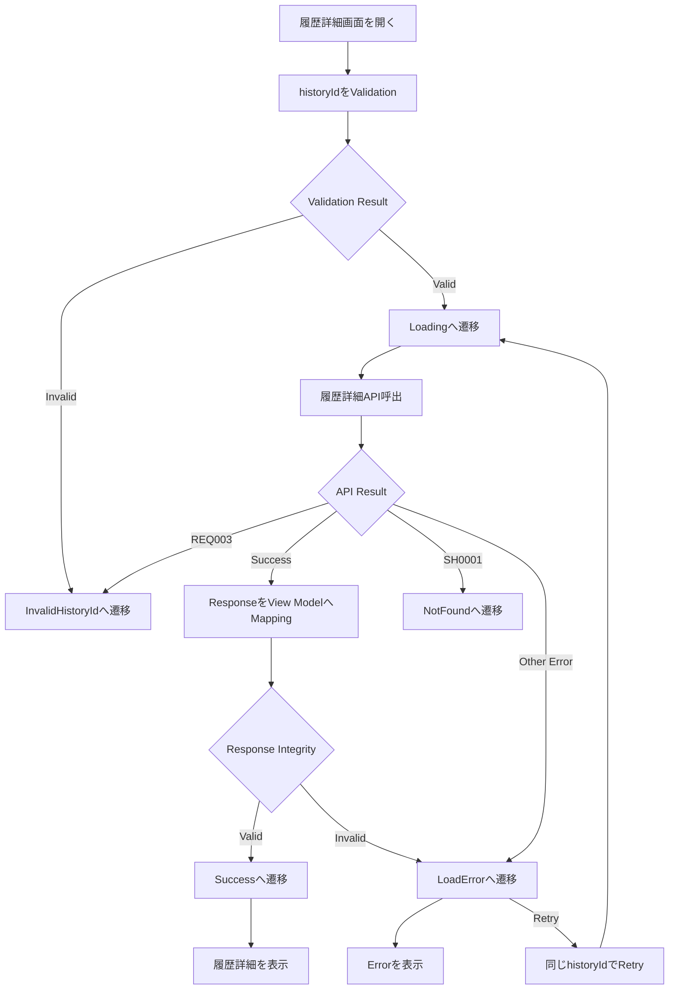
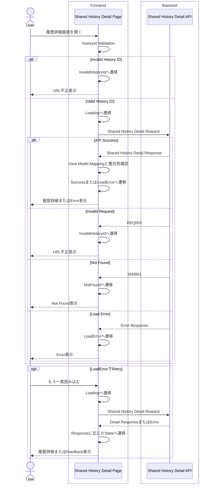

# Shared History Detail Screen Specification

## 変更履歴

| Change | Date | Train | Summary |
| --- | --- | --- | --- |
| Initial Design | 2026-10-15 | 20260915-initial-implementation | 初回UI仕様を確定 |

## **1. Summary**

| Item | Value |
| --- | --- |
| Physical Name | `SharedHistoryDetailPage` |
| Logical Name | 履歴詳細画面 |
| Application | Web Frontend Application |
| Platform | `Web` |
| Screen Type | `Page` |
| Route / Path | `/shared-histories/:historyId` |
| Description | 指定された共有履歴の保存日時、生成条件および3件の実装課題を確認する画面。 |

認証は設けない。Backend APIは同一Originの相対URLで呼び出し、CORSおよびFrontend ContainerによるBackend Reverse Proxyを前提としない。LocalではFrontend開発ServerのProxyを使用する。連携Contractは[履歴詳細API](../api/shared-history-detail-api-spec.md)、共通Error Codeは[Error Codes](../error-codes.md)を正とする。

## **2. Screen Structure**

```text
Shared History Detail Page
├─ Application Header [Top]
│  ├─ Brand Link
│  └─ Primary Navigation
│     ├─ Practice Proposal Link
│     └─ Shared History Link
└─ Main Content
   ├─ Back to History Link
   ├─ Page Header
   │  └─ Page Title
   ├─ Detail Status
   │  ├─ Loading Indicator
   │  ├─ Invalid URL Message
   │  ├─ Not Found Message
   │  └─ Load Error Message
   │     └─ Retry Button
   ├─ History Detail
   │  ├─ Result Status
   │  ├─ Saved Date Time
   │  ├─ Conditions Summary
   │  │  ├─ Technology Name
   │  │  ├─ Difficulty
   │  │  ├─ Duration Hours
   │  │  ├─ Purpose
   │  │  └─ Additional Preference
   │  └─ Proposal Section
   │     ├─ Proposal Heading
   │     └─ Proposal List
   │        └─ Proposal Card
   └─ Detail Actions
      ├─ Back to History Action
      └─ New Proposal Action
```

Loading中および取得Error時は`History Detail`を表示せず、正常取得後だけ条件、保存日時および3件を一体として表示する。共有履歴画面へ戻る操作は、詳細取得成功後はResponseの`conditions.technologyId`をQuery Parameterに使用し、それ以外ではQuery Parameterなしの共有履歴画面へ移動する。

## **3. Component Definition**

| No. | Component | Type | Label / Text | Model / Value | Required | Editable | Description | Note |
| ---: | --- | --- | --- | --- | :---: | :---: | --- | --- |
| 1 | `applicationHeader` | Header | - | - | - | - | 全画面共通のHeader | - |
| 2 | `brandLink` | Link | Dev Menu | `/` | - | - | 注文画面へ移動するBrand Link | - |
| 3 | `primaryNavigation` | Navigation | - | - | - | - | 主要画面へのNavigation | - |
| 4 | `practiceProposalNavLink` | Link | 課題を注文 | `/` | - | - | 注文画面へのNavigation | - |
| 5 | `sharedHistoryNavLink` | Link | 共有履歴 | `/shared-histories` | - | - | 共有履歴画面へのNavigation | `aria-current="page"`を設定 |
| 6 | `backToHistoryLink` | Link | 共有履歴へ戻る | `backToHistoryPath` | - | - | 本文上部から共有履歴画面へ戻る | 全Stateで表示 |
| 7 | `pageTitle` | Heading | 共有履歴の詳細 | - | - | - | 画面の`h1` | - |
| 8 | `loadingIndicator` | Status | 共有履歴の詳細を読み込んでいます。 | - | - | - | 詳細取得中であることを表示 | MessageをAnimationに併記 |
| 9 | `invalidHistoryIdMessage` | Inline Message | 指定されたURLが正しくありません。 | - | - | - | Route Parameter不正を表示 | Programmatic Focus対象 |
| 10 | `notFoundMessage` | Inline Message | 指定された共有履歴は見つかりませんでした。 | - | - | - | 対象履歴が存在しないことを表示 | Programmatic Focus対象 |
| 11 | `loadErrorMessage` | Inline Message | 共有履歴の詳細を読み込めませんでした。時間をおいて、もう一度お試しください。 | `detailLoadError` | - | - | 詳細取得Errorを表示 | Programmatic Focus対象 |
| 12 | `retryButton` | Button | もう一度読み込む | - | - | - | 同じ`historyId`で詳細取得を再実行 | `LoadError`だけで表示 |
| 13 | `historyDetail` | Region | - | `historyDetail` | - | - | 保存日時、条件および3件を一体表示 | Successだけで表示 |
| 14 | `historyDetailStatus` | Status | 共有履歴の詳細を読み込みました。 | - | - | - | 詳細表示完了を支援技術へ通知 | 視覚表示は必須としない |
| 15 | `savedDateTime` | Time | 保存日時 | `historyDetail.createdAt` | - | - | 保存日時を端末のLocal Time Zoneで表示 | - |
| 16 | `conditionsSummary` | Description List | 生成条件 | `historyDetail.conditions` | - | - | 保存済みの生成条件を表示 | Component Detail参照 |
| 17 | `proposalListHeading` | Heading | 提案された課題 | - | - | - | Proposal領域の見出し | - |
| 18 | `proposalList` | List | - | `historyDetail.practiceProposals` | - | - | 保存済みの3件を表示 | `proposalNumber`順 |
| 19 | `proposalCard` | List Item | `提案{proposalNumber}` | `historyDetail.practiceProposals[]` | - | - | 課題1件を表示 | Component Detail参照 |
| 20 | `backToHistoryAction` | Link / Button Style | 共有履歴へ戻る | `backToHistoryPath` | - | - | 本文下部から共有履歴画面へ戻る | NavigationのためLinkを使用 |
| 21 | `newProposalAction` | Link / Button Style | 新しい課題を注文する | `/` | - | - | 注文画面へ移動 | NavigationのためLinkを使用 |

### **Component Detail**

#### **conditionsSummary**

**Item Definition**

| No. | Component / Field | Label | Value | Description |
| ---: | --- | --- | --- | --- |
| 1 | `technologyName` | 技術 | `conditions.technologyName` | 保存された代表表示名を表示 |
| 2 | `difficulty` | 難易度 | `conditions.difficulty` | Codeを表示名へ変換 |
| 3 | `durationHours` | 取り組める時間 | `{conditions.durationHours}時間` | 時間単位で表示 |
| 4 | `purpose` | 目的 | `conditions.purpose` | Codeを表示名へ変換 |
| 5 | `additionalPreference` | その他の希望 | `conditions.additionalPreference` | nullは`指定なし`と表示 |

#### **proposalCard**

**Item Definition**

| No. | Component / Field | Label | Value | Description |
| ---: | --- | --- | --- | --- |
| 1 | `proposalNumber` | `提案{proposalNumber}` | `proposal.proposalNumber` | 1〜3の提案番号を表示 |
| 2 | `title` | - | `proposal.title` | 課題Titleを見出しとして表示 |
| 3 | `overview` | 概要 | `proposal.overview` | 課題概要を表示 |
| 4 | `achievementGoal` | 達成目標 | `proposal.achievementGoal` | 達成目標を表示 |
| 5 | `practiceFocus` | 目的に応じたLabel | `proposal.practiceFocus` | 技術習得は`学ぶポイント`、PoCは`検証するポイント` |

## **4. Screen State**

| State | Condition | Component | Visibility | Enabled | Display / Behavior | Note |
| --- | --- | --- | :---: | :---: | --- | --- |
| `InvalidHistoryId` | `historyId`が形式・Long範囲不正、またはAPIが`REQ003`を返却 | `invalidHistoryIdMessage` | ● | - | URL不正を表示 | Frontend検知時はAPIを呼び出さない |
| `InvalidHistoryId` | 同上 | `historyDetail`、`retryButton` | - | - | 表示しない | - |
| `InvalidHistoryId` | 同上 | `backToHistoryAction`、`newProposalAction` | ● | ● | 画面移動を許可 | 戻り先はQuery Parameterなし |
| `Loading` | 履歴詳細API実行中 | `loadingIndicator` | ● | - | Loading Messageを表示 | Detailと下部Actionsは表示しない |
| `Loading` | 履歴詳細API実行中 | `historyDetail`、`retryButton` | - | - | 表示しない | - |
| `Success` | API正常終了かつResponse表示可能 | `historyDetail` | ● | - | 保存日時、条件および3件を表示 | 部分表示しない |
| `Success` | API正常終了かつResponse表示可能 | `backToHistoryAction`、`newProposalAction` | ● | ● | 画面移動を許可 | 戻り先に`technologyId`を設定 |
| `Success` | API正常終了かつResponse表示可能 | `loadingIndicator`、各Error Message、`retryButton` | - | - | 表示しない | - |
| `NotFound` | APIが`SH0001`を返却 | `notFoundMessage` | ● | - | 対象なしを表示 | Retryなし |
| `NotFound` | APIが`SH0001`を返却 | `historyDetail`、`retryButton` | - | - | 表示しない | - |
| `NotFound` | APIが`SH0001`を返却 | `backToHistoryAction`、`newProposalAction` | ● | ● | 画面移動を許可 | 戻り先はQuery Parameterなし |
| `LoadError` | `SH0002`、`DB9999`、`ER9999`、Communication ErrorまたはUnmapped Error | `loadErrorMessage` | ● | - | 取得Errorを表示 | - |
| `LoadError` | 同上 | `retryButton` | ● | ● | 同じ`historyId`でRetry可能 | - |
| `LoadError` | 同上 | `historyDetail` | - | - | 表示しない | 部分表示しない |
| `LoadError` | 同上 | `backToHistoryAction`、`newProposalAction` | ● | ● | Retry以外の画面移動も許可 | 戻り先はQuery Parameterなし |

`backToHistoryLink`、Application HeaderおよびPage HeaderはすべてのStateで表示する。Stateに対応しないStatus、Error、Detailおよび下部Actionは非表示とする。

## **6. Validation / Display Rules**

### **Validation Presentation Rules**

本画面にForm Validationはない。Route Parameterの`historyId`はProcessing Detailsに従って検証し、不正な場合は`InvalidHistoryId`としてError Presentationを適用する。

### **Display / Interaction Rules**

| No. | Component | Condition | Rule | Description | Note |
| ---: | --- | --- | --- | --- | --- |
| 1 | `backToHistoryLink`、`backToHistoryAction` | Success | `/shared-histories?technologyId={conditions.technologyId}`へ移動 | 取得した技術を選択した一覧へ戻す | URL生成時に安全にEncode |
| 2 | `backToHistoryLink`、`backToHistoryAction` | Success以外 | `/shared-histories`へ移動 | 技術IDを未取得のため未選択一覧へ戻す | - |
| 3 | `difficulty` | Code `1` / `2` / `3` | `初級` / `中級` / `上級`を表示 | Enum Codeを表示名へMapping | 未知CodeはUnmapped Error |
| 4 | `purpose` | Code `1` / `2` | `技術習得` / `PoC`を表示 | Enum Codeを表示名へMapping | 未知CodeはUnmapped Error |
| 5 | `additionalPreference` | null | `指定なし`を表示 | 未指定を明示 | - |
| 6 | `practiceFocus` | 目的が技術習得 / PoC | `学ぶポイント` / `検証するポイント`をLabel表示 | 目的に応じた意味を明示 | - |
| 7 | `savedDateTime` | 正常なUTC ISO 8601 | 端末Local Time Zoneの`YYYY年M月D日 HH:mm`で表示 | 24時間表記。秒・小数秒は非表示 | `time`要素の`datetime`には元のUTC値を設定 |
| 8 | 技術名・条件・生成文 | 表示時 | Reactの通常のText描画を使用 | Markupとして解釈しない | `dangerouslySetInnerHTML`禁止 |
| 9 | 技術名・条件・生成文 | 改行・長い連続文字列あり | 改行を保持して領域内で折り返す | `white-space: pre-wrap`、`overflow-wrap: anywhere`相当 | 省略せず全文表示 |
| 10 | `proposalList` | Success | `proposalNumber`順で3件表示 | 1、2、3を各1件表示 | - |
| 11 | `historyDetailStatus` | Success | `role="status"`、`aria-live="polite"` | 詳細表示完了を通知 | Focusは現在位置に維持 |
| 12 | `loadingIndicator` | Loading | `role="status"`、`aria-live="polite"` | Loading Messageを通知 | Animationだけに依存しない |
| 13 | `pageTitle` | React内の画面遷移 | Browser Titleを`共有履歴の詳細 \| Dev Menu`へ更新しFocusを移動 | `tabindex="-1"`を設定 | 初回通常LoadではFocusを強制しない |
| 14 | Main Content | すべてのViewport | 1Columnで表示 | Proposal Cardを縦方向に配置 | 最大幅・Breakpointは実装時調整可 |
| 15 | 主要Action | 狭いViewport | 利用可能幅まで拡張 | 画面全体の横Scrollを防止 | Header Navigationは折返し可 |
| 16 | 操作Component | 常時 | Semantic HTMLと視認可能なKeyboard Focusを使用 | 状態を色だけで伝えない | Click可能な`div`を使用しない |

Application HeaderはSemanticなHeaderおよびNavigationとして構成し、Heading Levelを飛ばさず本画面の`h1`を一つとする。意味を持つIconにはAccessible Nameを設定し、装飾Iconは支援技術から除外する。NavigationにはLinkを使用し、`disabled`状態を設ける場合はNative Controlへ設定する。

## **7. Interaction Flow**



共有履歴画面へ戻る操作および注文画面への移動はAPIを呼び出さず、確定済みのRouteへ遷移する。

## **8. Sequence**



Backend内部のDatabase処理には展開せず、履歴詳細API Specificationを正とする。

## **9. Processing Details**

##### **Pattern A: Shared History Detail Loading**

###### **Step 1. Route Parameter Validation**

**1.1.** Routeの`historyId`はJavaScriptの`Number`へ変換せず、正の10進整数Stringとして保持する。

**1.2.** 履歴詳細API Specificationと同じPatternおよびLong範囲で検証する。不正な場合はAPIを呼び出さず`InvalidHistoryId`へ遷移し、Message領域へFocusを移す。

###### **Step 2. Detail Request**

**2.1.** 正常な`historyId`の場合は`Loading`へ遷移し、String IDを用いて履歴詳細APIを呼び出す。Frontend独自の自動Retryは行わない。

###### **Step 3. Response Validation and Mapping**

**3.1.** Success Responseの`historyId`がRouteと一致し、`conditions.technologyId`が正の10進整数形式およびLong範囲を満たすStringであることを確認する。保存日時、条件、Enum CodeおよびProposalの必須Fieldが表示可能であることも確認する。

**3.2.** Proposalは`proposalNumber`が1、2、3で各1件存在することを確認し、その番号順でView ModelへMappingする。

**3.3.** ID不一致、未知のEnum Code、不正な日時、欠落FieldまたはProposal構成不正がある場合は部分表示せず、Unmapped Errorとして`LoadError`へ遷移する。

###### **Step 4. Screen Update and Error Mapping**

**4.1.** 正常な場合は`Success`へ遷移し、保存日時、条件および3件を一体表示する。Focusは現在位置に維持し、`historyDetailStatus`で完了を通知する。

**4.2.** `REQ003`は`InvalidHistoryId`、`SH0001`は`NotFound`、`SH0002`、`DB9999`、`ER9999`、Communication ErrorおよびUnmapped Errorは`LoadError`へ遷移する。ErrorまたはNot FoundのMessage領域へFocusを移す。

###### **Step 5. Retry and Cancellation**

**5.1.** Retryは同じ`historyId`を使用して`Loading`から再実行する。Retry開始時に以前のErrorを消去する。

**5.2.** Route変更、Retryまたは画面破棄によって別のRequestへ切り替わる場合は以前のRequestを中断する。中断済みRequestの結果およびErrorは画面へ反映せず、中断自体を利用者向けErrorとして表示しない。

###### **Step 6. Navigation**

**6.1.** Success後の共有履歴画面への操作は、`conditions.technologyId`をQuery Parameterに設定したPathへ遷移する。それ以外のStateではQuery Parameterなしの共有履歴画面へ遷移する。

**6.2.** `newProposalAction`は注文画面`/`へ遷移する。

## **10. Error Presentation**

| No. | Error Type | Error / Condition | Target | Presentation Type | Display Content | User Action | Note |
| ---: | --- | --- | --- | --- | --- | --- | --- |
| 1 | Client Validation Error | Routeの`historyId`が形式・Long範囲不正 | `invalidHistoryIdMessage` | Inline Message | `指定されたURLが正しくありません。` | 共有履歴画面または注文画面へ移動可能 | APIを呼び出さない |
| 2 | API Error | `REQ003` | `invalidHistoryIdMessage` | Inline Message | `指定されたURLが正しくありません。` | 共有履歴画面または注文画面へ移動可能 | Retryなし |
| 3 | API Error | `SH0001` | `notFoundMessage` | Inline Message | `指定された共有履歴は見つかりませんでした。` | 共有履歴画面または注文画面へ移動可能 | Retryなし |
| 4 | API Error | `SH0002`、`DB9999`、`ER9999` | `loadErrorMessage` | Inline Message | `共有履歴の詳細を読み込めませんでした。時間をおいて、もう一度お試しください。` | Retry、共有履歴画面または注文画面へ移動可能 | - |
| 5 | Communication Error | API Responseを正常に取得できない | `loadErrorMessage` | Inline Message | `共有履歴の詳細を読み込めませんでした。時間をおいて、もう一度お試しください。` | Retry、共有履歴画面または注文画面へ移動可能 | 自動Retryなし |
| 6 | Unmapped Error | Status／Code不一致、非JSON、未知Code、ID・日時・Enum・Response構成不正 | `loadErrorMessage` | Inline Message | `共有履歴の詳細を読み込めませんでした。時間をおいて、もう一度お試しください。` | Retry、共有履歴画面または注文画面へ移動可能 | 部分表示しない |

ErrorおよびNot Found領域は`role="alert"`とし、状態確定後にProgrammatic Focus用の`tabindex="-1"`を設定した対象MessageへFocusを移す。Backendの英語`errorMessage`、Error Code、Stack TraceおよびRequest IDは画面へ表示しない。HTTP Statusと`errorCode`の組合せがAPI Specificationどおりの場合だけ既知ErrorとしてMappingする。
