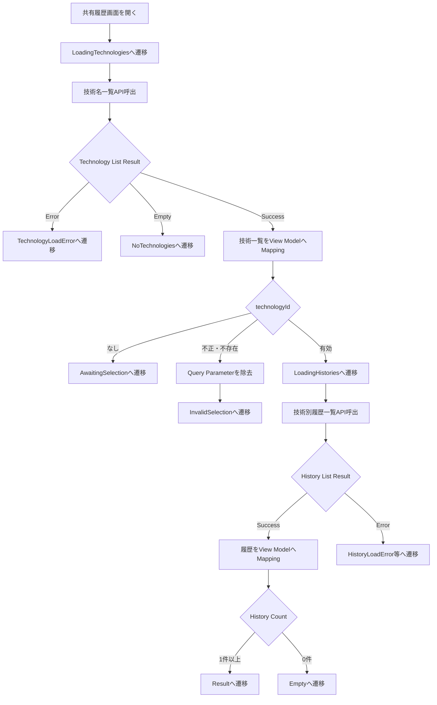
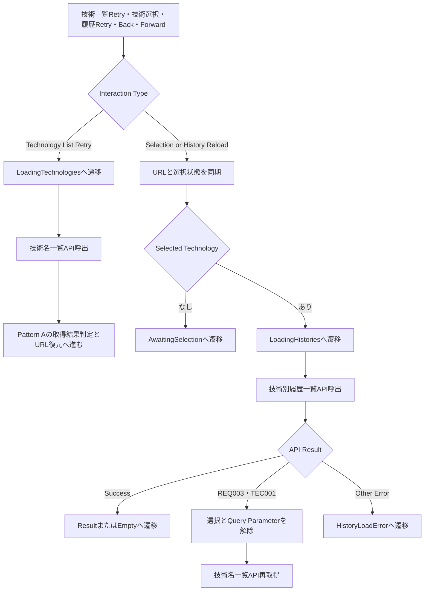
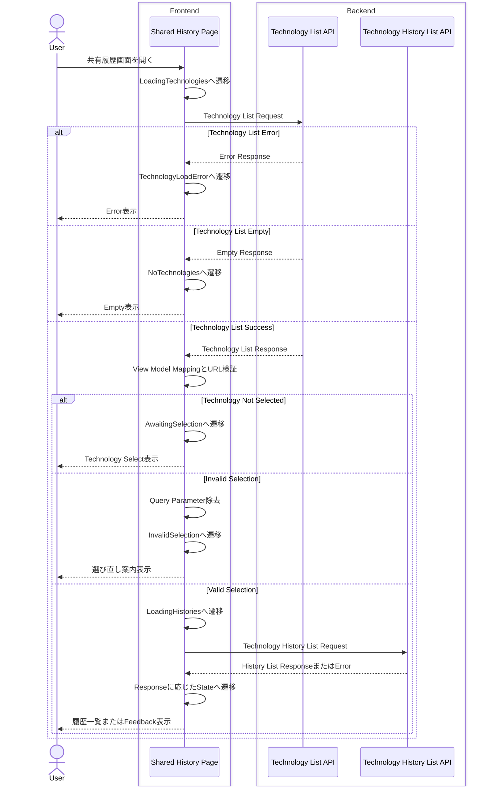
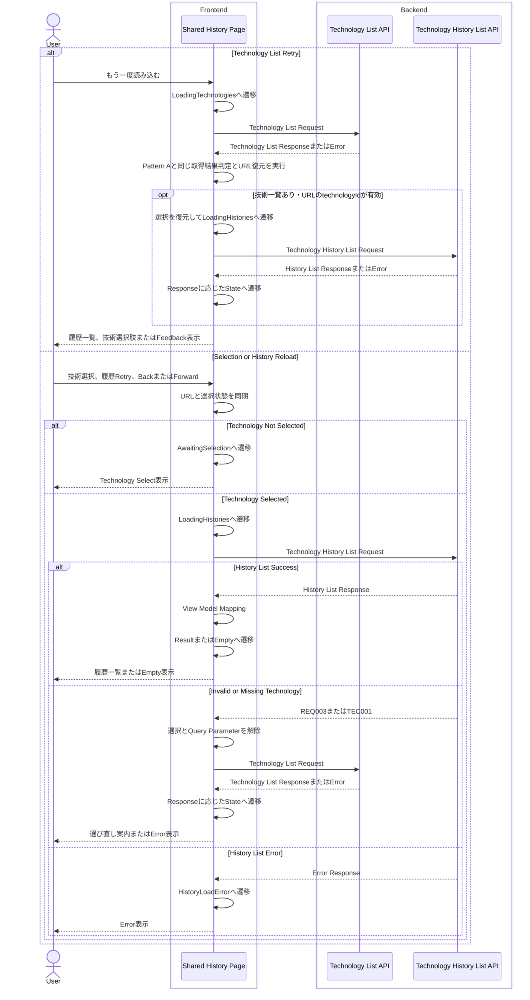

# Shared History Screen Specification

## 変更履歴

| Change | Date | Train | Summary |
| --- | --- | --- | --- |
| Initial Design | 2026-10-15 | 20260915-initial-implementation | 初回UI仕様を確定 |

## **1. Summary**

| Item | Value |
| --- | --- |
| Physical Name | `SharedHistoryPage` |
| Logical Name | 共有履歴画面 |
| Application | Web Frontend Application |
| Platform | `Web` |
| Screen Type | `Page` |
| Route / Path | `/shared-histories` |
| Description | 共有履歴を持つ技術を選択し、その技術に属する履歴概要を新しい順に確認する画面。 |

任意のQuery Parameter `technologyId`で選択中の代表技術IDを表す。形式は`/shared-histories?technologyId={technologyId}`とし、Query Parameterがない場合は技術未選択とする。

認証は設けない。Backend APIは同一Originの相対URLで呼び出し、CORSおよびFrontend ContainerによるBackend Reverse Proxyを前提としない。LocalではFrontend開発ServerのProxyを使用する。連携Contractは[技術名一覧API](../api/technology-list-api-spec.md)および[技術別履歴一覧API](../api/technology-history-list-api-spec.md)、共通Error Codeは[Error Codes](../error-codes.md)を正とする。

## **2. Screen Structure**

```text
Shared History Page
├─ Application Header [Top]
│  ├─ Brand Link
│  └─ Primary Navigation
│     ├─ Practice Proposal Link
│     └─ Shared History Link
└─ Main Content
   ├─ Page Header
   │  ├─ Page Title
   │  └─ Page Description
   ├─ Technology Filter
   │  └─ Technology Select
   ├─ History Status
   │  ├─ Loading Indicator
   │  ├─ Error Message
   │  │  └─ Retry Button
   │  ├─ Invalid Selection Message
   │  └─ Empty Message
   └─ History Result
      ├─ Result Status
      ├─ Selected Technology Heading
      └─ History List
         └─ History Item Link
            ├─ Saved Date Time
            ├─ Difficulty
            ├─ Duration Hours
            └─ Purpose
```

初期表示時に技術一覧を取得し、技術未選択時は履歴一覧を表示しない。Technology Selectの選択変更時にQuery Parameterを更新して履歴一覧を取得し、Submit Buttonは設けない。履歴0件はErrorではなくEmptyとして表示する。

## **3. Component Definition**

| No. | Component | Type | Label / Text | Model / Value | Required | Editable | Description | Note |
| ---: | --- | --- | --- | --- | :---: | :---: | --- | --- |
| 1 | `applicationHeader` | Header | - | - | - | - | 全画面共通のHeader | - |
| 2 | `brandLink` | Link | Dev Menu | `/` | - | - | 注文画面へ移動するBrand Link | - |
| 3 | `primaryNavigation` | Navigation | - | - | - | - | 主要画面へのNavigation | - |
| 4 | `practiceProposalNavLink` | Link | 課題を注文 | `/` | - | - | 注文画面へのNavigation | - |
| 5 | `sharedHistoryNavLink` | Link | 共有履歴 | `/shared-histories` | - | - | 共有履歴画面へのNavigation | `aria-current="page"`を設定 |
| 6 | `pageTitle` | Heading | 共有履歴 | - | - | - | 画面の`h1` | - |
| 7 | `pageDescription` | Text | これまでに生成された課題を、技術ごとに確認できます。 | - | - | - | 画面の目的を説明 | - |
| 8 | `technologySelect` | Select | 技術 | `selectedTechnologyId` | - | ● | 共有履歴を表示する技術を選択 | 未選択表示は`技術を選択してください` |
| 9 | `technologyLoadingIndicator` | Status | 技術を読み込んでいます。 | - | - | - | 技術一覧の取得中を表示 | MessageをAnimationに併記 |
| 10 | `historyLoadingIndicator` | Status | 共有履歴を読み込んでいます。 | - | - | - | 履歴一覧の取得中を表示 | MessageをAnimationに併記 |
| 11 | `technologyLoadErrorMessage` | Inline Message | Error Presentation参照 | `technologyLoadError` | - | - | 技術一覧取得Errorを表示 | Programmatic Focus対象 |
| 12 | `historyLoadErrorMessage` | Inline Message | Error Presentation参照 | `historyLoadError` | - | - | 履歴一覧取得Errorを表示 | Programmatic Focus対象 |
| 13 | `invalidSelectionMessage` | Inline Message | 選択した技術は見つかりませんでした。技術を選び直してください。 | - | - | - | 無効な選択を通知 | Programmatic Focus対象 |
| 14 | `retryButton` | Button | もう一度読み込む | - | - | - | 失敗した取得処理を再実行 | 対象Error領域内に表示 |
| 15 | `noTechnologiesMessage` | Status | 共有履歴のある技術はまだありません。 | - | - | - | 技術一覧が0件であることを表示 | - |
| 16 | `noHistoriesMessage` | Status | この技術の共有履歴はありません。 | - | - | - | 選択技術の履歴が0件であることを表示 | - |
| 17 | `historyResult` | Region | - | `historyResult` | - | - | 選択技術の履歴一覧を表示 | 履歴が1件以上の場合だけ表示 |
| 18 | `historyResultStatus` | Status | `{technologyName}の共有履歴を{count}件読み込みました。` | - | - | - | 一覧更新を支援技術へ通知 | 視覚表示は必須としない |
| 19 | `selectedTechnologyHeading` | Heading | `「{technologyName}」の共有履歴` | `historyResult.technologyName` | - | - | 選択技術の一覧見出し | - |
| 20 | `historyList` | List | - | `historyResult.sharedHistories` | - | - | 選択技術の全履歴概要を表示 | Backend返却順を維持 |
| 21 | `historyItemLink` | Link / List Item | - | `historyResult.sharedHistories[]` | - | - | 履歴1件全体を詳細画面へのLinkとして表示 | `/shared-histories/{historyId}` |

### **Component Detail**

#### **technologySelect**

**Option Definition**

| No. | Component / Field | Label | Value | Description |
| ---: | --- | --- | --- | --- |
| 1 | `placeholderOption` | 技術を選択してください | Empty | 未選択状態を表示 |
| 2 | `technologyOption` | `technology.technologyName` | `technology.technologyId` | 代表技術を選択肢として表示 |

#### **historyItemLink**

**Item Definition**

| No. | Component / Field | Label | Value | Description |
| ---: | --- | --- | --- | --- |
| 1 | `createdAt` | 保存日時 | `history.createdAt` | 端末のLocal Time Zoneへ変換して表示 |
| 2 | `difficulty` | 難易度 | `history.difficulty` | Codeを表示名へ変換 |
| 3 | `durationHours` | 取り組める時間 | `{history.durationHours}時間` | 時間単位で表示 |
| 4 | `purpose` | 目的 | `history.purpose` | Codeを表示名へ変換 |

## **4. Screen State**

| State | Condition | Component | Visibility | Enabled | Display / Behavior | Note |
| --- | --- | --- | :---: | :---: | --- | --- |
| `LoadingTechnologies` | 初期表示または技術一覧Retry | `technologySelect` | ● | - | 未選択のまま操作不可 | - |
| `LoadingTechnologies` | 技術一覧API実行中 | `technologyLoadingIndicator` | ● | - | Loading Messageを表示 | 履歴領域は表示しない |
| `TechnologyLoadError` | 技術一覧取得失敗 | `technologySelect` | ● | - | 操作不可 | - |
| `TechnologyLoadError` | 技術一覧取得失敗 | `technologyLoadErrorMessage` | ● | - | Errorを表示 | 履歴領域は表示しない |
| `TechnologyLoadError` | 技術一覧取得失敗 | `retryButton` | ● | ● | 技術一覧Retryを許可 | - |
| `NoTechnologies` | 技術一覧が0件 | `technologySelect` | ● | - | 選択肢なしで操作不可 | - |
| `NoTechnologies` | 技術一覧が0件 | `noTechnologiesMessage` | ● | - | Empty Messageを表示 | 履歴領域は表示しない |
| `AwaitingSelection` | 技術一覧取得済みかつ未選択 | `technologySelect` | ● | ● | 技術を選択可能 | 履歴領域は表示しない |
| `LoadingHistories` | 選択技術の履歴一覧API実行中 | `technologySelect` | ● | - | 選択を維持して操作不可 | - |
| `LoadingHistories` | 選択技術の履歴一覧API実行中 | `historyLoadingIndicator` | ● | - | Loading Messageを表示 | 以前の履歴は表示しない |
| `Result` | 選択技術の履歴が1件以上 | `technologySelect` | ● | ● | 技術を変更可能 | - |
| `Result` | 選択技術の履歴が1件以上 | `historyResult` | ● | - | 見出しと履歴一覧を表示 | - |
| `Empty` | 選択技術の履歴が0件 | `technologySelect` | ● | ● | 技術を変更可能 | - |
| `Empty` | 選択技術の履歴が0件 | `noHistoriesMessage` | ● | - | Empty Messageを表示 | 履歴一覧は表示しない |
| `HistoryLoadError` | 選択技術の履歴取得失敗 | `technologySelect` | ● | ● | 選択技術を維持し、変更も可能 | - |
| `HistoryLoadError` | 選択技術の履歴取得失敗 | `historyLoadErrorMessage` | ● | - | Errorを表示 | 以前または不完全な履歴は表示しない |
| `HistoryLoadError` | 選択技術の履歴取得失敗 | `retryButton` | ● | ● | 同じ技術の履歴Retryを許可 | - |
| `InvalidSelection` | Query Parameter不正または選択技術不存在 | `technologySelect` | ● | ● | 選択を解除して選び直し可能 | Query Parameterを除去 |
| `InvalidSelection` | Query Parameter不正または選択技術不存在 | `invalidSelectionMessage` | ● | - | 選び直しを案内 | 履歴一覧は表示しない |

Stateに応じて表示するStatus、Error、EmptyおよびResult以外は非表示とする。Application HeaderとPage HeaderはすべてのStateで表示する。

## **6. Validation / Display Rules**

### **Validation Presentation Rules**

本画面にForm Validationはない。URLの`technologyId`はProcessing Detailsに従って検証し、不正な場合は`InvalidSelection`としてError Presentationを適用する。

### **Display / Interaction Rules**

| No. | Component | Condition | Rule | Description | Note |
| ---: | --- | --- | --- | --- | --- |
| 1 | `technologySelect` | 技術選択 | Query Parameterへ`technologyId`を追加 | Browser HistoryへEntryを追加して履歴取得 | Submit Buttonは設けない |
| 2 | `technologySelect` | 現在と同じ技術を再選択 | URL更新・再取得を行わない | 重複操作を抑止 | - |
| 3 | `technologySelect` | Query Parameterなし | 未選択表示 | 履歴領域を表示しない | - |
| 4 | `technologySelect` | 不正・不存在の`technologyId` | 選択解除 | Browser HistoryへEntryを追加せずQuery Parameterを除去 | - |
| 5 | `difficulty` | Code `1` / `2` / `3` | `初級` / `中級` / `上級`を表示 | Enum Codeを表示名へMapping | 未知CodeはUnmapped Error |
| 6 | `purpose` | Code `1` / `2` | `技術習得` / `PoC`を表示 | Enum Codeを表示名へMapping | 未知CodeはUnmapped Error |
| 7 | `createdAt` | 正常なUTC ISO 8601 | 端末Local Time Zoneの`YYYY年M月D日 HH:mm`で表示 | 24時間表記。秒・小数秒は非表示 | `time`要素の`datetime`には元のUTC値を設定 |
| 8 | 技術名・表示値 | 表示時 | Reactの通常のText描画を使用 | Markupとして解釈しない | `dangerouslySetInnerHTML`禁止 |
| 9 | 技術名・表示値 | 改行・長い連続文字列あり | 改行を保持して領域内で折り返す | `white-space: pre-wrap`、`overflow-wrap: anywhere`相当 | 省略せず全文表示 |
| 10 | `historyList` | Result | Backend返却順を維持 | Frontendで再Sortしない | 全件表示。Paginationなし |
| 11 | `historyItemLink` | Result | Item全体をLinkとする | Keyboardでも詳細画面へ移動可能 | - |
| 12 | `historyResultStatus` | Result | `role="status"`、`aria-live="polite"` | 件数と対象技術を通知 | FocusはTechnology Selectに維持 |
| 13 | `technologyLoadingIndicator`、`historyLoadingIndicator` | 表示時 | `role="status"`、`aria-live="polite"` | Loading Messageを通知 | Animationだけに依存しない |
| 14 | `pageTitle` | React内の画面遷移 | Browser Titleを`共有履歴 \| Dev Menu`へ更新しFocusを移動 | `tabindex="-1"`を設定 | 初回通常LoadではFocusを強制しない |
| 15 | Main Content | すべてのViewport | 1Columnで表示 | History Itemを縦方向に配置 | 最大幅・Breakpointは実装時調整可 |
| 16 | Form Control・主要Button | 狭いViewport | 利用可能幅まで拡張 | 画面全体の横Scrollを防止 | Header Navigationは折返し可 |
| 17 | 操作Component | 常時 | Semantic HTMLと視認可能なKeyboard Focusを使用 | 状態を色だけで伝えない | Click可能な`div`を使用しない |

Application HeaderはSemanticなHeaderおよびNavigationとして構成し、Heading Levelを飛ばさず本画面の`h1`を一つとする。意味を持つIconにはAccessible Nameを設定し、装飾Iconは支援技術から除外する。`disabled`状態はNative Controlへ設定する。

## **7. Interaction Flow**

##### **Pattern A: Initial Load and URL Restoration**



##### **Pattern B: Technology Selection and Retry**



## **8. Sequence**

##### **Pattern A: Initial Load and URL Restoration**



##### **Pattern B: Technology Selection and Retry**



Backend内部のDatabase処理には展開せず、各API Specificationを正とする。

## **9. Processing Details**

##### **Pattern A: Initial Load and URL Restoration**

初期表示および`TechnologyLoadError`での技術一覧Retryは、いずれも本PatternのStep 1から実行する。Retry開始時はURLのQuery Parameterを維持し、以前のErrorを消去する。

###### **Step 1. Technology List Loading**

**1.1.** `LoadingTechnologies`へ遷移し、技術名一覧APIを呼び出す。成功時は配列、各`technologyId`の形式および各`technologyName`が表示可能であることを確認してView ModelへMappingする。

**1.2.** 技術一覧はBackendの返却順を維持し、Frontendで再Sortしない。0件の場合は`NoTechnologies`へ遷移して本Patternを終了する。1件以上の場合はStep 2へ進み、Retry成功時も現在のURLから選択状態を復元する。

**1.3.** 取得失敗またはResponse構成不正の場合は`TechnologyLoadError`へ遷移し、Error Presentationに従って表示する。再度Retryする場合もStep 1から実行する。

###### **Step 2. Query Parameter Restoration**

**2.1.** `technologyId`はJavaScriptの`Number`へ変換せず、正の10進整数Stringとして保持する。Query Parameterは技術別履歴一覧API Specificationと同じ形式およびLong範囲で検証する。

**2.2.** Query Parameterがない場合は`AwaitingSelection`へ遷移する。不正または取得した技術一覧に存在しない場合はBrowser HistoryへEntryを追加せず除去し、`InvalidSelection`へ遷移する。

**2.3.** 有効な場合はTechnology Selectへ反映し、Pattern BのStep 2へ進んで履歴一覧を取得する。Retry成功後も利用者による技術の選び直しを要求しない。

##### **Pattern B: History List Loading**

###### **Step 1. URL Synchronization**

**1.1.** 利用者が別の技術を選択した場合は、Browser Historyへ新しい`technologyId`を追加する。同じ技術の再選択ではURL更新および再取得を行わない。

**1.2.** Browser Back／ForwardではURLへ選択状態を同期する。Query Parameterがない場合は`AwaitingSelection`へ戻し、履歴一覧を表示しない。

###### **Step 2. History List Request**

**2.1.** `LoadingHistories`へ遷移し、選択したString IDを用いて技術別履歴一覧APIを呼び出す。Frontend独自の自動Retryは行わない。

**2.2.** 別の選択またはBrowser Back／Forwardによる取得が開始された場合は以前のRequestを中断する。中断済みRequestの結果およびErrorは画面へ反映しない。

###### **Step 3. Response Mapping and Screen Update**

**3.1.** Responseの`technologyId`が選択中IDと一致し、`technologyName`、保存日時、Enum Codeおよび必須Fieldが表示可能であることを確認する。`historyId`もNumberへ変換せずStringとして保持する。

**3.2.** 1件でも表示不能な履歴がある場合は部分表示せず、Response全体をUnmapped Errorとして扱う。正常な履歴はBackend返却順のままView ModelへMappingする。

**3.3.** 1件以上は`Result`、0件は`Empty`へ遷移する。ResultではFocusをTechnology Selectに維持し、`historyResultStatus`で完了を通知する。

**3.4.** `REQ003`または`TEC001`は選択とQuery Parameterを解除して技術一覧を再取得する。再取得成功かつ技術ありの場合は`InvalidSelection`、0件の場合は`NoTechnologies`、再取得失敗の場合は`TechnologyLoadError`へ遷移する。その他の履歴取得失敗は`HistoryLoadError`へ遷移し、Error領域へFocusを移す。

###### **Step 4. Cancellation**

**4.1.** 画面破棄時は実行中の技術一覧および履歴一覧Requestを中断する。中断自体を利用者向けErrorとして表示しない。

## **10. Error Presentation**

| No. | Error Type | Error / Condition | Target | Presentation Type | Display Content | User Action | Note |
| ---: | --- | --- | --- | --- | --- | --- | --- |
| 1 | Client Validation Error | Query Parameterの`technologyId`が形式・Long範囲不正、または技術一覧に不存在 | `invalidSelectionMessage` | Inline Message | `選択した技術は見つかりませんでした。技術を選び直してください。` | 技術を選び直す、または画面移動可能 | 技術別履歴一覧APIを呼び出さない |
| 2 | API Error | 技術名一覧APIの`DB9999`、`ER9999` | `technologyLoadErrorMessage` | Inline Message | `技術一覧を読み込めませんでした。時間をおいて、もう一度お試しください。` | 技術一覧をRetryまたは画面移動可能 | - |
| 3 | Communication Error | 技術名一覧API Responseを正常に取得できない | `technologyLoadErrorMessage` | Inline Message | `技術一覧を読み込めませんでした。時間をおいて、もう一度お試しください。` | 技術一覧をRetryまたは画面移動可能 | - |
| 4 | Unmapped Error | 技術名一覧APIのStatus／Code不一致、非JSON、未知Code、Response構成不正 | `technologyLoadErrorMessage` | Inline Message | `技術一覧を読み込めませんでした。時間をおいて、もう一度お試しください。` | 技術一覧をRetryまたは画面移動可能 | Response文字列を直接表示しない |
| 5 | API Error | 技術別履歴一覧APIの`REQ003`、`TEC001` | `invalidSelectionMessage` | Inline Message | `選択した技術は見つかりませんでした。技術を選び直してください。` | 技術を選び直す、または画面移動可能 | 選択解除後に技術一覧を再取得 |
| 6 | API Error | 技術別履歴一覧APIの`DB9999`、`ER9999` | `historyLoadErrorMessage` | Inline Message | `共有履歴を読み込めませんでした。時間をおいて、もう一度お試しください。` | 同じ技術でRetry、別技術を選択、または画面移動可能 | - |
| 7 | Communication Error | 技術別履歴一覧API Responseを正常に取得できない | `historyLoadErrorMessage` | Inline Message | `共有履歴を読み込めませんでした。時間をおいて、もう一度お試しください。` | 同じ技術でRetry、別技術を選択、または画面移動可能 | - |
| 8 | Unmapped Error | 技術別履歴一覧APIのStatus／Code不一致、非JSON、未知Code、日時・Enum・Response構成不正 | `historyLoadErrorMessage` | Inline Message | `共有履歴を読み込めませんでした。時間をおいて、もう一度お試しください。` | 同じ技術でRetry、別技術を選択、または画面移動可能 | 部分表示しない |

Error領域は`role="alert"`とし、Error確定後にProgrammatic Focus用の`tabindex="-1"`を設定した対象MessageへFocusを移す。次の取得開始時に以前のErrorを消去する。Backendの英語`errorMessage`、Error Code、Stack TraceおよびRequest IDは画面へ表示しない。HTTP Statusと`errorCode`の組合せがAPI Specificationどおりの場合だけ既知ErrorとしてMappingする。
