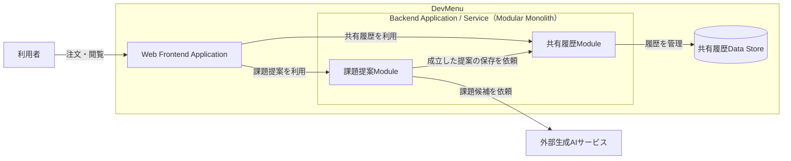
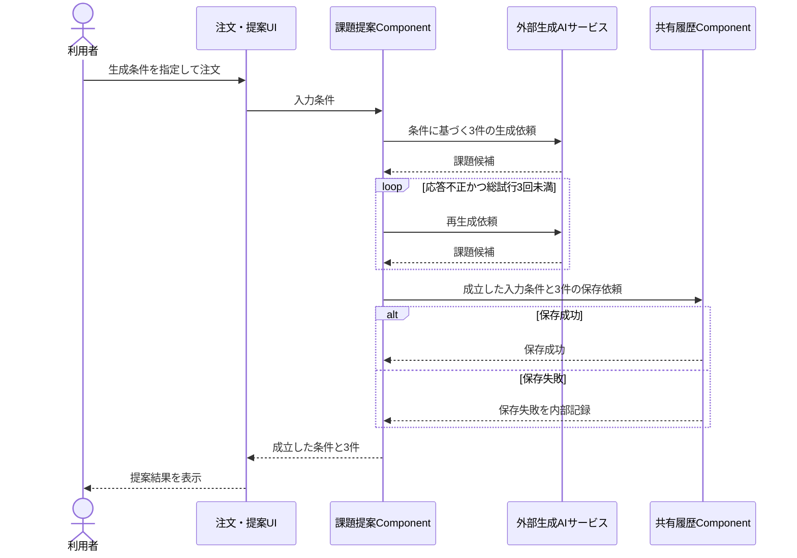
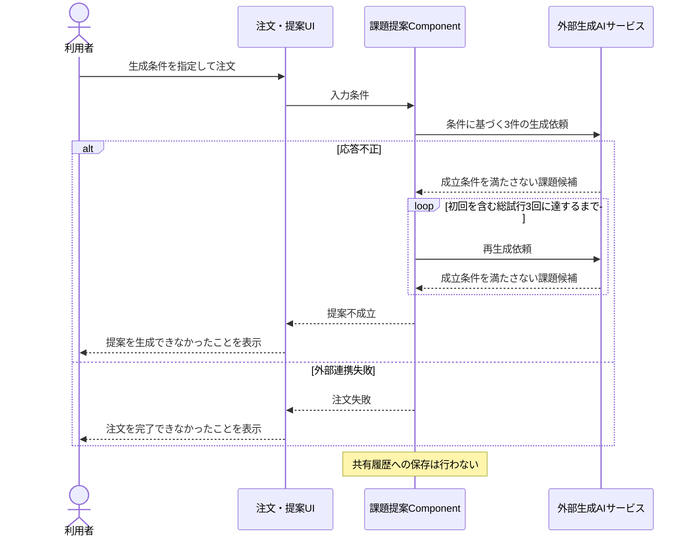
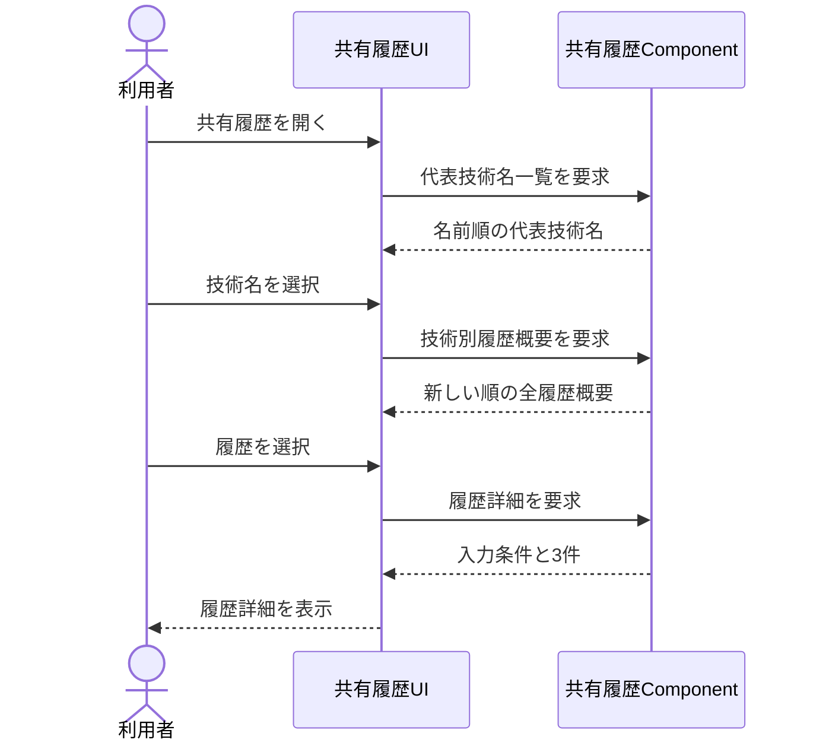
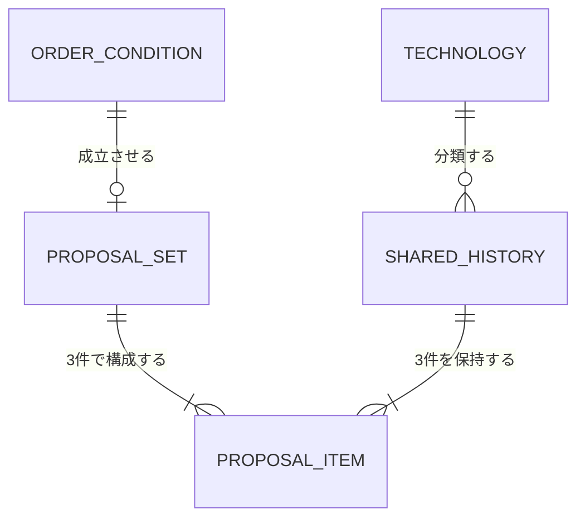
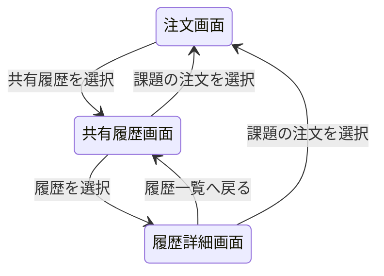

# 機能設計書（Functional Design Document）

## 0. Change History

| Change | Date | Train | Summary |
| --- | --- | --- | --- |
| Initial | 2026-10-13 23:57 | 20260915-initial-implementation | 初回機能設計を確定 |
| Change 1 | 2026-10-15 16:07 | 20260915-initial-implementation | External Interface詳細化に伴いBR-010〜012の生成Content取得・構造検証・再生成とSDK技術Retryの責務を明確化 |
| Change 2 | 2026-10-15 23:31 | 20260915-initial-implementation | PRD Clarificationに合わせ、初回Trainで対象外とする生成中表示をStreaming形式に限定し、通常のLoading表示を禁止しない境界を明確化 |

## 1. Functional Overview and Scope

### 1.1 Purpose / Functional Overview

- 実現すること：利用者が学びたい技術、難易度、所要時間、目的および任意の意向を指定し、条件に合う3件の実装課題を得られるようにする。
- 提供する価値・役割：限られた時間と習熟度に合う個人開発またはPoCの題材を比較可能にし、既出の提案を共有履歴から再発見できるようにする。
- 対象機能領域：課題の注文、課題提案、成立した提案の共有履歴への保存、技術名に基づく共有履歴の閲覧。

### 1.2 In Scope

- 業務・機能領域：課題生成条件の受付、3件の課題提案、共有履歴の提供。
- ユーザー操作：条件入力、注文、提案結果の確認、技術名の選択、履歴一覧および履歴詳細の閲覧。
- システム処理：入力検証、プロンプト構成、生成依頼、応答検証、応答不正時の有限回の再生成、成立した提案の保存、履歴の取得。
- 外部連携領域：外部生成AIサービスへの課題候補の生成依頼と応答の受領。

### 1.3 Deferred Scope

- 提案された課題の選択保存。
- 選択した課題の進捗管理。
- 生成途中の内容を逐次受信し、生成できた部分から提案結果として順次表示するStreaming形式の表示。
- 失敗した注文の入力条件をSession等へ保存し、画面の再読み込みまたは画面遷移後に復元する仕組み、および保存された条件を使用する専用の再試行機能。
- 課題同士を比較するための追加表示、異なる観点からの追加提案、技術を使う理由の説明。
- 所要時間帯または日数による入力方式。
- 生成AI APIの呼び出し回数制限。
- 外部生成AIとの通信失敗に対する独立した再試行制御。
- 多言語入力を内部で英語化して生成し、任意言語へ翻訳して表示する方式。
- 共有履歴のページング、自由文検索および全文検索。

### 1.4 Excluded Scope

- 利用者と生成AIのチャットによる課題の調整。
- ユーザー登録、ログイン、個人ごとの履歴管理およびアクセス制御。
- 生成モデル自体の用意、学習および運用。
- 外部生成AIサービスが保持する履歴への依存。
- Mobile、DesktopおよびCLI向けClient Application。

### 1.5 Actors / Users

| Actor / User | Role |
| --- | --- |
| 利用者 | 学習またはPoCの条件を注文し、提案結果および共有履歴を閲覧する。 |
| 外部生成AIサービス | DevMenuから渡された条件と指示に基づき、課題候補を生成する。 |

### 1.6 Preconditions / Assumptions

- 利用者はユーザー登録およびログインを行わずに利用する。
- 画面と生成される課題の言語は、初回Trainでは日本語とする。
- 共有履歴は利用者個人に属さず、URLを知る利用者が共通して閲覧する。
- 課題内容が入力条件に意味的に適合するかは、利用者が確認する。

## 2. Functional Decomposition

### 2.1 Functional Hierarchy

```text
DevMenu
├── 課題注文・提案
│   ├── 生成条件入力
│   ├── 入力条件検証
│   ├── 課題候補生成
│   ├── 生成応答検証・再生成
│   └── 提案結果表示
└── 共有履歴
    ├── 成立提案保存
    ├── 技術名一覧提供
    ├── 技術別履歴一覧提供
    └── 履歴詳細提供
```

### 2.2 Functional Description

| Function | Functional Area | Description |
| --- | --- | --- |
| 生成条件入力 | 課題注文・提案 | 技術名、難易度、所要時間、目的および任意のその他の意向を受け付ける。 |
| 入力条件検証 | 課題注文・提案 | 注文条件が共通の入力規則を満たすかを確認し、不正な注文による生成を防ぐ。 |
| 課題候補生成 | 課題注文・提案 | 検証済みの条件をプロンプトテンプレートへ組み込み、外部生成AIサービスへ3件の課題候補を依頼する。 |
| 生成応答検証・再生成 | 課題注文・提案 | 生成応答の構造、件数および必須内容を確認し、応答不正の場合だけ上限内で再生成する。 |
| 提案結果表示 | 課題注文・提案 | 成立した3件と生成時の条件を、比較可能な一組の提案として表示する。 |
| 成立提案保存 | 共有履歴 | 成立した提案と入力条件を一つの履歴として永続化する。 |
| 技術名一覧提供 | 共有履歴 | 履歴に存在する代表技術名を選択肢として提供する。 |
| 技術別履歴一覧提供 | 共有履歴 | 選択された技術名に属する履歴の概要を新しい順に提供する。 |
| 履歴詳細提供 | 共有履歴 | 選択された履歴の入力条件と3件の課題を提供する。 |

### 2.3 Requirement Traceability

| Requirement | Function |
| --- | --- |
| PRD FR-001 課題生成条件の入力 | 生成条件入力、入力条件検証 |
| PRD FR-002 実装課題の提案 | 課題候補生成、生成応答検証・再生成、提案結果表示 |
| PRD FR-003 課題提案の共有履歴 | 成立提案保存、技術名一覧提供、技術別履歴一覧提供、履歴詳細提供 |
| PRD 非機能要件／セキュリティ | 入力条件検証、提案結果表示、成立提案保存、各履歴提供機能 |

## 3. Logical System Structure

### 3.1 Logical Structure Overview

| Logical Element | Role in Functional Design |
| --- | --- |
| Web Frontend Application | 条件入力、注文、提案結果の表示、共有履歴の選択と閲覧を利用者へ提供する。 |
| Backend Application | 一つのApplicationおよびServiceとして稼働するModular Monolithであり、課題提案Moduleと共有履歴Moduleを同じ境界内に持つ。 |
| Backend Application／課題提案Module | 入力検証、プロンプト構成、外部生成AIへの生成依頼、応答検証および有限回の再生成を担う。 |
| Backend Application／共有履歴Module | 代表技術名を管理し、成立した入力条件と3件の提案を保存して共有履歴として提供する。 |
| 共有履歴Data Store | 共有履歴Moduleが管理する入力条件、代表技術名、提案および保存日時を永続化する。 |
| 外部生成AIサービス | 渡された条件と出力指示に基づいて課題候補を生成する。 |

### 3.2 Functional Allocation Overview

| Functional Area | Primary Logical Element | Related Elements |
| --- | --- | --- |
| 課題注文・提案 | 課題提案Module | Web Frontend Application、外部生成AIサービス、共有履歴Module |
| 共有履歴 | 共有履歴Module | Web Frontend Application、課題提案Module、共有履歴Data Store |

### 3.3 Logical System Diagram



## 4. Use Cases

### 4.1 Use Cases

| Use Case | Actor | Purpose | Preconditions | Expected Outcome |
| --- | --- | --- | --- | --- |
| UC-01 課題を注文する | 利用者 | 指定した条件に合う実装課題を比較する。 | 注文画面を利用できる。 | 有効な3件と、その生成に使われた条件を確認できる。 |
| UC-02 技術別の共有履歴を探す | 利用者 | 既出の技術に関する提案を見つける。 | 共有履歴画面を利用できる。 | 技術名を選び、該当する履歴概要を新しい順に確認できる。 |
| UC-03 共有履歴の詳細を見る | 利用者 | 過去の入力条件と提案内容を再利用のために確認する。 | 対象の履歴が保存されている。 | 入力条件と3件の課題を確認できる。 |

## 5. Components and Responsibilities

### 5.1 Component Overview

| Component | Type | Parent | Responsibility |
| --- | --- | --- | --- |
| 注文・提案UI | UI機能Component | Web Frontend Application | 条件入力、事前検証、公開に関する注意の提示、注文、結果および注文エラーの表示。 |
| 共有履歴UI | UI機能Component | Web Frontend Application | 技術名の選択、履歴一覧、履歴詳細および履歴取得エラーの表示。 |
| 課題提案Component | 業務機能Component | 課題提案Module | 入力条件の最終検証、生成処理の制御、成立判定および提案結果の提供。 |
| 生成AI連携Component | 外部連携Component | 課題提案Module | アプリケーション側のテンプレートによる生成依頼と外部生成AI応答の受領。 |
| 共有履歴Component | 業務機能Component | 共有履歴Module | 技術名の同一視、成立提案の保存、技術名・履歴一覧・履歴詳細の提供。 |
| 共有履歴Data Store | 永続化対象 | DevMenu | 共有履歴Componentが所有する共有履歴データを保持する。 |

### 5.2 Component Responsibilities and Relationships

| Component | Responsibility | Related Component | Relationship |
| --- | --- | --- | --- |
| 注文・提案UI | 利用者との注文入出力を担い、業務上の成立判定は行わない。 | 課題提案Component | 注文条件を渡し、成立した提案または利用者向け失敗結果を受け取る。 |
| 課題提案Component | 課題提案の成立を判断する。共有履歴の永続管理は行わない。 | 生成AI連携Component | 検証済み条件による候補生成を依頼し、応答を検証する。 |
| 課題提案Component | 成立した提案を利用者へ返す責任を持つ。 | 共有履歴Component | 成立後に保存を依頼するが、保存失敗を提案失敗にはしない。 |
| 共有履歴Component | 代表技術名と履歴データを所有し、生成の成立判断は行わない。 | 共有履歴Data Store | 成立した一つの履歴を構成するデータを一体として保存・取得する。 |
| 共有履歴UI | 共有履歴の閲覧操作を担う。 | 共有履歴Component | 技術名一覧、技術別履歴一覧および履歴詳細を取得する。 |

## 6. Business Rules

### 6.1 Decision and Validation Rules

| Rule | Condition | Result / Behavior |
| --- | --- | --- |
| BR-001 技術名入力 | 前後空白除去後の技術名が1〜20文字で、空白だけではない。 | 注文条件として許可する。連続する空白は一つへ統一する。 |
| BR-002 難易度入力 | 初級・中級・上級のいずれかである。 | 注文条件として許可する。 |
| BR-003 所要時間入力 | 時間単位で1〜999の整数である。 | 注文条件として許可する。0、負数、小数、範囲外および数値でない値は許可しない。生成条件および保存値も時間単位とする。 |
| BR-004 目的入力 | 技術習得・PoCのいずれかである。 | 注文条件として許可する。 |
| BR-005 その他の意向入力 | 未入力、または前後空白除去後に1〜200文字である。 | 注文条件として許可する。空白だけの場合は未入力として扱う。 |
| BR-006 公開通知 | 利用者がその他の意向を入力して注文しようとする。 | 注文前から、内容がログイン不要の共有履歴で閲覧されることを常時確認できるようにする。同意操作は要求しない。 |
| BR-007 提案件数 | 生成応答がJSONとして解釈でき、課題をちょうど3件含む。 | 件数条件を満たす。 |
| BR-008 提案必須内容 | 各課題のタイトル、概要、達成目標および目的に応じたポイントが、前後空白除去後に非空である。 | 必須内容条件を満たす。 |
| BR-009 提案文字数 | タイトルが100文字以内で、概要、達成目標およびポイントがそれぞれ500文字以内である。 | 文字数条件を満たす。 |
| BR-010 提案成立 | 外部生成AIから検証対象となる生成内容を取得でき、BR-007〜BR-009をすべて満たす。 | 3件全体を一つの成立した提案として扱う。内容面での入力条件への適合および提案間の重複は機械判定しない。 |
| BR-011 応答不正時の再生成 | 外部呼出しは成功したが検証対象となる生成内容を取得できない、またはBR-007〜BR-009のいずれかを満たさない。 | 初回を含むApplicationからの生成依頼回数が3回に達するまで再生成し、3回目も不成立なら提案不成立とする。 |
| BR-012 外部連携失敗 | SDK内部のRetryを含む外部呼出しが、通信、タイムアウト、外部サービス、認証または設定に関する技術的失敗として最終的に終了する。 | Applicationは追加試行せず、当該注文を直ちに失敗とする。SDK内部の技術的Retryは許容する。 |
| BR-013 履歴保存対象 | 提案がBR-010により成立する。 | 入力条件と3件の課題を一つの履歴として保存対象にする。 |
| BR-014 履歴保存失敗 | 成立した提案を共有履歴へ保存できない。 | 提案結果は成功として利用者へ返し、保存失敗は内部エラーとして記録する。利用者には保存失敗を表示しない。 |
| BR-015 技術名の同一視 | 前後空白と連続空白を正規化した技術名が、大文字小文字を除いて既存の技術名と一致する。 | 同一の技術として扱い、最初に保存された整形後の表記を代表表示名として使用する。 |
| BR-016 技術名の保存表記 | BR-015に該当する履歴を保存する。 | 履歴の技術名には代表表示名を用い、注文時の別表記は保持しない。 |
| BR-017 難易度の意味 | 利用者が難易度を選ぶ。 | DigComp 3.0の認知的要求、課題の複雑さおよび自律性を参考にしたDevMenu独自基準として、6.2の区分を適用する。 |

検証対象となる生成内容を取得できたかの具体的な判定は、課題候補生成InterfaceのExternal Interface Specificationを正とする。BR-011の最大3回はApplicationからの生成依頼回数であり、SDK内部の通信試行数とは区別する。

### 6.2 Calculation and Derivation Rules

#### 難易度区分

- 適用条件：利用者が課題の難易度を指定し、生成AIへ課題候補を依頼する場合。
- 使用する情報：利用者が選択した初級・中級・上級の区分。
- 計算・導出方法：
  - 初級：必要に応じて手がかりを参照し、単純で明確な課題を実施する水準。
  - 中級：明確に定義された課題と問題を、複数の要素を組み合わせながら自力で解決する水準。
  - 上級：複雑な課題に対して複数の選択肢を評価し、自力で設計・実施する水準。
- 結果の意味：課題の実施に求められる理解、判断および自律性の深さを表す。外部Frameworkへの適合または認定を表さない。

#### 技術名の代表表示

- 適用条件：成立した提案を保存し、技術名の選択肢または共有履歴を表示する場合。
- 使用する情報：前後空白と連続空白を正規化した入力技術名、既存の代表技術名。
- 計算・導出方法：大文字小文字を区別せずに既存名と照合し、一致すれば既存の代表表示名を用いる。一致しなければ整形後の入力を新たな代表表示名とする。
- 結果の意味：表記揺れを一つの技術へ集約する、共有履歴上の表示名を表す。

### 6.3 Business Constraints

| Constraint | Description |
| --- | --- |
| BC-001 提案の一体性 | 一回の成功結果は常に3件で構成し、一部だけを成功、表示または保存しない。 |
| BC-002 履歴の一体性 | 一つの履歴に入力条件と成立した3件が揃う場合だけ保存済み履歴として扱う。 |
| BC-003 提案と保存の独立性 | 提案の成立は生成応答の検証結果で決まり、共有履歴への保存成否には依存しない。 |
| BC-004 共有性 | 保存された履歴は、ユーザー登録またはログインなしで全利用者が閲覧できる。 |
| BC-005 提案言語 | 初回Trainで生成する課題のタイトル、概要、達成目標およびポイントは日本語とする。 |
| BC-006 ポイント種別 | 目的が技術習得なら学ぶポイント、PoCなら検証するポイントを、各課題につき一つの文章として扱う。 |
| BC-007 表示安全性 | 入力値と生成内容は、実行可能なスクリプトまたはMarkupとして解釈せず、表示用の文字列として扱う。 |
| BC-008 失敗条件の引継ぎ | 失敗応答を受けた同一画面上の入力値は消去しない。一方、失敗した注文条件をSession等へ保存して再読み込みまたは画面遷移後に復元せず、保存条件を用いる専用の再試行機能も提供しない。 |

## 7. Functional Flows

### 7.1 Main Functional Flows

#### 課題注文・提案Flow

- 対応Use Case：UC-01

1. 利用者は注文・提案UIで生成条件を入力し、その他の意向に関する公開通知を確認できる状態で注文する。
2. 注文・提案UIは入力条件を検証し、有効な条件を課題提案Componentへ渡す。
3. 課題提案Componentは入力条件を再検証し、アプリケーションが管理するテンプレートへ条件と3件固定の構造化出力指示を組み込む。
4. 生成AI連携Componentは外部生成AIサービスへ生成を依頼し、応答を受け取る。
5. 課題提案ComponentはBR-007〜BR-009により応答を検証する。
6. 応答不正の場合はBR-011に従って再生成し、有効な応答または試行上限への到達を確定する。
7. 提案が成立した場合、課題提案Componentは共有履歴Componentへ入力条件と3件の保存を同期的に1回依頼する。
8. 共有履歴Componentは技術名をBR-015に従って同一視し、入力条件と3件を一つの履歴として保存する。
9. 課題提案Componentは保存成否にかかわらず、生成に使用した整形済み注文条件と成立した3件を注文・提案UIへ返す。共有履歴に保存される技術名の代表表記とは区別する。
10. 注文・提案UIは生成時の条件要約と3件を、フォームの下に応答順で表示する。

#### 技術別履歴閲覧Flow

- 対応Use Case：UC-02

1. 利用者は共有履歴UIを開く。
2. 共有履歴UIは共有履歴Componentから代表技術名の一覧を取得し、大文字小文字を区別しない名前順で表示する。
3. 利用者は一つの技術名を選択する。
4. 共有履歴UIは選択した技術に属する履歴概要を共有履歴Componentから取得する。
5. 共有履歴UIは該当する全履歴を保存日時の新しい順に表示する。
6. 各履歴概要には保存日時、難易度、所要時間および目的を表示し、保存日時は利用端末の現地時間へ変換する。

#### 履歴詳細閲覧Flow

- 対応Use Case：UC-03

1. 利用者は技術別履歴一覧から一つの履歴を選択する。
2. 共有履歴UIは履歴識別情報を用いて共有履歴Componentから詳細を取得する。
3. 共有履歴UIは別の履歴詳細画面へ、技術名、難易度、所要時間、目的、その他の意向、保存日時および3件の課題を表示する。

### 7.2 Interaction Sequences

- 対応Flow：課題注文・提案Flow（提案成立時）



- 対応Flow：課題注文・提案Flow（提案不成立時）



- 対応Flow：技術別履歴閲覧Flow、履歴詳細閲覧Flow



### 7.3 Alternative and Exception Flows

| Related Flow | Condition | Alternative / Exception Flow | Outcome |
| --- | --- | --- | --- |
| 課題注文・提案Flow | 入力条件がBR-001〜BR-005を満たさない。 | 不正な項目を示して生成処理を開始しない。 | 利用者は条件を修正して再注文できる。 |
| 課題注文・提案Flow | 応答不正が3回続く。 | 生成を終了し、共有履歴への保存を行わない。 | 注文画面へ提案不成立を表示する。 |
| 課題注文・提案Flow | BR-012の外部連携失敗が発生する。 | 再生成せず処理を終了し、共有履歴への保存を行わない。 | 注文画面へ注文失敗を表示する。 |
| 課題注文・提案Flow | 成立した提案の保存に失敗する。 | 失敗を内部記録し、成立した提案の返却を継続する。 | 利用者には成功結果を表示するが、当該注文は共有履歴に現れない。 |
| 課題注文・提案Flow | 以前の成功結果が表示された状態で再注文に成功する。 | 以前の結果を最新の条件と3件へ置き換える。 | 最新の提案だけを通常の成功結果として表示する。 |
| 課題注文・提案Flow | 以前の成功結果が表示された状態で再注文に失敗する。 | 失敗を表示し、以前の結果と生成条件を「前回成功した提案」として残す。 | 失敗した条件の結果と誤認させず、前回結果を引き続き確認できる。 |
| 技術別履歴閲覧Flow | 保存済み技術名または該当履歴がない。 | 空であることを共有履歴画面内に表示する。 | 利用者は別の画面へ移動できる。 |
| 技術別履歴閲覧Flow／履歴詳細閲覧Flow | 履歴情報を取得できない。 | 対象画面内に取得失敗を表示し、不完全な履歴を表示しない。 | 利用者は同じ操作の再実施または別画面への移動ができる。 |

## 8. Data Overview

### 8.1 Domain and Data Model Overview

| Data / Entity | Purpose | Description |
| --- | --- | --- |
| 注文条件 | 課題生成の条件を表す。 | 入力規則に従って空白を整形した技術名、難易度、所要時間、目的および任意のその他の意向。生成処理中に扱い、提案結果では生成に使用した条件として表示する。履歴保存時の技術名は代表表示名へ統一する。 |
| 課題提案 | 一回の注文に対して成立した結果を表す。 | 生成時の注文条件と、検証済みの3件の実装課題からなる。 |
| 実装課題 | 利用者が比較する一つの候補を表す。 | タイトル、概要、達成目標、および目的に応じた学ぶポイントまたは検証するポイントを持つ。 |
| 代表技術 | 共有履歴を技術単位で集約する。 | 正規化により同一視された技術の代表表示名。最初に保存された整形後の表記を維持する。 |
| 共有履歴 | 過去の成立した提案を再利用可能にする。 | 代表技術、難易度、所要時間、目的、任意のその他の意向、保存日時および3件の実装課題を一体として持つ。 |

### 8.2 Data Relationships

| Source | Relationship | Target | Cardinality | Constraint / Meaning |
| --- | --- | --- | --- | --- |
| 注文条件 | 生成条件となる | 課題提案 | 1対0..1 | 一回の注文は、失敗時には提案を成立させず、成功時には一つの課題提案を成立させる。 |
| 課題提案 | 構成する | 実装課題 | 1対3 | 成立した課題提案は、常にちょうど3件を持つ。 |
| 代表技術 | 分類する | 共有履歴 | 1対0..多 | 一つの共有履歴は一つの代表技術に属する。 |
| 共有履歴 | 保持する | 実装課題 | 1対3 | 保存済み履歴は、成立した3件すべてを保持する。 |
| 課題提案 | 保存元となる | 共有履歴 | 1対0..1 | 提案成立後に保存を試み、保存失敗時は対応する履歴が存在しない。 |

### 8.3 Conceptual ER Diagram



### 8.4 Master Data Overview

| Master | Purpose | Used By | Relationship |
| --- | --- | --- | --- |
| 難易度区分 | 課題に求める理解、判断および自律性の水準を指定する。 | 生成条件入力、課題候補生成、共有履歴 | 初級・中級・上級の意味は6.2を正とする。 |
| 目的区分 | 課題を技術習得向けまたはPoC向けに区別する。 | 生成条件入力、課題候補生成、共有履歴 | 技術習得では学ぶポイント、PoCでは検証するポイントを用いる。 |

## 9. Interface Overview

### 9.1 Interface Landscape

| Interface | Type | Provider / Producer | Consumer | Purpose |
| --- | --- | --- | --- | --- |
| 課題提案Interface | API | 課題提案Module | Web Frontend Application | 注文条件を受け付け、生成に使用した整形済み条件と成立した3件、または機能上の失敗結果を返す。 |
| 成立提案保存Interface | Internal Interface | 共有履歴Module | 課題提案Module | 成立した入力条件と3件を一つの共有履歴として保存し、保存成否を返す。 |
| 技術名一覧Interface | API | 共有履歴Module | Web Frontend Application | 共有履歴で選択可能な代表技術名を提供する。 |
| 技術別履歴一覧Interface | API | 共有履歴Module | Web Frontend Application | 選択技術に属する全履歴の概要を新しい順で提供する。 |
| 履歴詳細Interface | API | 共有履歴Module | Web Frontend Application | 指定された共有履歴の入力条件と3件を提供する。 |
| 課題候補生成Interface | External IF | 外部生成AIサービス | 生成AI連携Component | DevMenuが指定した条件と構造に基づく課題候補を生成する。 |

### 9.2 API Overview

| API | Provider | Consumer | Purpose | Input Overview | Output Overview |
| --- | --- | --- | --- | --- | --- |
| 課題提案API | 課題提案Module | Web Frontend Application | UC-01を提供する。 | 技術名、難易度、所要時間、目的、任意のその他の意向。 | 成功時は生成に使用した整形済み条件と3件。失敗時は入力不備、提案不成立または外部連携失敗を利用者向け結果へ対応付けるための情報。保存成否は公開しない。 |
| 技術名一覧API | 共有履歴Module | Web Frontend Application | UC-02の選択肢を提供する。 | なし。 | 大文字小文字を区別しない名前順の代表技術名。 |
| 技術別履歴一覧API | 共有履歴Module | Web Frontend Application | UC-02の一覧を提供する。 | 選択された代表技術を識別する情報。 | 保存日時の降順による全履歴の識別情報、保存日時、難易度、所要時間および目的。 |
| 履歴詳細API | 共有履歴Module | Web Frontend Application | UC-03を提供する。 | 履歴を識別する情報。 | 代表技術名、難易度、所要時間、目的、任意のその他の意向、保存日時および3件。 |

### 9.4 External Interface Overview

| External System | Interface | Direction | Internal Component | Purpose | Information Overview |
| --- | --- | --- | --- | --- | --- |
| 外部生成AIサービス | 課題候補生成Interface | DevMenuから依頼し応答を受領 | 生成AI連携Component | 課題候補を生成する。 | DevMenuが構成した条件、難易度の意味、3件固定、日本語、JSON構造および項目制約を渡し、課題候補を受け取る。 |

- 責務境界：外部生成AIサービスは候補内容の生成を担い、入力の受入可否、応答の成立判定、再生成の上限管理および共有履歴の管理はDevMenuが担う。

## 10. UI and User Interaction Overview

### 10.1 Screen Overview

| Screen | Actor | Purpose | Main Functions |
| --- | --- | --- | --- |
| 注文画面 | 利用者 | 条件を指定して3件の実装課題を得る。 | 生成条件入力、入力例・難易度目安・公開通知の表示、注文、条件要約と提案結果の表示、入力・生成エラーの表示。 |
| 共有履歴画面 | 利用者 | 技術名から既存の提案を探す。 | 代表技術名の選択、技術別履歴一覧の表示、空状態および取得エラーの表示。 |
| 履歴詳細画面 | 利用者 | 過去の入力条件と3件を確認する。 | 共有履歴の条件、保存日時および3件の表示、取得エラーの表示。 |

### 10.2 Screen Relationships and Navigation

| Source Screen | Trigger / Condition | Destination Screen | Relationship |
| --- | --- | --- | --- |
| 注文画面 | 共有履歴の閲覧を選ぶ。 | 共有履歴画面 | 注文機能から履歴探索へ移る。 |
| 共有履歴画面 | 課題の注文を選ぶ。 | 注文画面 | 履歴探索から新しい注文へ移る。 |
| 共有履歴画面 | 一つの履歴を選ぶ。 | 履歴詳細画面 | 選択した履歴の全情報を確認する。 |
| 履歴詳細画面 | 履歴一覧へ戻る。 | 共有履歴画面 | 技術別履歴の探索を継続する。 |
| 履歴詳細画面 | 課題の注文を選ぶ。 | 注文画面 | 過去の提案確認から新しい注文へ移る。 |



### 10.3 Cross-Screen Information Flow

| Source Screen | Destination Screen | Information | Purpose |
| --- | --- | --- | --- |
| 共有履歴画面 | 履歴詳細画面 | 選択した履歴を識別する情報。 | 一覧で選んだ履歴の詳細だけを取得・表示する。 |

### 10.4 Cross-Screen Interaction Rules

| Interaction / Condition | Affected Screens | Behavior |
| --- | --- | --- |
| ログイン不要の利用 | 全画面 | 認証操作を要求せず、注文および共有履歴閲覧を提供する。 |
| 共有履歴の取得失敗 | 共有履歴画面、履歴詳細画面 | 不完全な履歴へ遷移または表示せず、現在の画面で取得失敗を認識可能にする。 |
| 注文失敗後の入力条件 | 注文画面 | BC-008に従い、同一画面の入力値は維持するが、再読み込みまたは画面遷移後の復元を保証しない。 |

## 11. Error and Exception Behavior

### 11.1 Error and Exception Classification

| Classification | Description | Example |
| --- | --- | --- |
| 入力不備 | 利用者が修正可能な注文条件の不備。 | 技術名の未入力、所要時間の範囲外、その他の意向の文字数超過。 |
| 生成応答不正 | 外部生成AIから応答を得たが、DevMenuの提案成立条件を満たさない状態。 | JSONとして解釈不能、3件以外、必須項目の欠落・空白・文字数超過。 |
| 外部連携失敗 | 検証対象となる応答を受け取る前に生成処理を継続できなくなった状態。 | 通信失敗、タイムアウト、外部サービスエラー、認証・設定不備。 |
| 履歴保存失敗 | 成立した提案を共有履歴として永続化できない状態。 | Data Storeへの保存失敗。 |
| 履歴取得失敗 | 共有履歴の選択肢、一覧または詳細を利用者へ提供できない状態。 | Data StoreまたはBackendでの取得失敗、存在しない履歴の指定。 |

### 11.2 Error Handling Behavior

| Classification / Condition | Processing Behavior | Result | Component / Data State |
| --- | --- | --- | --- |
| 入力不備 | 不正な条件を特定し、生成を開始しない。 | 注文失敗。利用者による修正を待つ。 | 課題提案および共有履歴は作成されない。 |
| 生成応答不正かつ総試行3回未満 | 同じ注文条件で再生成する。 | 注文処理を継続する。 | 不正な候補は表示・保存しない。 |
| 生成応答不正かつ総試行3回到達 | 生成を終了する。 | 提案不成立。 | 課題提案および共有履歴は作成されない。 |
| 外部連携失敗 | 応答不正の再生成を行わず、生成を終了する。 | 注文失敗。 | 課題提案および共有履歴は作成されない。 |
| 履歴保存失敗 | 失敗を内部記録し、成立した提案の返却を継続する。 | 注文成功。 | 3件は利用者へ返るが、共有履歴は作成されない。 |
| 履歴取得失敗 | 不完全なデータを表示せず、取得処理を失敗として終了する。 | 閲覧失敗。 | 保存済みデータは変更しない。 |

### 11.3 Error Propagation and Responsibility

| Error Source | Detection / Handling Responsibility | Propagation Target | Functional Result |
| --- | --- | --- | --- |
| 注文・提案UIまたは課題提案Component | 各Componentが同じ入力規則により検知し、課題提案Componentが最終的な受入可否を決める。 | 注文・提案UI | 入力不備として利用者へ返す。 |
| 外部生成AIサービスの応答 | 課題提案Component | 注文・提案UI | 上限内では再生成し、上限到達時だけ提案不成立を返す。 |
| 生成AI連携Component | 課題提案Component | 注文・提案UI | 外部連携失敗として注文失敗を返す。内部詳細は利用者へ公開しない。 |
| 共有履歴Componentの保存処理 | 共有履歴Componentが検知・記録し、課題提案Componentが注文成功を維持する。 | 内部記録のみ | 利用者へは成立した提案を返し、保存失敗は伝えない。 |
| 共有履歴Componentの取得処理 | 共有履歴Component | 共有履歴UI | 履歴取得失敗として閲覧画面へ返す。内部詳細は利用者へ公開しない。 |

### 11.4 User-Visible Error Behavior

| Condition | User-visible Result | Available Action |
| --- | --- | --- |
| 入力不備 | 該当入力項目の近くで、修正が必要であることを確認できる。 | 条件を修正して再注文する。 |
| 生成応答不正が3回継続 | 注文画面で提案を生成できなかったことを確認できる。 | 同じ画面から改めて注文する。 |
| 外部連携失敗 | 注文画面で注文を完了できなかったことを確認できる。 | 同じ画面から改めて注文する。 |
| 再注文失敗かつ前回成功結果が存在 | 失敗を確認しつつ、生成条件を伴う前回成功結果を明確に区別して閲覧できる。 | 条件を変更または維持して再注文する。 |
| 履歴取得失敗 | 対象の履歴情報を取得できなかったことを現在の履歴画面で確認できる。 | 同じ操作を再実施するか、別画面へ移る。 |
| 履歴保存失敗 | 保存失敗は表示されず、成立した3件を通常の成功結果として確認できる。 | 提案結果を閲覧する。 |

## 12. Non-Functional Requirements per Function

### 12.1 Performance and Capacity Requirements

| Target | Requirement | Condition / Scope |
| --- | --- | --- |
| 課題注文・提案 | 初回Trainでは数値による応答時間目標を設けない。 | 外部生成AIへの生成依頼と、応答不正時の最大3回の総試行を含む。 |
| 技術別履歴一覧 | 選択技術に属する履歴概要をページングせず全件提供する。 | 初回Trainの利用規模を対象とし、本番運用水準の高負荷対策は完了条件にしない。 |

### 12.2 Security and Access Requirements

| Target | Requirement |
| --- | --- |
| 注文条件 | Web Frontend ApplicationとBackend Applicationの双方で同じ業務上の入力規則を適用する。Backend Applicationが最終的な受入可否を決める。 |
| 入力値・生成内容・履歴内容 | スクリプトまたはMarkupとして実行せず、表示用の文字列として扱う。 |
| 外部生成AIサービスの認証情報 | 利用者のブラウザへ公開せず、Backend Applicationの境界内でのみ使用する。 |
| 共有履歴 | 認証なしで閲覧可能とする。その他の意向も公開対象であることを注文前から通知する。 |

### 12.3 Availability and Continuity Requirements

| Target | Requirement | Condition |
| --- | --- | --- |
| 課題提案 | 共有履歴の保存失敗によって、成立した提案の利用者への返却を失敗させない。 | 生成応答が提案成立条件を満たしている場合。 |
| 共有履歴 | 保存失敗時に不完全な履歴を閲覧可能にしない。 | 入力条件と3件を一体として保存できない場合。 |
| 課題提案・共有履歴 | 初回Trainでは恒久稼働および本番運用水準の高可用性を完了条件にしない。 | 公開環境での基本動作確認を対象とする。 |

### 12.4 Other Functional Quality Requirements

| Category | Target | Requirement |
| --- | --- | --- |
| Usability | 生成条件入力 | 技術名の入力例と、6.2で定義した難易度ごとの目安を表示する。 |
| Usability | 提案結果 | 3件を同じ結果領域で比較でき、生成時の条件との対応を確認できる。 |
| Usability | 共有履歴 | 技術名は大文字小文字を区別しない名前順、履歴は保存日時の降順で表示する。 |
| Localization | 共有履歴の保存日時 | 保存された同一の時点を、利用端末の現地時間へ変換して年月日と時分を表示する。 |
| Observability | 履歴保存 | 利用者へ公開しない保存失敗を、後から検知・調査できる内部エラーとして記録する。 |

## 13. Functional Verification Strategy

### 13.1 Verification Scope

| Verification Target | Verification Objective |
| --- | --- |
| 生成条件入力、BR-001〜BR-006 | 必須・任意、文字数、整数範囲、列挙値、空白処理および公開通知がFrontendとBackendで一貫すること。 |
| 課題候補生成、BR-007〜BR-012 | 日本語の3件を要求し、JSON、件数、必須内容および文字数によって成立可否を判断できること。 |
| 生成応答検証・再生成、BR-011〜BR-012 | 応答不正だけを最大3回の総試行対象にし、外部連携失敗を別の失敗として終了すること。 |
| 提案結果表示、BC-001、BC-005〜BC-007 | 生成条件と3件を安全に表示し、目的に応じたポイントを確認できること。 |
| 技術名一覧・履歴一覧・履歴詳細、BR-015〜BR-016 | 技術名が同一視され、名前順の選択肢、新しい順の全履歴および完全な詳細を閲覧できること。 |

### 13.2 Cross-Component Verification

| Related Elements | Verification Objective |
| --- | --- |
| 注文・提案UI―課題提案Component | 同じ入力規則を適用し、Backendで拒否された不正入力も利用者が修正可能な結果になること。 |
| 課題提案Component―外部生成AIサービス | 入力条件を自由プロンプトとしてそのまま扱わず、アプリケーションのテンプレートと構造化出力指示に組み込むこと。 |
| 課題提案Component―共有履歴Component | 成立した提案だけを保存対象とし、保存成否にかかわらず成立した3件をFrontendへ返すこと。 |
| 共有履歴Component―共有履歴Data Store | 入力条件と3件が一体として保存され、不完全な履歴が閲覧対象にならないこと。 |
| 共有履歴UI―共有履歴Component | 技術名選択、全履歴概要、履歴詳細および端末現地時間表示が一貫すること。 |

### 13.3 Alternative and Failure Verification

| Condition / Behavior | Verification Objective |
| --- | --- |
| 入力値の各境界および不正値 | 生成処理を開始せず、該当項目で修正を促すこと。 |
| JSON解釈不能、件数不正、必須項目欠落・空白・文字数超過 | 不正な候補を表示・保存せず、総試行3回以内で再生成すること。 |
| 外部連携失敗 | 応答不正の再生成を行わず、利用者へ内部詳細を公開せずに注文を失敗させること。 |
| 履歴保存失敗 | 内部エラーを記録し、利用者には保存失敗を示さず成立した3件を返すこと。 |
| 再注文の成功・失敗 | 成功時は最新結果へ置換し、失敗時は前回成功結果を条件とともに明確に区別して維持すること。 |
| 注文失敗後の入力条件 | 同一画面では入力値が消去されず、再読み込みまたは画面遷移後にはSession等から復元されないこと。 |
| 履歴なし・履歴取得失敗 | 空状態と取得失敗を区別し、不完全な履歴を表示しないこと。 |

### 13.4 Non-Functional Verification Scope

| Requirement | Verification Objective |
| --- | --- |
| 12.2 入力検証 | Frontendの検証を迂回してもBackendが同じ規則で不正入力を拒否すること。 |
| 12.2 表示安全性 | 入力値および生成内容が実行可能な内容として解釈されないこと。 |
| 12.2 認証情報保護 | 外部生成AIサービスの認証情報がBrowserへ提供されないこと。 |
| 12.3 提案と保存の独立性 | 保存障害時にも成立した提案の成功応答を維持すること。 |
| 12.4 Observability | 保存失敗が内部で検知・調査可能な記録として残ること。 |

## 14. Detailed Design Handoff

### 14.1 Detailed Design Targets

| Design Target | Design Type | Functional Role | Source Section |
| --- | --- | --- | --- |
| 注文画面 | UI Specification | 条件入力、公開通知、注文、条件要約、3件および注文エラーを提供する。 | 6、7、10、11章 |
| 共有履歴画面 | UI Specification | 技術名選択と、選択技術に属する全履歴概要を提供する。 | 6、7、10、11章 |
| 履歴詳細画面 | UI Specification | 一つの履歴の入力条件と3件を提供する。 | 7、10、11章 |
| 課題提案API | API Specification | 注文条件を受け、成立した条件と3件または機能上の失敗結果を返す。 | 6、7、9、11章 |
| 技術名一覧API | API Specification | 代表技術名を名前順で提供する。 | 6、7、9章 |
| 技術別履歴一覧API | API Specification | 選択技術の全履歴概要を新しい順で提供する。 | 6、7、9章 |
| 履歴詳細API | API Specification | 指定履歴の入力条件と3件を提供する。 | 7、8、9章 |
| 成立提案保存Interface | Module Interface Specification | 課題提案Moduleから共有履歴Moduleへ、成立した提案の保存を依頼して保存成否を返す。 | 5、7、9、11章 |
| 課題候補生成Interface | External Interface Specification | 外部生成AIへ構造化された3件を依頼し、候補を受け取る。 | 6、7、9、11章 |
| 代表技術 | Table Definition | 技術名の同一視と代表表示名を永続的に管理する。 | 6、8章 |
| 共有履歴 | Table Definition | 成立した入力条件、保存日時および3件を一体として保持する。 | 6、8、11章 |
| 履歴保存失敗の観測 | System／Infrastructure Design | 利用者へ公開しない保存失敗を、内部で検知・調査できるようにする。 | 11、12章 |

### 14.2 Handoff Requirements

| Design Target / Type | Handoff Requirements |
| --- | --- |
| UI Specification | 画面ごとの項目、入力方法、表示構造、基本的なエラー表示、前回成功結果の識別、BC-008に基づく失敗条件の引継ぎ範囲、端末現地時間への変換および画面遷移を、6、7、10、11章と一致させる。 |
| API Specification | 意味的な入出力、入力不備・提案不成立・外部連携失敗・履歴取得失敗の区別、保存成否を提案APIの公開結果に含めないことを、6、9、11章と一致させる。 |
| Module Interface Specification | 成立した入力条件と3件の一体的な受渡し、技術名の代表表記への統一、保存成否の返却、および保存失敗が提案成功を妨げない関係を、5、6、7、9、11章と一致させる。 |
| External Interface Specification | アプリケーション管理のプロンプト、3件固定、日本語、JSON、必須項目、文字数および目的別ポイントを、6章の成立条件と一致させる。 |
| Table Definition | 代表技術と共有履歴の関係、履歴と3件の一体性、任意のその他の意向、保存日時および不完全な履歴を成立させない制約を、6、8、11章と一致させる。 |
| System／Infrastructure Design | 保存失敗を内部エラーとして記録し、後から検知・調査できる構成を、11、12章の利用者向け振る舞いを変えずに具体化する。 |

### 14.3 Unresolved Design Items

| Item | Reason | Resolution Target |
| --- | --- | --- |
| 外部生成AIサービスおよび利用Model | Function Designでは外部サービスとの機能的責務だけを定め、具体的な技術を選定しないため。 | System Architecture Design |
| Data StoreおよびFrontend・Backend間の通信技術 | Function Designでは論理境界と契約の意味だけを定め、実現技術を選定しないため。 | System Architecture Design |
| Prompt本文、生成応答の具体的Schemaおよび外部連携のTimeout値 | 本書の成立条件と外部連携失敗の判定を実現する個別外部連携契約であるため。 | External Interface／API Detailed Design |
| 履歴保存失敗のLog項目、出力先および検知方法 | Function Designでは利用者への結果と記録の必要性を定め、観測の技術方式を選定しないため。 | System／Infrastructure Design |
| 各APIのEndpoint、Method、Schemaおよび技術的Error表現 | 本書の論理APIを具体化する内部仕様であるため。 | API Specification |
| 画面のLayout、個別項目、文言および表示制御 | 本書の画面責務とInteractionを具体化する内部仕様であるため。 | UI Specification |
| Entityの物理Table、Column、型、KeyおよびIndex | 本書のData関係と制約を具体化する内部仕様であるため。 | Table Definition |
