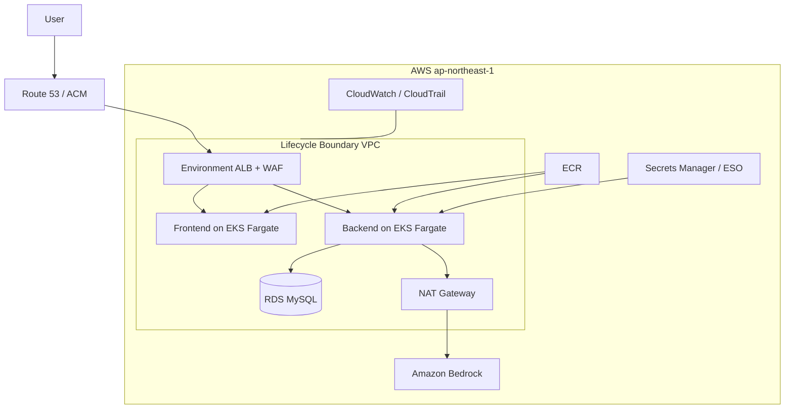
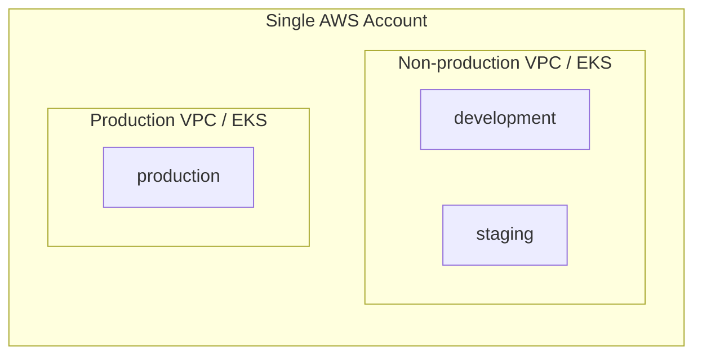
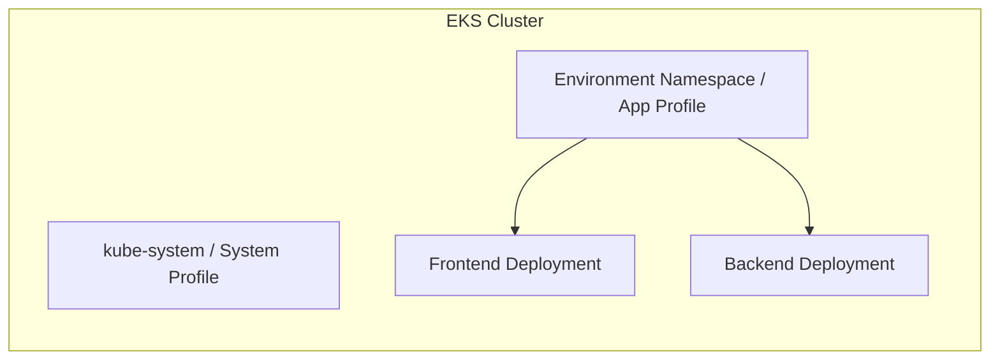
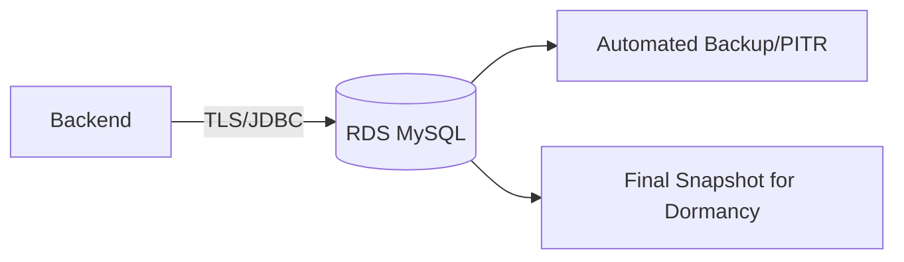
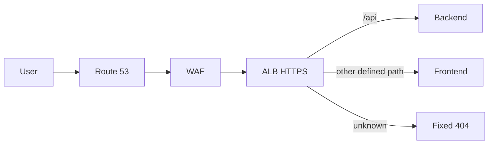
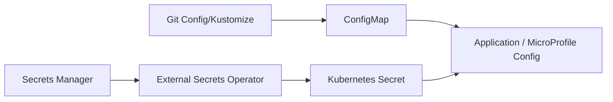
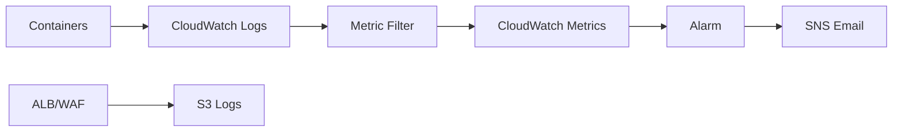
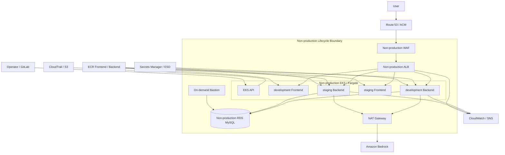
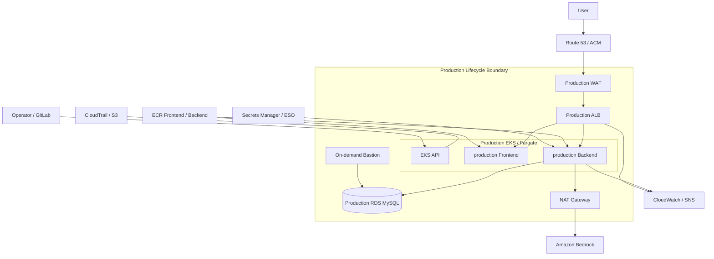
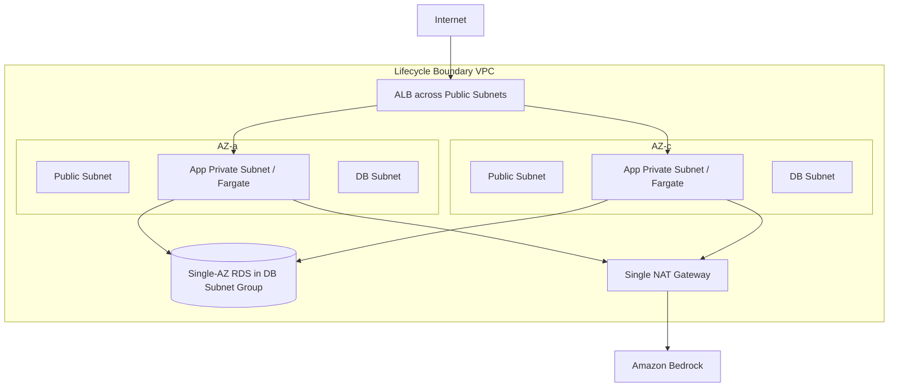

# Infrastructure Architecture

> [!NOTE]
> 本文書はポートフォリオ公開用のCopyです。実環境のIdentity、権限境界、管理経路、State、DeliveryおよびRecoveryに関する一部の詳細は、節または表単位で除外しています。

## 0. Change History

> [!NOTE]
> 公開版では、内部Trainにおける変更履歴と個別の設計判断記録を除外しています。

## 1. Infrastructure Overview

### 1.1 Infrastructure Purpose and Scope

本書は、Function DesignおよびSystem Architectureで定義されたDevMenuを、実行・接続・保護・監視・復元可能なAWS Infrastructureとして成立させる仕様を定義する。対象はdevelopment、staging、productionのNetwork、EKS/Fargate、RDS、Traffic、Security、Configuration、Observability、ProvisioningおよびLifecycleである。Applicationの機能、内部Architecture、API/UI/Table仕様は上位・後続設計を正とする。

### 1.2 Infrastructure Architecture Summary

- AWS東京Regionの単一Account内に、development/staging用Non-production Boundaryとproduction用Production Boundaryを構成する。
- BoundaryごとにVPC、EKS Cluster、RDSおよび公開ALBを分離し、developmentとstagingはNamespaceとSchemaを分離して共有基盤を利用する。
- FrontendとBackendはEKS on Fargateで実行し、RDS for MySQLへ永続化し、BackendはNAT Gateway経由でAmazon Bedrockを利用する。
- Terraform/Terragrunt、Helm、KustomizeとGitLab FreeのCI/CDで構築・変更し、State、Role、PipelineをLifecycle Boundary別に分離する。Production操作はProtectedなRelease Ref、Blocking Manual Job、保存PlanおよびAWS IAMによって制御する。
- 両Boundaryは非常設とし、未使用期間には課金の大きいResourceをDestroyして、State、Domain、Secret、Snapshot等から復元する。

### 1.3 Application and Infrastructure Mapping Overview

| Application / Service / Workload | Infrastructure Role / Requirement | High-Level Placement |
| --- | --- | --- |
| React Web Frontend | Public Web Entry、Static/SPA Runtime | EKS on Fargate Frontend Workload |
| Jakarta EE Backend | API Runtime、RDS/Bedrock接続 | EKS on Fargate Backend Workload |
| Shared History Data | Relational Persistence | Amazon RDS for MySQL |
| Bedrock Integration | Managed Generative AI | Amazon Bedrock Regional Endpoint |
| Infrastructure Operations | Build、Deploy、Management、Audit | GitLab CI/CD、SSM、CloudTrail、CloudWatch |

### 1.4 Infrastructure Architecture Diagram

Infrastructure全体の統合Mermaidは19.1を参照する。別形式のCloud Architecture PNGは、本Artifactレビュー後の`infrastructure-design` Post Stepで`infrastructure-architecture.png`へ配置する。

## 2. Environment Separation Architecture

### 2.1 Environment Definition and Purpose

| Environment | Purpose | Usage | Production Data |
| --- | --- | --- | --- |
| development | 日常開発・手動Deploy・動作確認 | Developer-controlled | 禁止 |
| staging | Integration Test、Release検証 | Production相当の検証 | 原則禁止。独立Test Dataを使用 |
| production | 公開機能・Production Verification | 必要期間だけActive | 許可 |

### 2.2 Environment Isolation Model

| Boundary | development | staging | production | Separation Policy |
| --- | --- | --- | --- | --- |
| AWS Account | Shared | Shared | Shared | 初回Trainは単一Account |
| VPC | Non-production | Non-production | Production | ProductionをNetwork分離 |
| EKS Cluster | Non-production | Non-production | Production | ProductionをCluster分離 |
| Namespace/Fargate Profile | development | staging | production | Environment単位で分離 |
| RDS Instance | Non-production | Non-production | Production | ProductionをInstance分離 |
| Schema/User/Secret | development専用 | staging専用 | production専用 | 相互参照禁止 |
| Lifecycle | non-production | non-production | production | Boundary別Manifest。Non-production内部のEnvironment固有ResourceのActivationは17.2 |

### 2.3 Infrastructure Sharing and Separation

| Infrastructure | Sharing Policy | Shared Between | Reason / Constraint |
| --- | --- | --- | --- |
| VPC/EKS/RDS/ALB | Shared | development/staging | 個人開発のCostと複雑性を抑制。Namespace/Schema/Hostで分離 |
| Production VPC/EKS/RDS/ALB | Dedicated | productionのみ | 非本番変更・障害の影響を遮断 |
| ECR Repository | Shared by component | All | 同一DigestをStagingからProductionへ昇格 |
| Bootstrap / Shared State Bucket | Shared | Bootstrap / Shared Stack | BootstrapおよびShared ResourceのStateを継続保持 |
| Non-production State Bucket | Dedicated | development/staging | Non-production Stateの影響範囲とAccessをProductionから物理分離 |
| Production State Bucket | Dedicated | productionのみ | Production Stateの影響範囲とAccessをNon-productionから物理分離 |
| Domain/CloudTrail | Project shared | All | Public Nameと監査の継続性 |
| Secret/Workload Role | Separated | Environment単位 | Credentialと権限の横断を防止 |

### 2.4 Network Isolation and Cross-Environment Connectivity

| Source Environment | Target Environment | Connectivity | Purpose / Constraint |
| --- | --- | --- | --- |
| development | staging | No direct route | 共有VPC内でもSGとNamespaceで直接通信を許可しない |
| non-production | production | No route | VPC Peering/Transit Gatewayなし |
| Management Client | 対象Environment RDS | SSM Port Forwarding | 対応BastionとRoleに限定 |

### 2.5 Data Isolation and Cross-Environment Data Policy

| Data Flow | Policy | Constraint |
| --- | --- | --- |
| production → non-production | 禁止 | Production Dataを検証へ複製しない |
| development ↔ staging | 禁止 | Schema/User/Credentialを分離 |
| Staging → Production Artifact | 許可 | Dataではなく検証済みImage Digestのみ昇格 |

### 2.6 Identity and Security Separation

Infrastructure変更、Application Deploy、Workload実行およびHuman OperationのIdentityを分離し、Environmentと責務を越えるAccessを許可しない。Production操作は検証済みArtifact、明示的な実行Gateおよび短期Credentialを前提とする。

> [!NOTE]
> 公開版では、Role構成、Protected Ref、Manual Job、MFA、Approval BoundaryおよびIdentity別State Accessの具体的な契約を除外しています。

### 2.7 External Service Environment Separation

| External Service | development | staging | production | Separation Policy |
| --- | --- | --- | --- | --- |
| Amazon Bedrock | ConfigでStub/Realを切替 | Real | Realのみ | ProductionでStub Fallback禁止。RoleはEnvironment別 |
| Public DNS/TLS | Subdomain | Subdomain | Root Domain | Record/IngressをEnvironment別に定義 |

## 3. Infrastructure Technology Stack and Tooling

### 3.1 Cloud Platform

| Scope | Platform | Purpose |
| --- | --- | --- |
| Project Infrastructure | AWS Public Cloud | Managed Serviceを優先した実行・Data・Network・運用基盤 |

東京Region（`ap-northeast-1`）へ集約し、Global Serviceを除いてMulti-region/Multi-cloudは採用しない。

### 3.2 Compute and Container Platform

| Workload Type | Orchestration / Platform | Compute | Container Runtime |
| --- | --- | --- | --- |
| Frontend | Amazon EKS | AWS Fargate | OCI Container/Nginx |
| Backend | Amazon EKS | AWS Fargate | OCI Container/Payara Micro |

### 3.3 Operating System and Infrastructure Runtime

| Target | OS / Runtime | Purpose |
| --- | --- | --- |
| EKS Workload | AWS-managed Fargate Runtime | Node OS管理をAWSへ委譲 |
| DB Bastion | Amazon Linux 2023 ARM64 | SSM Session Managerによる一時管理接続 |

### 3.4 Infrastructure as Code

| Technology | Scope | Purpose |
| --- | --- | --- |
| Terraform | AWS/EKS/IAM/RDS/Network | 宣言的Provisioning |
| Terragrunt | Environment/Stack Invocation | Input、Remote State、Dependencyの重複削減 |

Terragruntは薄いWrapperに限定し、独自抽象化層へ拡大しない。

### 3.5 Infrastructure Configuration and Deployment Tooling

| Tool | Scope | Purpose |
| --- | --- | --- |
| Helm Provider | AWS Load Balancer Controller、ESO | 公式ChartによるAdd-on導入 |
| Kustomize | Application Kubernetes Resource | Base/Environment Overlay管理 |
| kubectl | Manifest適用 | `diff -k`後に`apply -k` |

### 3.6 Infrastructure Tool and Component Dependencies

| Source | Dependency | Relationship / Constraint |
| --- | --- | --- |
| Terragrunt | Terraform Module/State | Stack Dependency順にPlan/Apply |
| Helm Add-on | EKS/IRSA | ClusterとIAM完成後に導入 |
| Kustomize Overlay | EKS/Add-on/ECR/Secret | Runtime基盤完成後に適用 |
| Production Deploy | Staging Result | 同一Image Digestの検証完了が必須 |

### 3.7 Version and Compatibility Policy

| Technology / Tool | Version / Range | Compatibility / Constraint |
| --- | --- | --- |
| EKS/Kubernetes | Standard Support対象Versionを実装時固定 | Extended Support常態化を避け、Staging後に更新 |
| RDS MySQL | 8.4 LTS、Minorを実装時固定 | JDBC/EclipseLink/Schema/Query検証後にProductionへ適用 |
| Terraform/Terragrunt/Provider | Lock Fileと制約で固定 | 更新時にPlan/Validation/Compatibility確認 |
| Helm Chart/Add-on | 検証済みVersionを固定 | Staging Runtime Verification後にProductionへ反映 |

### 3.8 Infrastructure Development and Delivery Technologies

| Category | Technology / Platform | Scope | Purpose |
| --- | --- | --- | --- |
| SCM/CI | GitLab Free | Primary Repository/Pipeline | MR、Protected Ref上のBlocking Manual Job、Scheduled Job |
| Mirror | GitHub | Source Mirror | Primary Deliveryには使用しない |
| EKS API Access Runner | Project専用Self-managed GitLab Runner | 開発端末 | Terraform Helm Provider、`SecurityGroupPolicy`適用およびApplication DeployのEKS API接続元を単一Egressへ限定 |
| Validation | TFLint/Trivy Config/Checkov | IaC | Style、Provider、Security Misconfiguration検査 |
| Image Scan | Trivy/Dockle/ECR Basic Scan | Container | 脆弱性・Image設定検査 |

## 4. Cloud and Infrastructure Resource Architecture

### 4.1 Infrastructure Resource Inventory

| Resource | Category | Role | Used By |
| --- | --- | --- | --- |
| VPC/Subnet/NAT/S3 Endpoint | Network | Public/Private/Data区画とEgress | EKS、RDS、ALB |
| EKS/Fargate | Compute | Frontend/Backend実行 | Application |
| RDS for MySQL | Data | Shared History永続化 | Backend |
| ALB/WAF/Route 53/ACM | Traffic/Security | Public Entry、Routing、TLS、Protection | User Traffic |
| ECR | Registry | Frontend/Backend Image | Build、EKS |
| Secrets Manager/ESO | Configuration | Secret正本とPod同期 | Backend |
| CloudWatch/CloudTrail/SNS | Observability/Audit | Log、Metric、Alert、管理監査 | Operator |
| S3 | State/Log | Terraform State、ALB/CloudTrail Log | Infrastructure |
| SSM Bastion | Management | Private RDS管理接続 | Operator |

### 4.2 Environment Resource Matrix

| Resource | development | staging | production | Sharing / Separation |
| --- | --- | --- | --- | --- |
| VPC/EKS/ALB/RDS | Non-production共有 | Non-production共有 | Production専用 | Production分離 |
| Namespace/Fargate Profile | 専用 | 専用 | 専用 | Environment分離 |
| WAF | Non-production ALB用 | Non-production ALB用 | Production ALB用 | Boundary別Web ACL。共有ALBのためdevelopment/staging双方へ適用 |
| ECR | Component Repository共有 | 同左 | 同左 | Digest昇格 |
| Secret/Role/Config | 専用 | 専用 | 専用 | Environment分離 |

### 4.3 Resource Responsibilities and Ownership

| Resource | Responsibility | Primary Consumer / Concern | Excluded Responsibility |
| --- | --- | --- | --- |
| EKS/Fargate | SchedulingとCompute | Application Runtime | Business Logic |
| RDS | Relational Persistence/Backup | Backend | Schema Evolution Strategy |
| ALB/WAF | TLS Entry/Routing/Managed Protection | Public Traffic | API Business Validation |
| Secrets Manager/ESO | Secret保管/配送 | Workload | Application独自Secret取得 |
| Terraform/Terragrunt | Resource Desired State | Infrastructure Executor | Application Manifest本体 |

### 4.4 Logical Resource Relationships

| Source Resource | Relationship | Target Resource |
| --- | --- | --- |
| Route 53/ACM | HTTPS Alias/TLS | ALB/WAF |
| ALB | Host/Path Routing | Frontend/Backend Service |
| Backend Pod | TLS/JDBC | RDS MySQL |
| Backend Pod | HTTPS/NAT | Amazon Bedrock |
| EKS Pod | Image Pull | ECR |
| ESO | Secret Sync | Secrets Manager |

### 4.5 Logical Cloud Infrastructure Diagram

1.4および19章を参照する。

## 5. Network Architecture

### 5.1 Network Topology

| Environment | Network / VPC | Region | Isolation / Relationship |
| --- | --- | --- | --- |
| development/staging | Non-production VPC | ap-northeast-1 | ProductionとRouteなし |
| production | Production VPC | ap-northeast-1 | Non-productionとRouteなし |

### 5.2 Address Space and Subnet Design

| VPC | Subnet | Type | AZ | CIDR | Purpose |
| --- | --- | --- | --- | --- | --- |
| Non-production | public-a/public-c | Public | 2 AZ | `10.10.0.0/24`, `10.10.1.0/24` | ALB、NAT |
| Non-production | app-a/app-c | Private | 2 AZ | `10.10.10.0/24`, `10.10.11.0/24` | Fargate、Bastion |
| Non-production | db-a/db-c | Private DB | 2 AZ | `10.10.20.0/24`, `10.10.21.0/24` | RDS |
| Production | public-a/public-c | Public | 2 AZ | `10.20.0.0/24`, `10.20.1.0/24` | ALB、NAT |
| Production | app-a/app-c | Private | 2 AZ | `10.20.10.0/24`, `10.20.11.0/24` | Fargate、Bastion |
| Production | db-a/db-c | Private DB | 2 AZ | `10.20.20.0/24`, `10.20.21.0/24` | RDS |

VPC CIDRはそれぞれ`10.10.0.0/16`、`10.20.0.0/16`とする。

### 5.3 Routing Architecture

| Route Table | Associated Subnet | Destination | Target | Purpose |
| --- | --- | --- | --- | --- |
| Public RT | Public | `0.0.0.0/0` | Internet Gateway | ALB公開、NAT Egress |
| App Private RT | App Private | `0.0.0.0/0` | Boundary内単一NAT Gateway | Outbound HTTPS |
| App Private RT | App Private | S3 Prefix | S3 Gateway Endpoint | ECR Layer/S3通信 |
| DB RT | DB | VPC Localのみ | Local | Internet Routeなし |

### 5.4 Ingress and Egress Architecture

| Traffic | Source | Destination | Entry / Exit | Network Path |
| --- | --- | --- | --- | --- |
| Public HTTPS | Internet | Frontend/Backend | Ingress | Route 53 → WAF/ALB → Fargate |
| Backend DB | Backend Pod | RDS | Internal | App Private → DB Subnet |
| Bedrock/API | Backend Pod | AWS Public Endpoint | Egress | App Private → NAT → HTTPS |
| DB Management | Developer Client | RDS | Management | SSM Port Forward → Bastion → RDS |

### 5.5 Private Connectivity and Endpoints

| Source | Target | Connectivity | Endpoint / Connection | Purpose |
| --- | --- | --- | --- | --- |
| App Private Subnet | Amazon S3 | Private Route | Gateway VPC Endpoint | S3 TrafficのNAT回避 |
| Developer Client | Bastion/RDS | SSM | Session Manager | Inbound/SSHなしの管理接続 |

ECR、CloudWatch Logs、STS、Secrets Manager、BedrockのInterface Endpointは初回Trainでは作成せずNATを使用する。

### 5.6 DNS and Name Resolution

| Zone / Domain | Type | Environment | Purpose |
| --- | --- | --- | --- |
| Base Domain | Route 53 Public Hosted Zone | Project shared | Production Rootと非本番Subdomain |
| Environment Host | Public Alias | development/staging/production | 対応ALBへRouting |
| VPC DNS | AWS-provided | Boundary別 | Workload/RDS/AWS Endpoint解決 |

RegistrarはRoute 53 Domainsとする。Domain購入と本人確認はConsoleで手動実施し、自動更新を有効化する。Zone/Record/ACM ValidationはTerraform管理、DNSSECは初回対象外とする。

### 5.7 Network Segmentation

Public、Application Private、Databaseの3層とする。ALB以外をInternetへ直接公開せず、Pod/RDS/BastionにPublic IPを付与しない。Environment/Component別Security Groupを主要制御とし、Network ACLはDefaultを維持する。

### 5.8 Network Connectivity Matrix

| Source | Destination | Protocol / Port | Policy |
| --- | --- | --- | --- |
| Internet | ALB | HTTPS/443、HTTP/80 Redirect | Allow |
| ALB SG | Frontend/Backend SG | Application Port | Allow |
| Backend SG | RDS SG | TLS/MySQL 3306 | Allow |
| Backend SG | External/AWS Service | HTTPS/443 | Allow through NAT |
| Frontend SG | Outbound | All | 初回のみ許容、実測後見直し |
| Bastion SG | RDS SG | TLS/MySQL 3306 | Environment一致時のみAllow |
| Cross-boundary | Other VPC | Any | No route/Deny |

### 5.9 Network Availability and Failure Considerations

Subnetは2 AZに配置するが、Cost優先でNAT GatewayとRDSはBoundaryごとに単一構成とする。NAT AZ障害およびSingle-AZ RDS停止を受容し、要件上昇時にAZ別NAT/Multi-AZ RDSを再検討する。

## 6. Compute and Container Platform Architecture

### 6.1 Compute and Container Platform Structure

2 EKS Cluster（Non-production/Production）とFargateだけを使用し、EC2 Node Group、Node AutoscalerおよびSelf-managed Runtimeを初回対象外とする。

### 6.2 Cluster Architecture

Non-productionとProductionに独立したEKS Clusterを配置し、Cluster管理面への接続元と認証主体を限定する。Kubernetes認証はAWS IdentityとEKS Access Controlを使用し、広域なPublic Accessや恒久Credentialを前提としない。

> [!NOTE]
> 公開版では、EKS API Endpoint、許可CIDR、Runner、Preflight、Access EntryおよびDevelopment Applyの具体的な接続・認証手順を除外しています。

### 6.3 Node and Compute Architecture

各Clusterに`kube-system`用System Fargate Profileを一つ、Environment NamespaceごとのApplication Profileを一つ配置する。Profileは2 AZのApp Private Subnetを使用する。

### 6.4 Infrastructure Runtime

CoreDNS、AWS Load Balancer Controller、External Secrets OperatorとFargate Log RouterをCluster共通Runtimeとする。Add-onは専用ServiceAccount/IRSAを使用する。

### 6.5 Namespace Architecture

| Cluster | Namespace | Purpose |
| --- | --- | --- |
| Non-production | `kube-system` | System/Add-on |
| Non-production | `development` | Development Application |
| Non-production | `staging` | Staging Application |
| Production | `kube-system` | System/Add-on |
| Production | `production` | Production Application |

### 6.6 Kubernetes Resource Architecture

ApplicationはDeployment、ClusterIP Service、Ingress、ConfigMap、ExternalSecret、Secret、ServiceAccount、ResourceQuota、LimitRangeを使用する。Infrastructureは`SecurityGroupPolicy`を使用し、Fargate PodへComponent別Security Groupを割り当てる。Application固有ResourceはKustomize Base/Overlay、Add-onはTerraform Helm Provider、`SecurityGroupPolicy`はTerraformのEnvironment Resource Stackで管理する。

Infrastructureは上記に加え、BoundaryごとのALB維持用Ingressを所有する。同IngressはApplication用Ingressと区別し、9.2および16.5の管理・保持規則に従う。

### 6.7 Workload Execution Models

Frontend/Backendは常駐Deploymentとし、Batch/CronJobは初回対象外とする。通常Replicaは各1、Rolling Updateは`maxUnavailable: 0`、`maxSurge: 1`とする。

### 6.8 Pod and Workload Baseline

- Requests/Limits、Startup/Readiness/Liveness Probeを必須とする。
- `terminationGracePeriodSeconds`とALB Deregistration Delayを30秒に揃える。
- Secret ValueをImage/Manifestへ含めず、標準出力/標準エラーをCloudWatchへ送信する。
- 単一ReplicaのためPDBは設定せず、2 Replica以上への拡張時に導入する。

### 6.9 Compute and Container Platform Diagram

## 7. Application and Workload Placement

### 7.1 Application and Workload Inventory

| Workload | Type | Infrastructure Dependency |
| --- | --- | --- |
| Frontend | Long-running Web Container | ALB、ECR、ConfigMap |
| Backend | Long-running API Container | ALB、RDS、Bedrock、Secrets Manager |

### 7.2 Environment Placement Matrix

Frontend/Backendはdevelopment、staging、productionの各Namespaceへ同一構造で配置し、Image Digest、Host、Configuration、Secret ReferenceだけをOverlayで差し替える。

### 7.3 Workload-to-Platform Mapping

両WorkloadをEKS Deployment/ClusterIP ServiceとしてFargateへ配置する。FrontendからBackendへのBrowser通信は同一Origin ALB経由とし、Pod間直接通信を前提にしない。

### 7.4 Cluster and Namespace Placement

2.2および6.5の境界を正とする。Production WorkloadをNon-production Clusterへ配置せず、development/staging間でもNamespace、Role、Secret、Schemaを共有しない。

### 7.5 Compute and Node Placement

Application Profileは対応NamespaceだけをSelectorとする。Profile固有LabelへのManifest依存を避け、Namespaceを安定したPlacement Contractとする。

### 7.6 Workload Isolation and Co-location

Frontend/Backendは同一Environment Namespaceに配置するが、Deployment、ServiceAccount、Security Group、Image RepositoryをComponent別に分離する。Frontend/Backend Podはそれぞれ専用ServiceAccountを使用し、ServiceAccountへ安定した`devmenu.io/component=frontend`または`devmenu.io/component=backend` Labelを設定する。`SecurityGroupPolicy`は`serviceAccountSelector`でこのLabelを選択し、Environmentに対応するComponent SGを割り当てる。

### 7.7 Application and Workload Placement Diagram

6.9および19章を参照する。

## 8. Data and Messaging Infrastructure

### 8.1 Persistence Infrastructure Mapping

| Data | Infrastructure | Environment Policy |
| --- | --- | --- |
| Shared History | RDS for MySQL | Schema/User/CredentialをEnvironment別に分離 |
| Bootstrap / Shared Terraform State | Bootstrap / Shared S3 Backend | BootstrapおよびShared Stack別Key |
| Non-production Terraform State | Non-production S3 Backend | 共通基盤Stack別Keyとdevelopment／staging固有Resource別Key |
| Production Terraform State | Production S3 Backend | Production Stack別Key |
| Logs/Audit | CloudWatch Logs/S3 | Environment/用途別保持 |

### 8.2 Database Infrastructure

- RDS for MySQL 8.4 LTS、Single-AZ、`db.t4g.micro`、gp3 20 GiB、Autoscaling上限100 GiBを初期値とする。
- Public Accessを無効化し、2 AZのDB Subnet GroupとBackend/Bastion SGからのTLS接続だけを許可する。
- `utf8mb4`/`utf8mb4_0900_ai_ci`、UTCをParameter Group、Schema、JDBC、Runtimeで明示する。
- Master、Application、Migration Userを分離し、EnvironmentごとのSchemaだけへ最小権限を付与する。
- Non-production/ProductionともDeletion Protectionは初回Trainでは無効とし、Role、Plan Review、State境界で誤削除を防ぐ。
- Non-production削除時はLifecycle Manifestの`database_preservation`により`final-snapshot`または`recreate`をDormancyごとに明示選択する。Production削除時は一意なFinal Snapshotを必須とする。
- Auto Minor Version Upgradeを有効にし、Maintenance Window内で適用する。Minor VersionはNon-productionでJDBC、EclipseLink、Migration、代表Queryを検証後、同じVersionをProductionへ適用する。

### 8.3 Cache Infrastructure

Application Cache用Infrastructureは初回Trainでは使用しない。

### 8.4 Object Storage Infrastructure

Business Data用Object Storageは使用しない。S3はTerraform State、ALB/CloudTrail Log等のInfrastructure Dataだけに使用する。

### 8.5 Messaging Infrastructure

Application Messaging/Queue Infrastructureは初回Trainでは使用しない。SNSは運用Alert通知だけに使用する。

### 8.6 Environment Separation and Placement

Non-production RDSはdevelopment/stagingでInstanceを共有してSchema/Userを分離し、Production RDSは専用Instanceとする。Snapshot、SecretおよびConnection PermissionもBoundaryを跨がない。

### 8.7 Backup, Replication and Recovery Implementation

- Automated Backup: Non-production 1日、Production 7日。Production稼働中はPITRを有効化する。
- Production稼働中の運用目標はRPO 15分/RTO 4時間。SLAではない。
- Production Restore Testは初回Release前と、Active期間中は四半期ごとに隔離一時Instanceで行う。
- Dormancy用Snapshotの取得・命名・保持・復元単位は`non-production`または`production`のLifecycle Boundaryとする。development/stagingを個別Snapshotとして扱わない。
- ProductionはDormancy前のFinal Snapshotを必須とし、新Snapshotの復元確認まで旧確認済みSnapshotを保持する。定常保持は最新確認済み1世代とする。
- Non-productionで`database_preservation=final-snapshot`を選択した場合は共有RDS Instance全体のFinal Snapshotを取得し、Productionと同じ確認済み世代交代を行う。
- Non-productionで`database_preservation=recreate`を選択した場合はSnapshotを省略し、Schema Migrationと承認済みSeed/Test Dataを再生成元として記録する。復元時はMigration、Data投入、Backend接続およびEnvironment間Schema分離を検証する。

### 8.8 Data and Messaging Infrastructure Diagram

## 9. Traffic Management and External Connectivity

### 9.1 Traffic Entry and Exposure Architecture

Internet-facing ALBをBoundaryごとに一つ配置する。Route 53 AliasとACM Certificateを使用し、HTTPはHTTPSへRedirectする。ALB以外のApplication/Data Resourceは非公開とする。

### 9.2 Load Balancing Architecture

AWS Load Balancer ControllerがIngressからALB/Target Groupを管理する。TLSはALBで終端しPodへはVPC内HTTP、TLS Policyは`ELBSecurityPolicy-TLS13-1-2-Res-PQ-2025-09`、Idle Timeoutは120秒、Deregistration Delayは30秒とする。

BoundaryごとにInfrastructure所有の恒久Ingressを`kube-system` Namespaceへ配置する。明示的なIngressGroup名はNon-productionで`devmenu-non-production`、Productionで`devmenu-production`とし、同じBoundaryのApplication用および検証用Ingressが参加する。恒久IngressはWorkloadやServiceを参照せず、HTTPSのDefault Actionを固定404とする。ALB共通のScheme、Subnet、Security Group、HTTP/HTTPS Listener、HTTPS Redirect、Certificate、TLS Policy、WAFおよびALB属性はInfrastructureが管理する。Application未配置時および検証用Ingress削除後も恒久Ingressを残し、同じALBとそのDNS参照を維持する。恒久とはBoundaryのActive期間中の保持を意味し、Dormancy時は削除・Restore時は再作成する。

Application用Ingressは同じGroupのHTTPS Listenerへ、担当EnvironmentのHostとServiceへのRoutingを追加する。`listen-ports`はHTTPS 443を明示して共通Listenerに参加し、共通設定を上書きしない。Backendは`group.order: 10`、Frontendは`group.order: 20`とし、BackendのAPI Pathを先に評価する。恒久Ingressには業務Host/Pathの包括Ruleを置かず、Default Actionだけを持たせる。Target Group固有のHealth Check等はApplication用Ingressで本書の規定に従って設定する。

Non-production/Production ALBともDeletion Protectionは初回Trainでは無効とする。Access LogとConnection Logを専用S3 BucketのLifecycle Boundary別Prefixへ保存し、SSE-S3、Public Access Block、TLS必須Policy、ALB Log Delivery限定Writeを設定する。Non-production LogではHost名からdevelopment/staging Trafficを識別するが、Retentionは分離しない。

### 9.3 Application Traffic Routing

Environment HostとPathを明示Ruleで定義し、Backend API PathをFrontend包括Pathより優先する。未知Host/PathはALB固定`404`とし、Applicationへ転送しない。

### 9.4 API Gateway and Edge Architecture

API Gateway、CloudFront、CDN Cache、Edge Functionは初回Trainでは使用しない。Route 53からALBへ直接Routingする。

### 9.5 DNS Traffic Routing

ProductionはBase Domain Root、development/stagingはSubdomainを使用する。Dormancy中は対象ALB Aliasを削除する。Non-productionは対象EnvironmentのInfrastructure VerificationにTemporary Verification Workloadを使用でき、Infrastructure Integration完了時にApplicationを受け入れ可能な公開経路を揃える。Production再公開では17.7の順序に従い、DNS公開前のApplication Production Verification後にAliasを復元し、Public経路のInfrastructure Verificationを行う。

### 9.6 External System Connectivity

利用者向けTrafficと管理Trafficを分離し、利用者はPublic HTTPSだけを使用する。Infrastructure、KubernetesおよびDatabaseの管理接続は、対象を限定した認証済み経路から実施する。

> [!NOTE]
> 公開版では、Runner種別、Egress、OIDC / AssumeRole、EKS APIおよびDatabase管理接続の具体的な経路を除外しています。

### 9.7 External Service Connectivity

BackendはNAT Gateway経由で東京RegionのAmazon Bedrock Public EndpointへHTTPS接続する。Interface Endpoint/Proxyは使用せず、IRSA RoleをNova Lite Invokeに限定する。

### 9.8 Deployment Traffic Switching

Rolling UpdateでReadyな新PodへTargetを切り替える。自動Blue/Green/Canaryおよび自動Rollbackは初回対象外とする。

### 9.9 Traffic Management Diagram

## 10. Infrastructure Security and Identity

### 10.1 Infrastructure Trust Boundaries

Trust BoundaryはInternet/ALB、Non-production VPC、Production VPC、EKS Namespace、Database、Management Plane、GitLab CI/CDおよびAWS Serviceに分ける。Production VPCとNon-production VPCの直接経路は持たない。

### 10.2 Infrastructure Identity Model

Human、CI/CDおよびWorkloadのIdentityを分離し、最小権限、短期CredentialおよびEnvironment境界を適用する。各Identityは承認された責務だけを持ち、通常操作、初期確立およびRecoveryの権限経路を共用しない。

> [!NOTE]
> 公開版では、Identity種別、Role構成およびGuardrailの具体的な対応を除外しています。

### 10.3 IAM Architecture

IAM ResourceはInfrastructure as Codeで管理し、Role、Identity Policy、Permissions BoundaryおよびTrust Policyの組合せにより、責務とLifecycle Boundaryを越える操作を拒否する。通常のDevelopment、Integration、Productionおよび限定Recoveryは、それぞれ独立した権限経路を使用する。

> [!NOTE]
> 公開版では、AWS Account、ARN、Role / Policy名、Action Allowlist、Permissions Boundary、PassRole、Trust Conditionおよび初期Identity確立手順の詳細を除外しています。

### 10.4 Workload Identity and Cloud Access

Frontend、Backend、AWS Load Balancer Controller、External Secrets Operatorへ専用ServiceAccountを割り当てる。Backend、Controller、ESOは用途別IRSA Roleを使用し、BackendはEnvironment別にNova Lite Invokeだけ、ESOは対象Secret取得だけ、Controllerは対応Cluster/Resource操作だけを許可する。Frontend/Backend ServiceAccountのComponent LabelはWorkload Identityと`SecurityGroupPolicy`の安定した選択境界として共用する。EKS FargateではEKS Pod Identityを使用しない。

AWS Infrastructureはdevelopment、stagingおよびproductionごとにBackend専用IRSA RoleとRole固有PolicyをTerraformで作成する。Trustは対応するEKS OIDC Provider、NamespaceおよびBackend ServiceAccountへ限定する。development / stagingにはNon-production Workload Boundary、productionにはProduction Workload Boundaryを作成時から設定する。InfrastructureはEnvironment別Role ARNをHandoffし、Backend担当は対応ServiceAccountへの設定、Application DeploymentおよびBedrock接続検証を担う。

### 10.5 Kubernetes Authorization and Isolation

EKS Access Entry/API Modeを使用する。Development Deploy Role、Staging Deploy Role、Production Deploy Roleは対応NamespaceのDeployment、Service、ConfigMap、ExternalSecret等に限定し、Cluster Scopeおよび他Namespaceを変更できないRBACとする。

### 10.6 Network Security Controls

ALB維持用Ingressは`kube-system`に置き、Application Deploy Roleからの変更を許可しない。IngressGroupは認可境界ではなく、Ingress作成権限を持つ主体が他のRuleや共通設定へ影響できるため、同じGroupへ参加する主体はProjectの信頼された運用主体に限定する。Application Deploy前にRendered IngressのGroup名、担当EnvironmentのHost、Path、Rule順序および共通Annotation非上書きを検査する。この検査とReviewをNamespace RBACと併用し、IngressGroupやNamespace RBACだけで共有ALB上のRoutingを完全分離できるとは扱わない。

- ALB SGはInternetから80/443、Pod SGは対応ALB SGからApplication Portだけを許可する。
- Backend SGはDNS、対応RDS SG/MySQL、必要HTTPS Egressだけを許可する。
- RDS SGは対応Backend SGとBastion SGだけを許可する。
- Frontend Egressは初回Trainでは全許可とし、侵害時Riskを受容して実測後に縮小する。
- EnvironmentごとにFrontend/Backend用`SecurityGroupPolicy`を作成し、専用ServiceAccount Labelを`serviceAccountSelector`としてComponent SGを割り当てる。SG IDは同じTerraform Environment Resource Stackで作成したOutputを使用し、Manifestへ固定値を埋め込まない。
- Component SGにはFargate PodがKubernetes Control Plane、kubeletおよびCoreDNSと通信するための必須Ruleを明示し、Cluster SGの広いDefault Egressを無条件に併用してBackend Egress制限を迂回しない。
- `SecurityGroupPolicy`は新規ScheduleされたPodへ適用されるため、PolicyまたはSG変更後に対象DeploymentをRolling Restartし、Pod AnnotationとENIのSecurity Groupから期待するComponent SGの適用を確認する。
- Default NACLを維持し、主要制御をSGへ集約する。

### 10.7 Edge and Application Protection

Non-production/Productionに独立WAF Web ACLを関連付け、`AWSManagedRulesCommonRuleSet`、`AWSManagedRulesKnownBadInputsRuleSet`、`AWSManagedRulesAmazonIpReputationList`を使用する。Non-production Web ACLは共有ALB全体へ適用されるため、development/staging双方のTrafficを同じRuleで検査・記録する。Staging Trafficを用いたCount検証 → 誤検知調整 → Non-production Block → Production Blockの順に昇格し、Non-production Block化がdevelopmentにも作用することを変更前に確認する。対応可能なManaged Rule Group Versionは検証済みVersionを固定する。Custom/Rate-based RuleはProduct Requirement変更なしに追加しない。WAF LogはLifecycle Boundary別CloudWatch Log Groupへ送り、Host名で非本番Environmentを識別し、機密性を持つRequest部分をRedactする。

### 10.8 Infrastructure Encryption and Key Management

- Public TLSはACM、Backend-RDSはServer Certificate検証付きTLSを必須とする。
- RDS/ Snapshotは`aws/rds`、Secrets Managerは`aws/secretsmanager`、S3/CloudWatch/ECRはService標準暗号化を使用する。
- 初回TrainではCustomer Managed KMS Keyを作成しない。

### 10.9 Resource Access Control Matrix

Resource AccessはEnvironment、責務、Resource所有者および実行Phaseに基づいて分離する。Human、PipelineおよびWorkloadには共通の広域権限を付与せず、必要な操作と対象Resourceの積集合として許可する。

> [!NOTE]
> 公開版では、実行主体とResource / Actionの具体的な対応表を除外しています。

### 10.10 Temporary Development Authorization

通常のDevelopment権限だけでは完了できない一時的な構築操作には、Task単位の明示的なユーザー承認、必要最小限の権限、対象と停止条件の事前定義、非機密な実行記録および作業後の一時認可Resource撤去を要求する。恒久権限への暗黙的な追加やTask間再利用は行わない。

> [!NOTE]
> 公開版では、Authorization Plan、Policy、Session、Resource-based Policy確認、Cleanupおよび異常終了時の具体的な運用手順を除外しています。

## 11. Configuration, Secrets and Certificates

### 11.1 Configuration Classification

| Classification | Example | Source |
| --- | --- | --- |
| Non-secret Environment Configuration | Host、Bedrock Mode、Timeout | Git/Kustomize ConfigMap |
| Secret | DB Credential | AWS Secrets Manager |
| Certificate | Public TLS | ACM |
| Dynamic Infrastructure Value | Endpoint/Resource ID | Terraform Output/Handoff |

### 11.2 Configuration Inventory and Source

Environment別設定はKustomize Overlay/ConfigMap、Secret ValueはSecrets Manager、Kubernetes参照はExternalSecret、Domain/TLSはRoute 53/ACM、Infrastructure値はTerraform Outputを正とする。Payara固有設定管理を正本にしない。

### 11.3 Configuration Management and Distribution

ApplicationはMicroProfile ConfigからConfigMap/Secretを参照する。ConfigMapはKustomize Generatorの内容HashでPod Template変更を発生させ、変更時にRolling Updateする。

### 11.4 Secret and Credential Management

SecretはEnvironment/用途別に分け、Master、Application、Migration Credentialを分離する。Repository、Image、Manifest、Terraform State/Output、LogへSecret Valueを保存・表示しない。

GitLab CI/CD Variableを使用する場合はProtected Refだけへ提供されるProtected Variableとする。GitLab FreeではEnvironment ScopeによるProduction分離を前提とせず、Production権限はGitLab OIDC TrustとAWSのBoundary別Roleで強制する。AWSへのLong-lived Access KeyはCI/CD Variableへ保存しない。

### 11.5 Secret Injection and Workload Integration

ESOがIRSAでSecrets ManagerからKubernetes Secretへ同期し、ApplicationはMicroProfile Configから参照する。Deploy Roleに`GetSecretValue`を付与せず、ESOだけを取得主体とする。

### 11.6 Rotation and Configuration Update Strategy

- Master CredentialはRDS-managed方式とし、RDSによる既定7日周期の自動Rotationを許容する。独自のRotation Scheduleは追加しない。
- Master CredentialのRotationはRDS管理境界内で完結させ、Application用ESO同期、Application Deployment更新およびApplication CredentialのRotation手順へ混在させない。Bootstrap / 管理用途で現在のManaged Secret参照と利用可否を確認する。
- Application Credentialは初回Trainでは自動Rotationせず、Release前、漏えい時、権限変更時等に手動実施する。新Credential発行、Secrets Manager Secret更新、ESO同期確認、Secret VersionId AnnotationによるDeployment更新、DB接続確認、旧Credential無効化の順を守る。
- Migration Credentialは初回Trainでは自動Rotationせず、必要時に手動実施する。Database Migrationの利用主体と接続確認を完了してから旧Credentialを無効化し、Application用ESOまたはDeployment更新を必須工程としない。
- ESOの通常同期は`refreshInterval` 1時間とし、Application Credentialの手動Rotation時はRefresh Triggerで即時同期する。Secret Value HashをCIで計算せず、Secret VersionIdを非機密MetadataとしてPod Template Annotationへ設定する。
- いずれのCredentialもSecret ValueをRepository、Image、Manifest、Terraform State / Output、SQL File、Command Line、Shell History、Log、EvidenceまたはHandoffへ保存・表示しない。

### 11.7 Certificate and TLS Asset Management

ACM Public CertificateはBase Domain/必要なWildcardをDNS Validationで発行し、自動更新可能なValidation Recordを保持する。期限切れ・検証不能Certificateを継続使用しない。Dormancy中もHosted Zone/Validation Recordを保持する。

### 11.8 Environment-specific Configuration

Environment OverlayはNamespace、Host、Image Digest、Replica、Resource、Config/Secret Referenceだけを差分化する。developmentはPropertyでStub/Real Bedrockを切替可能、staging/productionはRealを使用する。

### 11.9 Configuration and Secret Flow

## 12. Resource, Performance and Scaling Architecture

### 12.1 Resource Requirements and Sizing

初期Sizeは個人開発と基本動作確認を対象とし、負荷実測後に変更する。Cost Guardrailを優先し、本番高可用・高負荷Capacityを初回完了条件としない。

### 12.2 Workload Resource Allocation

| Workload | CPU Request / Limit | Memory Request / Limit |
| --- | --- | --- |
| Frontend | `250m` / `500m` | `512Mi` / `1Gi` |
| Backend | `500m` / `1` | `1Gi` / `2Gi` |

各NamespaceのResourceQuotaはRequests `2 CPU/4Gi`、Limits `4 CPU/8Gi`、Pod 10。LimitRangeはContainer最小`50m/64Mi`、最大`2 CPU/4Gi`、Default Request`250m/512Mi`、Default Limit`1 CPU/2Gi`とする。Manifestで明示値を必須とする。

### 12.3 Workload Replica and Concurrency

通常ReplicaはFrontend/Backend各1。両Deploymentの同時SurgeをQuota内に収容する。単一Replica障害・Maintenance時の停止を受容する。

### 12.4 Workload Auto Scaling

HPAは使用しない。Latency、CPU/Memory、ConcurrencyおよびCost実績からReplica/HPA導入を再判断する。

### 12.5 Node and Compute Capacity

Fargate課金SizeはContainer Requests合計とFargate追加Memoryで決まるため、RequestsをCapacity/Cost見積りの基準とする。Node Capacity管理はAWSへ委譲する。

### 12.6 Infrastructure Auto Scaling

ALB、Fargate、RDS Storage AutoscalingのManaged Capabilityを利用する。RDS Compute自動ScalingとCluster Autoscalerは使用しない。

### 12.7 Data and Messaging Capacity

RDS gp3は20 GiB、Autoscaling上限100 GiB。拡張後は縮小できないため、Free Storage AlarmとCostを監視する。Application Messaging Capacityは該当しない。

### 12.8 Environment-specific Capacity

初回値は全Environmentで揃え、Development/Stagingの実測からProduction反映前に調整する。Productionだけ未検証Sizeへ変更しない。

### 12.9 Capacity Constraints and Bottlenecks

単一NAT、Single-AZ RDS、単一Replica、`db.t4g.micro`が主要Constraintである。CPU Throttling、OOM、DB Connection/Storage、ALB Response Time、Bedrock Latencyを変更判断に使用する。

### 12.10 Cost Management

- Cost Allocation Tagを有効化し、Project、Environment、Component別にCost Explorerで確認する。
- AWS Budgetsは月次Actual Costの50%、80%、100%でSNS Email通知し、Resourceを自動停止・削除しない。金額はEnvironment Configurationとして注入する。
- Dormancy後は請求明細を確認し、想定外の課金Resourceが残っていないことをEvidence化する。

## 13. Availability, Recovery and Infrastructure Health

### 13.1 Availability Requirements Mapping

恒久稼働と本番運用水準の高可用性は初回Trainの完了条件ではない。Active期間中の基本Availability、Backup、復元可能性および明示的Dormancy/Restoreを対象とする。

### 13.2 Resource Redundancy and Failure Domains

VPC Subnet/EKS Fargate配置は2 AZとするが、RDSとNATは単一構成、Applicationは単一Replicaである。ALB/EKS Managed Plane以外の完全冗長化は行わない。

### 13.3 Failover Architecture

自動Region/AZ/Database Failoverは設けない。障害時はManaged Service回復、Pod再配置、Snapshot RestoreまたはIaC再構築を手動判断する。

### 13.4 Infrastructure Health Model

EKS/Pod/Target/RDS/Application/External Serviceを分離して観測する。Bedrock障害だけでBackend PodをNot Readyにせず、Application Error/Latencyとして扱う。

### 13.5 Readiness, Liveness and Health Check Configuration

- Backend Startup: 10秒間隔、Failure 30（最大5分）、Timeout 3秒。Readiness: 10秒間隔、Failure 3、Timeout 10秒。Liveness: 30秒間隔、Failure 3、Timeout 3秒。
- Frontend Startup: 5秒間隔、最大1分。Readiness 10秒、Liveness 30秒、Timeout 3秒。
- ALB Health: 30秒間隔、Healthy/Unhealthy各2。Backend向けは`/health/ready`を使用しTimeout 10秒、Frontend向けはTimeout 5秒。認証不要の軽量Endpointを使用し、機密/詳細Dependencyを返さない。
- Backend Readinessは共通DataSourceのTimeout設定を使用する。Connection取得と接続検証を含む応答全体が10秒以内に完了する保証は設けず、監視側TimeoutもHealth Check失敗として扱う。Backend側の処理終了とConnection解放を検証する。

### 13.6 Infrastructure Recovery Strategy

Active時はTerraform/Kustomize再適用、Pod再配置、RDS PITRを使用する。Dormancy時はNon-production復元 → SourceからImage再Build/Scan → Staging検証 → Production Infrastructure/RDS復元 → Production Verification → DNS公開の順とする。新変更を伴わない再開では、17.7の運用Restore経路でRelease済み構成のstagingを復元し、Staging検証を行う。Current Trainの新変更を伴う再開では、同節のPhase進行条件に従う。

### 13.7 Infrastructure Rollback Strategy

InfrastructureはReview済みPlan/Sourceへ戻して再Plan/Applyする。Applicationは直前の検証済みDigestをKustomizeで再適用する。Schema非互換時はRollbackせずExpand/Contractに従ってRoll-forwardする。

### 13.8 Data Recovery Infrastructure

Production Active時は7日PITR、Dormancy時は最新確認済みFinal SnapshotをRecovery Pointとする。Dormancy再公開目標は復元判断から1営業日以内でありSLAではない。

### 13.9 Failure and Recovery Matrix

| Failure | Impact | Recovery |
| --- | --- | --- |
| Pod Failure | 単一Workload停止 | Fargate再配置/Image Pull |
| RDS/AZ Failure | DB/API停止 | Managed RecoveryまたはSnapshot/PITR Restore |
| NAT Failure | External/AWS API接続停止 | NAT再作成/IaC Apply |
| Bad Deploy | Readiness/Smoke失敗 | Evidence取得後Digest Rollback/Forward |
| Boundary Loss | Environment停止 | Terraform/TerragruntとSnapshotから再構築 |
| Dormancy | 意図的停止 | Lifecycle Manifestに従うRestore Procedure |

## 14. Environment Access and Management Architecture

Environmentへの管理Accessは通常のApplication Trafficから分離し、承認された管理主体、短期Credential、監査可能な経路および対象を限定した操作によって実施する。管理Resourceは常設を前提とせず、必要な期間と用途に限定する。

> [!NOTE]
> 公開版では、Bastion、Session、実行Tool、接続経路、Identity要件、Auditおよび管理Resource Lifecycleの具体的な構成と手順をSection単位で除外しています。

## 15. Observability Architecture

### 15.1 Observability Scope and Signals

Application Log、EKS Control Plane Log、ALB/WAF Log、RDS/ALB Metrics、Kubernetes/Target Health、CloudTrailを対象とする。Container Insights、Managed Prometheus/Grafana、Distributed Tracingは初回対象外とする。

### 15.2 Metrics Architecture

AWS標準Metricsに加え、Backend JSON Metric EventをCloudWatch Logs Metric FilterでStaging/Production Custom Metricへ変換する。Dimensionは`Environment`と有限な`Operation`だけとし、`proposal`、`history-create`、`history-list`等の安定名を使用する。Request ID/Input/Error等を含めない。

BackendとInfrastructureは次のMetric Event Contractを共有する。1 Eventは`eventType="application-metric"`、`metric`、`value`（非負の数値）、`environment`、`operation`を持つ1行のJSONとする。`metric`は下表のCustom Metric名を使用する。InfrastructureはEnvironment別Backend Log Groupに各MetricのFilterを定義し、`eventType`と`metric`で選択して`value`をNamespace `DevMenu/Backend`の同名Custom Metricへ変換する。Dimensionは`Environment ← environment`、`Operation ← operation`とする。

| Metric Event / Custom Metric | Unit | Event Value / Measurement Boundary | Operation |
| --- | --- | --- | --- |
| `ApiRequestCount` | Count | Backend APIが受け付けたRequestごとに`1` | 対象APIの固定名 |
| `ApiErrorCount` | Count | 最終的にError ResponseとなったRequestごとに`1` | 対象APIの固定名 |
| `ApiLatency` | Milliseconds | Request受付からResponse生成完了までの経過時間。成功・Errorの双方を対象とする | 対象APIの固定名 |
| `BedrockCallCount` | Count | Applicationから生成Portへの依頼ごとに`1` | `proposal` |
| `BedrockFailureCount` | Count | 技術的失敗、InvalidResponseまたは生成Contentの構造検証不成立となった生成依頼ごとに`1` | `proposal` |
| `BedrockLatency` | Milliseconds | Port呼出し開始からResult／Exception受領までの経過時間。Real時はSDK内Retry・待機を含む | `proposal` |
| `BedrockApplicationRetryCount` | Count | 応答不成立による追加生成依頼ごとに`1`。初回を除き一注文最大2回 | `proposal` |
| `HistorySaveFailureCount` | Count | 成立提案の保存Transaction／Commit失敗ごとに`1` | `history-create` |

Countは期間内Sum、Latencyは期間内Average／Maximumで確認する。累積CounterをEvent Valueへ出力しない。OperationはApplicationの固定Mappingで管理し、URL中のID、入力値、Request ID、Error Codeを含めない。

生成計測の正本は[課題候補生成External Interface Specification](details/api/practice-candidate-generation-external-interface-spec.md) 9章 Measurement Boundaryおよび[課題提案API Specification](details/api/practice-proposal-api-spec.md) Step 3.5／4.2とする。生成MetricはReal／Stub共通のPort境界で計測し、Adapterで二重計上しない。SDK内部Retryは独立Metricにせず、SDK内で回復した失敗も失敗数へ含めない。再生成成功でも先行する生成依頼の失敗数は取り消さず、最終API Error数とは分離する。履歴保存失敗は同API Step 5.3に従い、提案成功を維持したまま独立計上する。原因詳細はLogで扱う。

Applicationは全Environmentで同じEvent Contractを使用する。developmentはLogで確認し、Custom Metricへの変換はstaging／productionに限定する。

### 15.3 Logging Architecture

Fargate Log RouterでContainer標準出力/標準エラーをEnvironment/Component別CloudWatch Log Groupへ送る。Backendは1 Event 1 JSONとRequest IDを使用し、Credential、利用者入力、生成内容を既定で記録しない。ALB Access/Connection LogはS3へ保存する。

両EKS ClusterでControl Plane Logの`api`、`audit`、`authenticator`を有効化する。`controllerManager`と`scheduler`は初回Trainでは無効とし、調査要件が生じた場合に見直す。参照権限は運用・監査Roleに限定する。

### 15.4 Distributed Tracing Architecture

初回Trainでは導入しない。Request IDとStructured Logで追跡し、複数Service化または追跡不足が明確になった場合に再検討する。

### 15.5 Telemetry Collection and Processing

Fargate Log Router、CloudWatch Logs、Metric Filter、AWS標準Metricsを使用し、ADOT/Sidecar Agentを導入しない。

### 15.6 Telemetry Flow

### 15.7 Alerting Architecture

ProductionはALB Unhealthy/Target 5xx、RDS Storage/CPU/Connection、StagingはALB Unhealthy/RDS Storageを対象とする。ThresholdはUnhealthy 1が2回、5xx 5件/5分、CPU 80%/15分、Storage 20%未満/5分、Connection 80%/5分。SNS Email Subscription確認を運用条件とする。

### 15.8 Dashboard and Visualization

Staging/Production DashboardへALB Request/5xx/Response Time/Host Health、RDS CPU/Storage/Connection、Alarm状態を表示する。DashboardをTest Evidenceの代替にしない。

15.2のCustom MetricもEnvironment／Operation別に表示し、APIのRequest／Error／Latency、生成PortのCall／Failure／Latency／Application Retry、および履歴保存失敗を確認できるようにする。Alarm条件は15.7を正とする。

### 15.9 Telemetry Storage and Retention

| Signal | development | staging | production |
| --- | --- | --- | --- |
| Application Log | 7日 | 14日 | 30日 |
| EKS Control Plane | Non-production 14日 | Non-production 14日 | 30日 |
| WAF Log | Non-production 14日 | Non-production 14日 | 30日 |
| ALB Log | Non-production 14日 | Non-production 14日 | 30日 |
| CloudTrail S3 | 90日 | 90日 | 90日 |

### 15.10 Environment-specific Observability

DevelopmentはLog/Healthの手動確認、Stagingは基本AlarmとIntegration Verification、Productionは公開Entry/DBの最小運用監視を行う。Dormancy中は対象Resource不存在を正常状態として扱い、保持ResourceとLifecycle不一致だけを監視する。

## 16. Infrastructure Provisioning and Delivery

### 16.1 Infrastructure Code Structure

Reusable Terraform Module、`bootstrap`/`shared`/`non-production`/`production`のTerragrunt Stack、Environment Kustomize Base/Overlay、Lifecycle Manifestを分離する。具体DirectoryはRepository Structureを正とする。

- Infrastructureには一つの担当Moduleがあり、その内部を責務、変更特性および依存関係に応じたInfrastructure構成要素へ分ける。
- 担当Moduleの具体的な名称、Infrastructure構成要素とFunctional Unitの対応、およびFunctional Unitの個数はTask Allocationを正とし、本Infrastructure Architectureでは新たに確定しない。
- Infrastructure構成要素、IaC Stack、Terraform / Kubernetes Layerおよび個々のResourceは、Provisioning、変更、適用、失敗または再実行を管理するための実行・適用単位であり、Current TrainのPhase進行単位ではない。
- Infrastructure構成要素間のDependencyおよびProvisioning Orderは、各Phase内で必要となるInputと適用順序を定めるものであり、他の担当ModuleとのPhase同期条件ではない。
- Infrastructure担当Moduleは、Current Trainで割り当てられた一連のInfrastructure変更のDevelopmentを完了した後、他の担当ModuleがDevelopment中であってもIntegrationへ進行できる。
- Infrastructure構成要素、IaC StackまたはResourceごとに`Development`、`Integration`、`Release`を繰り返さず、Infrastructure担当Moduleに割り当てられた一連の変更を各Phaseの完了単位とする。
- Resource DependencyとProvisioning Orderは16.3 / 16.6、担当境界はTask Allocationを正とする。

### 16.2 Terraform and IaC Architecture

TerraformをResource正本、TerragruntをInput/State/Dependency Wrapperとする。AWS Provider `default_tags`で`Project`、`Environment`、`Component`、`ManagedBy=Terraform`、`Repository`を付与する。

### 16.3 IaC Module Dependencies

External Moduleは一律に採用せず、再利用性、保守性、実装負荷、柔軟性およびCompatibilityをScopeごとに比較して選択的に採用する。採用するExternal ModuleはProject内部Moduleから利用し、Project固有の命名、Environment / Lifecycle Boundary差分、Tag、利用機能および公開OutputをProject内部Moduleが管理する。TerragruntからExternal Moduleを直接呼び出さない。

複数Resourceの組合せ、または反復的で誤設定Riskの高い構成を持ち、成熟したExternal Moduleによる実装・保守上の効果が大きいScopeではExternal Moduleを採用する。Bootstrapのように外部Dependencyの最小化が重要なScope、またはResource数が限定的でProject固有のSecurity / Lifecycle判断が中心となるScopeはProject内部で直接定義する。

| Type | Module / Chart | Source | Scope / Used For | Version | Purpose |
| --- | --- | --- | --- | --- | --- |
| Terraform Module | VPC | `terraform-aws-modules/vpc/aws` | Network | `6.7.3` | VPC、Subnet、Internet Gateway、NAT Gateway、Route TableおよびDB Subnet Groupの基礎構成 |
| Terraform Module | EKS | `terraform-aws-modules/eks/aws` | EKS基盤 | `21.26.0` | EKS Cluster、Cluster IAM Role、Fargate Profile、EKS Managed Add-onおよびAccess Entryの基礎構成 |
| Terraform Module | RDS | `terraform-aws-modules/rds/aws` | Database | `7.2.2` | RDS Instance、DB Parameter Group、DB Option GroupおよびMonitoring関連の基礎構成。DB Subnet Groupは作成せずNetwork Outputを利用 |
| Terraform Module | IAM Role for Service Accounts | `terraform-aws-modules/iam/aws//modules/iam-role-for-service-accounts` | Backend / AWS Load Balancer Controller / External Secrets OperatorのIRSA | `6.8.2` | EKS OIDC Trust、Namespace / ServiceAccount限定、RoleおよびPolicy Attachment。Project固有Policyは内部定義 |
| Helm Chart | AWS Load Balancer Controller | `https://aws.github.io/eks-charts` | EKS Add-on | `3.6.0` | IngressからのALB / Target Group管理 |
| Helm Chart | External Secrets Operator | `https://charts.external-secrets.io` | EKS Add-on | `2.11.0` | Secrets ManagerからKubernetes Secretへの同期 |

Terraform State Backend Bootstrap、S3 Gateway VPC Endpoint、Security Group / Rule、`SecurityGroupPolicy`、GitLab OIDC / Operation / Deploy Role、WAF、Route 53、ACM、ECR、Secrets Manager、Log用S3、CloudWatch、CloudTrail、SNSおよびSSM BastionにはExternal Moduleを採用せず、Project内部Moduleで直接定義する。AWS Load Balancer ControllerおよびExternal Secrets Operatorは包括的なAdd-on用External Terraform Moduleを使用せず、Project内部EKS Add-on Moduleから公式Helm Chartを個別に利用する。

Bootstrap / Shared Resourceの成立後、主要なLifecycle Boundary内部Dependencyは、Network → EKS / Database → EKS Add-on → Environment Resourceの有向Dependencyとし、循環を作らない。OutputはProject内部Moduleが必要な値だけを公開し、Terragrunt Dependencyで参照する。ApplicationからState Objectを直接読まない。

External Terraform ModuleおよびHelm ChartはPatch Versionまで完全固定する。共通Compatibility下限はTerraform `>= 1.11.1`、AWS Provider `>= 6.59`とする。Version更新は明示的なMerge Requestとして扱い、Release Note、Compatibility、Terraform Plan、Static ValidationおよびStaging Runtime Verificationを確認する。Helm Chart更新ではRendered Manifest、IAM PolicyおよびCRD差分も確認する。

AWS Load Balancer ControllerはChart `3.6.0`とApplication `v3.6.0`を使用し、Chart、Controller Image、CRDおよび公式IAM Policyを一つのCompatibility Unitとして更新する。Controller権限は採用Versionに対応する公式IAM PolicyをProject内部で管理してIRSA RoleへAttachする。External Secrets OperatorはChart `2.11.0`とApplication `v2.11.0`を使用し、Chart、ApplicationおよびCRD API Compatibilityを一つの単位として更新する。Chart固有の配置および設定は16.5を正とする。

### 16.4 Infrastructure State Management

Terraform StateはEnvironment、Lifecycle Boundaryおよび責務単位で分離し、Remote Backend、暗号化、Version管理および排他制御を使用する。Source、StateおよびLive Resourceの整合を確認し、競合Writerや不明なLockが存在する場合は変更操作を停止する。

> [!NOTE]
> 公開版では、Backend、State Key、Lock、Access主体、RecoveryおよびEvidenceの具体的な契約を除外しています。

### 16.5 Kubernetes Configuration Architecture

Kustomize Baseに共通Deployment/Service/ConfigMap/ExternalSecret/ServiceAccount/Ingress、OverlayにEnvironment差分を置く。Frontend/Backend ServiceAccountのComponent LabelとDeploymentのServiceAccount参照はBaseで管理し、Environment間でSelectorを変えない。`SecurityGroupPolicy`はSG作成後にTerraform Environment Resource StackからEnvironment Namespaceへ適用し、ServiceAccount Labelを選択してEnvironment固有SG IDを関連付ける。Application Deploy Roleは`SecurityGroupPolicy`を変更できない。Secret Valueは含めない。ConfigMap Hash、Secret VersionId Annotationで明示Rolloutする。

ALB維持用IngressはInfrastructureの共通Kubernetes設定としてTerraform管理し、Boundary共通のAdd-on Stackに属するState Keyへ保存する。Controller成立後に適用する。Non-productionではdevelopment / staging固有Stackの外側に置き、Developmentで成立させ、Integrationでは同じResourceを利用する。Applicationと検証用のIngressには18.9の参加契約を適用する。ALB作成・Readiness確認後、ControllerのStatusおよびAWS実状態から得たDNS Name / Hosted Zone情報をTerraformのAlias管理へ引き渡す。

### 16.6 Infrastructure Dependencies and Provisioning Order

共有基盤、Identity、Network、Compute、Data、Add-onおよびEnvironment Resourceを依存順に成立させる。Applicationは必要なInfrastructure Contractの成立後にDeployし、DestroyまたはDormancy移行は依存関係の逆順で行う。

> [!NOTE]
> 公開版では、Production Identity、Boundary、Stack、検証Workloadおよび再公開に関する具体的な成立順序を除外しています。

### 16.7 Environment Provisioning Strategy

Bootstrap、共有Resource、Security / Delivery Identity、Network、Compute、Data、Add-onおよびEnvironment Resourceを依存順に成立させる。通常経路の成立前に必要な初期処理と、成立後の継続的な変更経路を分離し、初期権限を通常変更へ流用しない。

> [!NOTE]
> 公開版では、Environment別のProvisioning経路、初期認可、適用対象および実行順序の詳細を除外しています。

### 16.8 Infrastructure Delivery Pipeline

Infrastructure変更は、CleanなSourceから生成したPlanをReviewし、承認された同一内容を手動Gate経由で適用する。Development、IntegrationおよびProductionは独立した実行Contextを持ち、検証済みSourceとArtifactだけを後続Phaseへ進める。

> [!NOTE]
> 公開版では、Pipeline Job、Branch / Ref、Runner、OIDC Trust、Role、Saved Plan、Approval、Checksum、Operation LockおよびEvidence項目の具体的な契約を除外しています。

### 16.9 Infrastructure Validation and Testing

Infrastructureは、Static Validation、Plan、Policy / Contract Test、Environmentへの適用後確認、Runtime Verificationおよび必要なNegative Verificationを組み合わせて検証する。Source、State、Live ResourceおよびApplicationへ引き渡すContractの一致を完了条件とする。

> [!NOTE]
> 公開版では、Identity Simulation、Live Read-back、Environment別Test、Recovery Testおよび証跡取得の具体的な手順を除外しています。

### 16.10 Application Delivery Integration

ECRはFrontend/Backend Repository、Immutable Tag、Digest Deployを使用する。Feature/MRはBuild/Test/Scanまで、ECR Pushは許可Refだけとする。Stagingで検証した同一DigestをProductionへ昇格し、自動Rollbackしない。

- ECRはScan on Pushを有効化し、CIのTrivy/Dockleと併用する。Enhanced Scanning/Inspectorは初回対象外とする。
- Tagは`IMMUTABLE`、Untagged Imageは7日、Tag付きImageは90日で削除する。`latest`をDeployに使用しない。
- ECR Push Roleは`develop`、Release Branch、Release TagのJobだけが引受可能とする。
- Development端末からのImageはBuild時刻、Short Commit SHA、Dirty識別子を持つ一意Tagとし、Dirty ImageをStaging/Productionへ昇格しない。

- Application Pipelineが利用するCluster、Namespace、Registry、Configuration、Secret、Roleおよび接続先は、Infrastructureが成立済みであることを実行前提とする。
- Current Projectでは、InfrastructureのDevelopmentおよびIntegration完了後にApplicationのDevelopmentおよびIntegrationを開始する。InfrastructureとApplicationのDevelopment / Integrationを並行進行させるための同期制御、または通常進行においてInfrastructureからApplicationへ引き渡した後にInfrastructureへ戻る往復手順は、本Infrastructure Architectureでは定義しない。
- Development / IntegrationにおいてApplicationの完成前にInfrastructureの成立性を確認する場合は、ApplicationのBusiness Logicを模倣しない最小限のTemporary Verification Workloadを使用して、Compute、Network、Data、IngressおよびApplication受入前提をInfrastructure側で検証する。検証後に不要なTemporary Resourceを削除し、Infrastructure担当ModuleのIntegrationを完了してからApplicationへ引き渡す。
- Current Train対象の全ModuleのIntegration完了によってRelease Gateを通過した後、Infrastructure変更を先にApplyし、Applicationを受け入れるためにInfrastructure単独で検証可能な範囲のReadinessを確認してからApplicationをReleaseする。同時Releaseは要求しない。
- Production ReleaseはCurrent Train対象の全ModuleがIntegrationを完了した後のTrain-wideな協調工程であるため、Infrastructure単独確認後にApplicationをReleaseし、そのProduction Verification完了後にInfrastructure側でDNS Aliasの復元とPublic経路を必要とする残りの確認を実施できる。この協調順序はDevelopment / Integrationの担当間往復を許容するものではなく、InfrastructureまたはApplicationについて新たなRelease Phaseを開始することも意味しない。
- Database変更がApplicationの前提となる場合も、Infrastructure、DatabaseおよびApplicationの互換性と既存Dependencyに従って順次Releaseする。
- Infrastructure Endpoint、Configuration Key、Secret Reference、Role、Namespaceその他のHandoff Contractを変更する場合は、影響するConsumerを同じTrainの対象として識別し、各担当Moduleで必要なDevelopmentとIntegrationを完了させる。具体的なApplication Handoff Contractは18章を正とする。

### 16.11 Infrastructure Change and Delivery Rules

変更対象、保持Resource、依存関係、適用順序、停止条件および検証方法を事前に定義し、Reviewした変更だけを適用する。失敗または結果不明時は追加変更を停止し、確認済み状態と未完了事項を明示してからRecoveryを別計画として扱う。

> [!NOTE]
> 公開版では、実行者、Metadata、Evidence、Cleanup、Identity更新およびRecoveryに関する詳細なDelivery Ruleを除外しています。

## 17. Environment Lifecycle and Dormancy Strategy

### 17.1 Lifecycle Requirements

Productionを含め常設・常時稼働を前提とせず、未使用期間の主要課金Resourceを停止する。再Build、再構築および復元に必要なSource、State、Application / Migration Secret、SnapshotならびにDomainを保持する。RDS-managed Master Secretは保持対象に含めず、RDS InstanceのLifecycleに従って削除・再生成する。

### 17.2 Lifecycle Model

Git管理Lifecycle Manifestを`non-production`/`production`ごとに置き、期待状態を`active`/`dormant`で管理する。Non-production ManifestにはDormancy時の`database_preservation`として`final-snapshot`または`recreate`を必須指定し、Productionは`final-snapshot`に固定する。Review対象、Review結果、CommitおよびReviewerをEvidenceへ記録したManifestをJob Inputとし、Terraform State/AWS実状態との一致を完了条件とする。GitLab Freeの任意のMerge Request Approvalを強制された承認とは扱わない。

- Non-production Lifecycle Manifestは、Boundary全体の`active` / `dormant`を維持したうえで、Infrastructureが所有するEnvironment固有Resourceについてdevelopmentとstagingそれぞれの`active` / `inactive`を記録する。Current Trainの新変更を適用する再開では、Developmentで共有Boundaryを`active`、developmentを`active`、stagingを`inactive`とし、Integration進行後にIntegration Pipelineがstagingを`active`へ変更・適用する。新変更を伴わない運用Restoreでは17.7に従い、Release済み構成の必要なEnvironmentをLifecycle Pipelineで`active`へ戻す。Dormancyでは両Environmentを`inactive`とする。

Manifestは期待状態の正本であり、現在状態の記録ではない。Production再開では17.7の固定Descriptor、復元用目標Manifest、AWS / Stateの観測結果およびRestore完了Evidenceを区別する。復元完了と新変更Apply完了は、それぞれの目標への一致で判定する。

### 17.3 Lifecycle Strategy by Environment

| Boundary | Included Environments | Independent Operation |
| --- | --- | --- |
| non-production | development、staging | 共通BoundaryとしてDormancy。新変更を伴う再開は共有基盤／developmentを先行し、stagingはIntegration進行後にActivation。変更なしの運用Restoreは17.7に従い必要なEnvironmentを復元 |
| production | production | Non-productionと独立 |

Production Active/Non-production Dormant、およびその逆を許容する。Production変更・復元でStagingが必要な場合だけNon-productionを一時復元する。

### 17.4 Resource Lifecycle Classification

| Classification | Resources |
| --- | --- |
| Destroy on Dormancy | VPC、EKS、Fargate Profile、NAT、ALB、WAF、RDS Instance、RDS Instance削除に連動するRDS-managed Master Secret、Environment Kubernetes Resource、Bastion |
| Preserve | Bootstrap / Shared、Non-productionおよびProductionのState Bucket、ECR Repository、Domain / Hosted Zone、ACM Validation、Application / Migration Credential用Secrets Manager Secret、RDS Snapshot、保持期間内Log / Audit |
| Regenerate | RDS-managed Master Credential / Secretとその現在参照、Container Image、ALB Alias、Runtime Endpoint、Kubernetes Resource |

すべてのState BucketとNon-production Operation Lock専用Object／履歴をDormancyおよび通常のDestroy対象外とし、Environment Resourceの削除後も再構築および復元に必要なStateを保持する。Master Secretの削除と再生成を、Application / Migration Secretの削除または再作成へ波及させない。

### 17.5 Preservation Strategy

ALB維持用の恒久Ingressは通常VerificationのCleanupから除外するが、Dormancyでは対象BoundaryのApplication / 一時Ingressとともに削除する。Aliasを外してTrafficを停止し、他のGroup参加Ingressの削除後に恒久Ingressを削除してControllerによるALB削除を確認する。Controller / EKSはその後に削除する。RestoreはController、恒久Ingress、ALBの順に成立させ、再生成されたALBの識別情報をDNS管理へ渡す。Aliasの再公開条件は9.5 / 17.7を正とする。

Productionおよび`final-snapshot`を選択したNon-productionのRDS Snapshotは、Lifecycle Boundaryごとに最新確認済み1世代を定常保持し、新Snapshotを確認するまで旧世代を削除しない。`recreate`を選択したNon-productionはSchema Migrationと承認済みSeed/Test Dataを保持する。Container Imageは90日超の保持を前提にせず、Git Release Tag/Commitと固定Dependencyから再Buildする。

State Bucket Versioningは、旧State Version復元を選択できるRecovery Sourceとして維持する。旧Versionを復元する場合は復旧前のCurrent Versionを削除せず、Review済みVersion IDの内容を同一Keyの新しいCurrent Versionとして復元する。Terraform標準機能による限定State metadata補正など、旧Version復元以外のRecovery方法を選択した場合は存在しない復元対象Versionを要求しない。State更新前後のVersion IDは、変更結果とRecovery対象の追跡に使用する。

Application / Migration Credential用Secrets Manager SecretはEnvironment / 用途別の保持用Stateで管理し、Dormancy中も保持する。RDS-managed Master SecretはRDS Instanceとともに削除されるため、Snapshotや保持用StateによるSecret Resourceの維持を前提としない。復元または再構築では、対象Engineと採用Providerで確認された手順によりRDS-managed Master Credentialを再確立する。

復元または再構築後は、現在のMaster Secret ARN、RDS側の管理状態および利用可否を確認し、非機密Output / Handoffと完全一致の許可対象Secret参照を更新する。以前のARNとの一致を完了条件とせず、参照変更を理由にWildcardのSecret読取権限を追加しない。Snapshotから復元したDatabase内のApplication / Migration User Credentialと、保持したSecrets Manager Secretの一致は別途検証し、Secret Resourceが保持されていることだけで接続可能と判定しない。

### 17.6 Destroy and Suspension Procedure

Dormancyへの移行は、保持対象と再生成対象を事前に分離し、依存関係の逆順でApplicationおよびInfrastructure Resourceを停止または撤去する。保持Data、Stateおよび復元元の確認が成立しない場合は処理を停止する。

> [!NOTE]
> 公開版では、Environment別のDestroy対象、実行順序、Lockおよび確認Commandを除外しています。

### 17.7 Restoration Architecture

RestoreはRelease済みSourceと保持済みDataを使用し、Infrastructure、DatabaseおよびApplicationの依存順に再構成する。新しい変更の適用と変更なしRestoreを同一操作として混在させない。

> [!NOTE]
> 公開版では、復元元、State、Identity、DNS、CredentialおよびEnvironment別の具体的な再開手順を除外しています。

### 17.8 Restoration Verification

復元後は、Infrastructure単独の成立、DatabaseとApplicationの接続、Runtime Healthおよび公開経路を段階的に確認する。未確認または不整合が残る場合は後続の公開操作へ進まない。

> [!NOTE]
> 公開版では、Environment別の検証項目、判定値、Evidenceおよび停止・再開手順を除外しています。

### 17.9 Cost and Restoration Trade-offs

Dormancy中もDomain、Hosted Zone、Application / Migration Credential用Secrets Manager Secret、Snapshot、State、Repository、Log / Auditの少額費用を許容する。RDS-managed Master SecretはRDS Instance不在中の保持・課金を前提とせず、再開時の再生成と参照再確立に伴う運用確認を受け入れる。請求明細で残存Costを検証し、許容不能になった場合にSecret / Log再生成やSnapshot外部退避を再設計する。

Production Imageは90日以上連続利用しない。Weekly JobでPush日時を確認し75日で警告、85日で緊急通知する。更新できない場合は期限前にDormancyへ移行する。

## 18. Application and Deployment Handoff

### 18.1 Handoff Scope and Consumers

Frontend/Backend Detail Design、Infrastructure Implementation、Application Implementation、CI/CD、Test/Releaseが利用するEnvironment、Endpoint、Configuration、Secret、Identity、Deployment Contractを定義する。

### 18.2 Application Configuration Contract

ApplicationはEnvironment変数/MicroProfile Config Keyを介し、Environment固有Host/Endpoint/Mode/TimeoutをCodeへ固定しない。Backend外部API TimeoutはALB Idle Timeout 120秒未満とし、詳細設計で具体化する。

### 18.3 Configuration Reference Contract

Non-secret値はEnvironment ConfigMap、SourceはKustomize Overlayとする。Key名、型、必須/Default、変更時再起動要否をApplication Detail Designで定義し、ConfigMap内容HashでRolloutする。

Infrastructure Implementationは、次のHandoff Matrixに示すKeyをBackend用Kustomize ConfigMapまたはExternalSecretへ接続する。値、型、必須条件、DefaultおよびApplication起動時検証は参照先のApplication Detail Designを正とし、本書では重複定義しない。

| Consumer | Key | Supply / Source | Environment Difference | Contract Source | Update Reflection |
| --- | --- | --- | --- | --- | --- |
| Backend | `bedrock.mode` | ConfigMap / Kustomize Overlay | developmentはStub既定でRealへ切替可、staging／productionはReal | [課題候補生成External Interface Specification](details/api/practice-candidate-generation-external-interface-spec.md) 2章 | ConfigMap内容HashによるRolling Update |
| Backend | `bedrock.region` | ConfigMap / Kustomize Overlay | Real利用Environmentで供給 | [課題候補生成External Interface Specification](details/api/practice-candidate-generation-external-interface-spec.md) 2章 | ConfigMap内容HashによるRolling Update |
| Backend | `bedrock.model-id` | ConfigMap / Kustomize Overlay | Real利用Environmentで供給 | [課題候補生成External Interface Specification](details/api/practice-candidate-generation-external-interface-spec.md) 2章 | ConfigMap内容HashによるRolling Update |
| Backend | `bedrock.call-timeout-seconds` | ConfigMap / Kustomize Overlay | Real利用Environmentで供給 | [課題候補生成External Interface Specification](details/api/practice-candidate-generation-external-interface-spec.md) 2章 | ConfigMap内容HashによるRolling Update |
| Backend | `bedrock.max-tokens` | ConfigMap / Kustomize Overlay | Real利用Environmentで供給。未設定時の扱いはContract Sourceを正とする | [課題候補生成External Interface Specification](details/api/practice-candidate-generation-external-interface-spec.md) 2章 | ConfigMap内容HashによるRolling Update |
| Backend | `bedrock.temperature` | ConfigMap / Kustomize Overlay | Real利用Environmentで供給。未設定時の扱いはContract Sourceを正とする | [課題候補生成External Interface Specification](details/api/practice-candidate-generation-external-interface-spec.md) 2章 | ConfigMap内容HashによるRolling Update |
| Backend | `bedrock.top-p` | ConfigMap / Kustomize Overlay | Real利用Environmentで供給。未設定時の扱いはContract Sourceを正とする | [課題候補生成External Interface Specification](details/api/practice-candidate-generation-external-interface-spec.md) 2章 | ConfigMap内容HashによるRolling Update |
| Backend | `bedrock.stub.scenario` | ConfigMap / Kustomize Overlay | developmentのStub利用時に供給。Realでは不使用 | [課題候補生成External Interface Specification](details/api/practice-candidate-generation-external-interface-spec.md) 2章 | ConfigMap内容HashによるRolling Update |
| Backend | `database.host` | ConfigMap / Terraform OutputをKustomize Overlayへ登録 | Environment／Schema境界別 | [課題提案API Specification](details/api/practice-proposal-api-spec.md) 2章 | ConfigMap内容HashによるRolling Update |
| Backend | `database.port` | ConfigMap / Kustomize Overlay | 全Environment。未設定時の扱いはContract Sourceを正とする | [課題提案API Specification](details/api/practice-proposal-api-spec.md) 2章 | ConfigMap内容HashによるRolling Update |
| Backend | `database.name` | ConfigMap / Terraform OutputをKustomize Overlayへ登録 | development／stagingはSchema分離、productionは専用 | [課題提案API Specification](details/api/practice-proposal-api-spec.md) 2章 | ConfigMap内容HashによるRolling Update |
| Backend | `database.connection-timeout-millis` | ConfigMap / Kustomize Overlay | 全Environment | [課題提案API Specification](details/api/practice-proposal-api-spec.md) 2章 | ConfigMap内容HashによるRolling Update |
| Backend | `database.socket-timeout-millis` | ConfigMap / Kustomize Overlay | 全Environment | [課題提案API Specification](details/api/practice-proposal-api-spec.md) 2章 | ConfigMap内容HashによるRolling Update |
| Backend | `database.query-timeout-millis` | ConfigMap / Kustomize Overlay | 全Environment | [課題提案API Specification](details/api/practice-proposal-api-spec.md) 2章 | ConfigMap内容HashによるRolling Update |
| Backend | `database.username` | Kubernetes Secret / Secrets Manager + ExternalSecret | Environment／Application用途別 | [課題提案API Specification](details/api/practice-proposal-api-spec.md) 2章 | Secret VersionId AnnotationによるRolling Update |
| Backend | `database.password` | Kubernetes Secret / Secrets Manager + ExternalSecret | Environment／Application用途別 | [課題提案API Specification](details/api/practice-proposal-api-spec.md) 2章 | Secret VersionId AnnotationによるRolling Update |

### 18.4 Secret and Credential Reference Contract

Application / Migration CredentialのSecret Valueの正本はEnvironment / 用途別Secrets Manager Secretとする。Application CredentialのKubernetes側はExternalSecret / Kubernetes Secret Referenceを使用し、ApplicationはSecret名 / KeyだけをContractとして扱ってAWS APIを直接呼ばない。

Master CredentialはApplication Secret ContractおよびApplication用ESOの対象外とし、RDS-managed方式でBootstrap / 管理用途に限定する。Handoff対象は現在のSecret ARN、管理状態および用途を識別する非機密情報だけとし、Secret Valueを含めない。

RDS Instanceの復元または再構築後は、Master Secret ARNが変わり得ることを前提に非機密Output / Handoffと完全一致の許可対象参照を更新する。Application / Migration Secretの安定参照をMaster Secretにも適用せず、Wildcard読取権限を代替Contractとしない。

### 18.5 Infrastructure Endpoint and Resource Contract

| Consumer | Contract | Source |
| --- | --- | --- |
| Frontend | Same-origin `/api` | Environment Public Host/Ingress |
| Backend | RDS Endpoint/Port/Schema、接続Timeout、Application Credential | Terraform Output + 18.3 Configuration Handoff + Secret Reference |
| Backend | Bedrock Mode/Region/Model/Timeout/Inference/Stub Scenario | 18.3 Configuration Handoff + IRSA Role |
| Backend | Environment別Backend IRSA Role ARN | Terraform Output + Infrastructure Handoff。対応Namespace / ServiceAccountとLifecycle Boundary別Workload Boundaryを固定 |
| Deploy | Cluster/Namespace | Terraform Output + Lifecycle Manifest |

Dynamic実値をApplication Codeへ埋め込まない。

### 18.6 Certificate and Trust Handoff

Browser向けCertificateはACM/ALB、RDS接続はAWS CA検証を使用する。Application Image/SecretへPublic Certificate Private Keyを配布しない。

### 18.7 Application Deployment Target Contract

ApplicationはEnvironmentごとに分離されたCluster / Namespaceへ配置し、共通のManifest構造とEnvironment別Configurationを使用する。Stagingで検証したImmutable ArtifactをProductionへ昇格する。

> [!NOTE]
> 公開版では、Environment別のDeploy Source、Runner、Ref、RoleおよびManual Gateの具体的な対応表を除外しています。

### 18.8 Application Pipeline Infrastructure Contract

Application Pipelineは短期Credential、Immutable Image、対象Environmentの明示および適用前差分確認を使用し、Infrastructure所有Resourceや対象外Environmentを変更しない。

> [!NOTE]
> 公開版では、OIDC Trust、Runner、Egress、Protected Ref、Deploy Role、EvidenceおよびApprovalの具体的な契約を除外しています。

### 18.9 Environment-specific Handoff Matrix

InfrastructureからApplicationへ、Environmentごとの実行Target、Configuration / Secret Reference、Endpoint、Workload Identityおよび公開経路への参加条件を引き渡す。Applicationは引き渡されたContractをEnvironment Overlayへ反映し、Infrastructure所有の共通Resourceを変更しない。

> [!NOTE]
> 公開版では、IngressGroup名、Annotation、Rule順序、Host、Role / BoundaryおよびEnvironment別Deploy条件の具体的なMatrixを除外しています。

### 18.10 Handoff Completeness and Change Rules

Infrastructure Endpoint、Key、Secret Reference、Role、Namespace、Lifecycle Contractの変更は、Consumerと互換性を確認し、Infrastructure/Application/Pipelineを同一変更単位で更新する。Chat履歴や動的実値だけをHandoff正本にしない。

## 19. Infrastructure Architecture Diagrams

### 19.1 Infrastructure Architecture Overview

本書確定時点のInfrastructure Architecture Overviewは、Lifecycle Boundaryごとに分けた次のMermaidを正とする。Project共通Resourceは、各Boundaryとの関係を単独で読めるよう両方の図へ掲載する。

#### Non-production Architecture

#### Production Architecture

別形式のCloud Architecture PNGは、本書に基づくProduction構成の代表図として`docs/persistent/infrastructure-architecture.png`へ配置する。編集元は同名の`docs/persistent/infrastructure-architecture.drawio`とし、正式な参照画像はPNGとする。Non-production固有の構成およびProductionとの差異は、本節のMermaidと本文を正とする。PNGはEnvironment/Network Boundary、2 AZ、主要Resource、Application配置、Connectivity、External Service、Security、ManagementおよびObservabilityを視覚化する。

### 19.2 Multi-AZ Infrastructure Topology

単一NAT、Single-AZ RDS、単一Replicaは初回TrainのCost優先Constraintであり、図上の2 AZ配置はこれらを自動的に冗長化するものではない。
