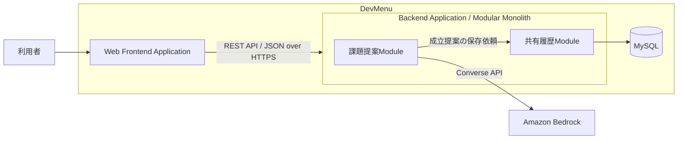
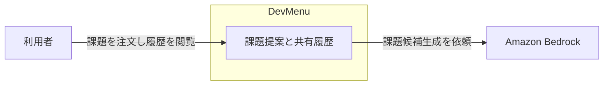
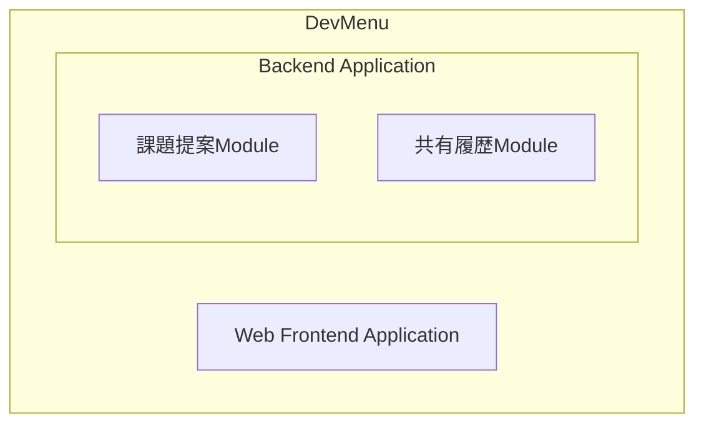

# システムアーキテクチャ設計書（System Architecture Design Document）

## 0. Change History

| Change | Date | Train | Summary |
| --- | --- | --- | --- |
| Initial | 2026-10-14 01:52 UTC | 20260915-initial-implementation | 初回System Architectureを確定 |
| Change 1 | 2026-10-15 07:07 UTC | 20260915-initial-implementation | External Interface詳細化に伴い計測・SDK Retryの境界を整合し、Stubの応答不成立ScenarioとUnit Testによる構造不正検証を区別 |
| Change 2 | 2026-10-16 | 20260915-initial-implementation | GitLab Freeと単独運用を前提に、Production DeliveryをProtected Ref上のBlocking Manual Job、運用ReviewおよびEvidenceによる制御へ更新 |
| Change 3 | 2026-10-17 | 20260915-initial-implementation | Phase Progression Principleに基づき、ModuleごとのDevelopment／Integration／Release境界とCurrent Train全体のRelease Gateを明確化 |
| Change 4 | 2026-10-29 14:56 UTC | 20260915-initial-implementation | BackendのDependency Security GateをTrivyによるRuntime Image内Java Dependency Scanへ統合 |

## 1. Architecture Overview

### 1.1 Architecture Purpose

本書は、Product Requirements Definition、Architecture OutlineおよびFunction Designを成立させるDevMenuのSystem／Application Architectureを定義し、Application Detail Design、API／UI／Table Specification、Infrastructure Architecture、Test Designおよび実装が従う境界と技術制約を示す。

### 1.2 Architecture Summary

DevMenuは、ReactによるWeb Frontend Applicationと、Jakarta EEによるBackend Applicationを独立Applicationとして構成する。Backendは課題提案Moduleと共有履歴Moduleを内包するModular Monolithとし、Layered ArchitectureとPorts and Adaptersを適用する。共有履歴はMySQLへ永続化し、課題候補生成はAmazon Bedrockへ委ねる。FrontendとBackendは独立したOCI Container ImageとしてBuildし、Current Train全体のRelease Gate通過後は、互換性と依存関係を維持しながら個別のDeployment UnitとしてDeployできる。

### 1.3 Key Architectural Characteristics

| Characteristic | Description |
| --- | --- |
| Modular Monolith | Backendを一つのServiceとして運用しながら、課題提案と共有履歴の責務・Data Ownershipを分離する |
| Stateless Application | Frontend／BackendはReplica固有の継続状態を持たず、永続DataはMySQLを正とする |
| Technology Isolation | Domain／ApplicationをAWS SDK、EclipseLink、REST等の技術詳細からPortで分離する |
| Independent Delivery | Frontend／Backendを独立Artifactとし、Current Train全体のRelease Gate通過後は、互換性と依存関係を維持して個別Deploy可能にする |
| Observable Operation | Request ID、Structured Log、HealthおよびMetricsにより運用状態を追跡する |

### 1.4 System Architecture Diagram



## 2. System Boundary and Context

### 2.1 System Scope and Responsibility

| Domain / Functional Area | Responsibility | Scope |
| --- | --- | --- |
| 課題注文・提案 | 条件受付、入力検証、Prompt構成、生成制御、応答検証、有限回の再生成、結果提供 | 対象内 |
| 共有履歴 | 成立提案と入力条件の保存、代表技術名管理、履歴提供 | 対象内 |
| 生成Model | Modelの提供、学習および運用 | 対象外 |
| 個人管理 | Login、個人履歴、課題選択保存、進捗管理 | 初回Train対象外 |

### 2.2 External Responsibility Boundaries

| Domain / Functional Area | This System Responsibility | External System | External Responsibility |
| --- | --- | --- | --- |
| 課題候補生成 | 条件と指示の構成、依頼、応答検証、成立判断 | Amazon Bedrock | 指定された条件に基づく候補生成とModel運用 |

### 2.3 Existing System Positioning

取り込み、併存または置換対象となる既存Systemはない。

### 2.4 System Context



## 3. Application and Service Structure

### 3.1 Application Structure

| Application | Type | Target / Usage | Role |
| --- | --- | --- | --- |
| Web Frontend Application | Browser SPA | 利用者 | 条件入力、結果表示、共有履歴閲覧 |
| Backend Application | REST Backend / Modular Monolith | Web Frontend | 入力検証、生成制御、成立判断、履歴管理 |

### 3.2 Application Boundaries

| Boundary | Decision | Responsibility Separation |
| --- | --- | --- |
| Frontend／Backend | 分離 | Frontendは利用者Interaction、Backendは業務判断と外部／Data連携を所有する |
| Backend Module | 同一Application内の論理分離 | 課題提案と共有履歴を公開内部Interfaceで接続する |

### 3.3 Backend Structure

| Backend | Structure | Description |
| --- | --- | --- |
| Backend Application | Modular Monolith | 一つのRuntime内で二つの機能Module境界を維持する |

### 3.4 Service and Module Boundaries

| Service / Module | Parent Application | Boundary | High-Level Role |
| --- | --- | --- | --- |
| 課題提案Module | Backend Application | 論理Module | 入力検証、Bedrock連携、応答検証、成立判断 |
| 共有履歴Module | Backend Application | 論理Module／Data Owner | 技術名管理、成立提案の保存と履歴提供 |

### 3.5 Application and Service Structure Diagram



## 4. Responsibility, Ownership and Architecture Evolution

### 4.1 Responsibility Allocation

| Application / Service / Module | Responsible Areas | Excluded Areas |
| --- | --- | --- |
| Web Frontend Application | 入力、事前検証、公開通知、結果・Error表示、履歴閲覧 | 課題成立判断、永続化 |
| 課題提案Module | 最終入力検証、Prompt構成、生成制御、応答検証、成立判断 | 履歴Data Ownership |
| 共有履歴Module | 代表技術名、成立提案、入力条件、履歴提供 | 候補生成と成立判断 |
| Amazon Bedrock | 候補生成 | DevMenuの検証、成立判断、履歴管理 |

### 4.2 Overlapping Responsibility Boundaries

| Functional Area | Element A Responsibility | Element B Responsibility | Boundary |
| --- | --- | --- | --- |
| 入力検証 | Frontendは即時の利用者補助 | Backendは最終的な構文・業務検証 | Backend判定を正とする |
| 成立提案保存 | 課題提案Moduleは成立後に一回依頼 | 共有履歴Moduleは一体保存を保証 | 公開内部Interface |
| AI応答 | Bedrockは候補を生成 | 課題提案Moduleは構造と成立を検証 | Bedrock Adapter |

### 4.3 Data Ownership

| Data Domain | Owner | Ownership Responsibility | Other Consumers |
| --- | --- | --- | --- |
| 共有履歴・代表技術名 | 共有履歴Module | 生成、変更、整合性、永続化 | 課題提案Module、Web Frontend |
| 処理中の注文・生成結果 | 課題提案Module | 処理中の検証と成立判断 | Web Frontend、共有履歴Module |

### 4.4 Current Architecture

| Logical Boundary | Current Structure | Separation Level |
| --- | --- | --- |
| Frontend／Backend | 独立Application | 独立Build／Artifact／Deployment Unit。Release Phase開始はCurrent Train全体のRelease Gateに従う |
| 課題提案／共有履歴 | 同一Backend内Module | Package、依存、Interface、Ownershipを論理分離 |

### 4.5 Architecture Evolution

| Target Area | Current Structure | Evolution Direction | Target Structure / Intent |
| --- | --- | --- | --- |
| Backend Module | Modular Monolith | 必要性発生時のみService分割を検討 | 責務とOwnershipを保った独立Service候補 |
| API Boundary | Java | Resource／API ModelのみKotlin化可能 | Null Safetyと表現力を境界に限定して活用 |

### 4.6 Evolution Boundaries

| Target Area | Current Placement | Boundary to Preserve | Reason |
| --- | --- | --- | --- |
| 課題提案／共有履歴 | Backend内Module | 公開内部InterfaceとData Ownership | 将来分割時のCoupling抑制 |
| Kotlin適用 | Interface Layer | DI、Application、DomainはJavaを維持 | Core Logicの一貫性維持 |

## 5. Technology Stack

### 5.1 Application Platform and Language

| Application / Service | Platform | Language | Runtime |
| --- | --- | --- | --- |
| Web Frontend | Web Browser | TypeScript | Browser |
| Backend | Java Platform | Java 21 | Payara Micro 7.x |
| Backend API Boundary（将来選択肢） | JVM | Kotlin | Payara Micro 7.x |

### 5.2 Framework and Application Runtime

| Application / Service | Framework | Application Server / Runtime | Purpose |
| --- | --- | --- | --- |
| Web Frontend | React / Vite | Nginx Container | SPA構築と静的配信 |
| Backend | Jakarta EE 11 | Payara Micro 7.x | REST、DI、Persistence、Transaction等 |

- Payara MicroのPatch Versionは実装開始時にJakarta EE 11適合性とJava 21 Supportを確認して固定する。

### 5.3 Middleware and Data Technologies

| Category | Technology | Used By | Purpose |
| --- | --- | --- | --- |
| RDBMS | MySQL | 共有履歴Module | 共有履歴と代表技術名の永続化 |
| ORM | Jakarta Persistence / EclipseLink | Persistence Adapter | Relational Mapping |
| Database Connectivity | Container-managed DataSource / Connection Pool | Backend | JPA／JTA接続管理 |

### 5.4 Application Core Technologies

| Application / Service | Category | Technology | Purpose |
| --- | --- | --- | --- |
| Backend | REST / JSON / Validation | Jakarta REST / JSON-B / Validation | API境界 |
| Backend | DI / Transaction | Jakarta CDI / Jakarta Transactions | 依存構築とUse Case Transaction |
| Backend | Configuration | MicroProfile Config | 外部設定取得 |
| Backend | Health / Metrics / API Contract | MicroProfile Health / Metrics / OpenAPI | 運用とContract |
| Backend | Logging | Log4j 2 | Structured JSON Console Log |
| Backend | Bedrock Client | AWS SDK for Java 2.x | Converse APIとAWS認証 |
| Frontend | Routing / Styling / HTTP | React Router / CSS Modules / Fetch API | SPA境界 |
| Frontend | API Types | openapi-typescript | OpenAPIからRequest／Response型だけを生成して整合させる |

### 5.5 Development and Delivery Technologies

| Category | Technology / Platform | Used By | Purpose |
| --- | --- | --- | --- |
| Build / Package | Maven / WAR、npm | Backend、Frontend | 再現可能なBuild |
| Static Validation | Compiler、Checkstyle、SpotBugs、ESLint、Prettier | Backend、Frontend | 品質Gate |
| IDE Analysis | SonarLint | Developer | 実装時の補助分析 |
| Test | JUnit 5、Mockito、REST Assured、Vitest、React Testing Library、Playwright、Postman | Application | 各Test Level |
| Security Scan | npm audit、Trivy、Dockle | Dependencies／Images | Frontend Dependency、Runtime Image内のOS Package／Application DependencyおよびImage構成の検査 |
| Image Build | Dockerfile / BuildKit | Frontend、Backend | OCI Image生成 |
| SCM / Repository / CI | Git、GitLab Free、GitHub、GitLab CI/CD | 全体 | Version管理とDelivery |
| Registry | Amazon ECR | Frontend、Backend | OCI Image保管 |

## 6. Application Architecture

### 6.1 Architecture Pattern

| Application / Service | Architecture Pattern | Applied Scope | Purpose |
| --- | --- | --- | --- |
| Backend | Layered Architecture + Ports and Adapters | Backend全体 | 業務責務と外部技術を分離 |
| Frontend | Feature-oriented Component Structure | SPA全体 | 画面機能と共通技術境界を分離 |

### 6.2 Layer and Module Structure

| Layer / Module | Role | Contains |
| --- | --- | --- |
| Interface | 外部入出力 | REST Resource、API Model、変換 |
| Application | Use Case調整 | Use Case、Application Service、Port |
| Domain | 業務判断 | Domain Model、Rule、Domain Service |
| Infrastructure | 技術接続 | Bedrock Client、Repository、Entity |

### 6.3 Layer and Module Responsibilities

| Layer / Module | Responsibilities | Excluded Responsibilities |
| --- | --- | --- |
| Interface | Request受付、構文検証、変換、Use Case呼出し | Business Logic、Persistence直接利用 |
| Application | 処理順序、Transaction Boundary、Port利用 | Technology固有処理 |
| Domain | 成立条件、技術名同一視等の業務Rule | REST、ORM、AWS SDK依存 |
| Infrastructure | Port実装と外部技術変換 | 業務判断 |

### 6.4 Dependency Direction and Rules

- InterfaceはApplicationを介してUse Caseを呼び、Infrastructureを直接利用しない。
- ApplicationはDomainと自身が定義するPortへ依存する。
- DomainはJakarta REST、JSON-B、EclipseLink、AWS SDKへ依存しない。
- InfrastructureはApplication側Portを実装する。
- Module間は相手の内部Package、Entity、Data Storeへ直接依存しない。

### 6.5 Cross-Cutting Concern Placement

| Concern | Placement | Responsibility / Rule |
| --- | --- | --- |
| Validation | REST Boundary／Domain | 構文と業務Ruleを分離 |
| Transaction | Application Use Case | JTAによる宣言的境界 |
| Error Conversion | REST Boundary／Frontend API Client | 内部Errorと公開表現を分離 |
| Logging／Correlation | Cross-cutting Boundary | Request ID付きStructured Log |
| Health／Metrics | Backend Cross-cutting | 外部監視可能な状態を公開 |
| Frontend State | Component／Feature、必要最小限のContext | Redux／Zustandは初回不採用、Backendを永続Dataの正とする |

#### Health, Metrics and Logging Policy

- LivenessはApplication自身の回復不能状態だけを判定し、MySQL、Amazon Bedrockその他の外部Dependencyを能動確認しない。
- ReadinessはBackendの初期化状態とMySQL接続可能性を確認するが、Amazon Bedrockへ生成Requestを送信しない。Bedrock障害だけを理由にBackend全体をNot Readyにしない。
- MetricsはBackend APIのRequest数、Error数、応答時間、Bedrockの呼出し数、失敗数、応答時間、Retry回数、および共有履歴保存失敗数を対象とする。利用者入力、生成内容、CredentialおよびCardinalityが無制限に増える値をLabelへ含めない。
- Application Logは一Event一JSON Objectの単一行としてConsoleへ出力し、Timestamp、Level、Logger、Message、Error Code、Request IDのうち該当項目を保持する。Container内Fileへ永続化しない。
- SystemExceptionはStack Traceを伴うERROR、その他のCustom ExceptionはWARNとし、正常処理ではWARN／ERRORを出力しない。
- BackendはInbound RequestごとにRequest IDを生成し、Client指定値を信頼して採用しない。Log ContextとResponse Headerへ設定し、Request終了時に必ずContextから削除する。
- 初回TrainではDistributed Tracingを導入せず、Request ID、Log、Metricsを使用する。Service分割または非同期連携を導入する場合にOpenTelemetryを再検討する。

### 6.6 Package and Module Organization Policy

```text
backend/
├── proposal/{interface,application,domain,infrastructure}
├── history/{interface,application,domain,infrastructure}
└── shared/
```

- 最上位をFeature Module、その内側をLayerで分割する。`shared`へDomain Logicを置かない。

## 7. Dependency Management

### 7.1 Dependency Management Policy

- Platform標準または公式Libraryで成立する基盤処理は自前実装しない。
- Direct Dependencyは用途とOwnerを明示し、不要になったものを削除する。
- Technology固有DependencyはAdapter／Boundaryへ限定する。

### 7.2 Dependency Inventory

| Dependency | Category | Used By | Purpose | Selection Rationale |
| --- | --- | --- | --- | --- |
| AWS SDK for Java 2.x Bedrock Runtime | SDK | Bedrock Adapter | Converse API、認証、Region | SigV4等を公式SDKへ委ねる |
| Jakarta EE API | Platform API | Backend | REST、JSON-B、Validation、CDI、JPA、JTA | Payara Microが提供する標準APIをCompile時に参照する |
| MicroProfile Config / Health / Metrics / OpenAPI APIs | Platform API | Backend | 外部設定、Health、Metrics、API Contract | Payara Microが提供する標準化された横断機能を利用する |
| EclipseLink | ORM Runtime | Persistence Adapter | Jakarta Persistence実装 | Payara Micro標準のPersistence Providerを利用する |
| React | UI Framework | Web Frontend | Component-based SPA | UIをComponent単位で構成するため |
| Vite | Frontend Build Tool | Web Frontend | Development Buildと静的Artifact生成 | TypeScript／ReactのBuildを簡潔に構成するため |
| React Router | Frontend Library | Frontend | SPA Routing | Browser HistoryとURLを統一管理 |
| openapi-typescript | Code Generator | Web Frontend | OpenAPIからTypeScript型を生成 | Client SDKを生成せず型Contractだけを共有するため |
| Log4j 2 | Logging | Backend | Structured Log | JSON Console Logを統一 |
| Checkstyle / SpotBugs | Build Plugin / Static Analysis | Backend | Coding RuleとBug Patternの検出 | Mavenから再現可能なStatic Validationを行うため |
| JUnit 5 / Mockito | Test Framework | Backend Unit Test | Unit TestとTest Double | JavaのLogicと外部Portを独立検証するため |
| REST Assured | API Test Library | Backend API Integration Test | REST APIの実行と検証 | JUnit 5からStaging APIを機械判定するため |
| Vitest / React Testing Library | Test Framework | Frontend Unit／Component Test | Logicと利用者視点のComponent検証 | Vite／React構成と整合するTestを行うため |
| Playwright | Browser Test Framework | Browser E2E Test | 実Browserによる主要Flow検証 | Staging上のSystem全体を利用者視点で確認するため |

### 7.3 Version and Compatibility Management

- Jakarta EE APIは`provided` Scopeとし、Payara提供物と重複梱包しない。
- AWS SDK ModuleはBOMでVersionを固定する。動的Versionを使用しない。
- Frontendは`package-lock.json`をCommitし、Lock-based Installを行う。
- React、Vite、Frontend Library、Test Frameworkおよびopenapi-typescriptは`package.json`のDirect DependencyまたはDev DependencyとしてVersionを明示し、`package-lock.json`で解決結果を固定する。
- JUnit 5、Mockito、REST Assured、Log4j 2およびMaven Pluginは`pom.xml`でDirect Dependency／PluginとしてVersionを明示し、必要に応じてBOMまたはPropertyで統一する。
- OpenAPI ContractとBackend、生成TypeScript型の整合をCIで確認する。

### 7.4 Direct and Transitive Dependency Management

- 直接利用するLibraryをTransitive Dependencyへ暗黙依存させない。
- Maven Dependency Treeとnpm Lock Fileで競合・意図しない導入を確認し、Exclusion／Overrideは理由を記録する。

### 7.5 Shared Dependency Policy

- Backend Module間で共有するのは技術的に必要な最小要素に限定し、Domain Model共有によるCouplingを作らない。
- Frontendの共通要素もFeature Ownershipを侵害しないUI／技術要素に限定する。

### 7.6 Dependency Lifecycle and Risk Management

- Major更新時はRuntime、Contract、Testへの影響を確認する。
- Frontendはnpm audit、BackendはTrivyによるRuntime Image ScanをDependency Security Gateとして使用する。Backendでは、`pom.xml`から解決されWAR／JARへPackageされたJava DependencyをRuntime Image内で検査する。
- npm auditおよびTrivyはHigh／CriticalでGateを失敗させる。TrivyはRuntime Image内のOS PackageとApplication Dependencyの双方を対象とする。
- DockleはFATALでImage構成Gateを失敗させる。除外は対象、理由、影響を限定して記録する。
- Scan結果はSource Version、Dependency定義および生成Imageと対応するPipeline Artifactとして保持する。脆弱性検出とTool／Vulnerability Database取得失敗を区別し、取得失敗をDependency Security Gateの通過として扱わない。
- DockleのWARN以下およびDependency ScanのMedium以下は記録し、利用経路と影響を評価する。Scan全体を無効化しない。
- EOL、Deprecatedまたは不要なDependencyは代替確認後に削除する。

## 8. Integration Architecture

### 8.1 Integration Landscape

| Source | Target | Integration Purpose | Interaction | Integration Style |
| --- | --- | --- | --- | --- |
| Web Frontend | Backend | 課題提案・履歴利用 | 同期 | REST / JSON over HTTPS |
| 課題提案Module | 共有履歴Module | 成立提案保存 | 同期 | Java Interface |
| Backend | Amazon Bedrock | 候補生成 | 同期 | AWS Converse API |

### 8.2 Synchronous and Asynchronous Integration Strategy

| Integration Scenario | Strategy | Rationale |
| --- | --- | --- |
| Browser API | 同期 | 操作結果を同一Requestで返す |
| Module間保存 | 同期 | 一回の保存成否を観測する |
| Bedrock生成 | 同期 | 成立した3件を注文応答として返す |

- 初回TrainではEvent、Message Brokerまたは非同期Queueを導入しない。

### 8.3 API Integration Architecture

- `/`でSPA、`/api`でBackend APIを同一Originから公開し、Frontendは相対URLを使用する。
- Public通信はHTTPS、Data表現はJSONとする。CORS依存を持たない。
- Endpoint、Schema、Error表現はAPI Specificationで定義する。

### 8.5 External System Integration Principles

- 外部固有表現はAdapterで内部表現へ変換し、Business Logicへ伝播させない。
- Timeout、認証、通信等の技術Failureは業務上の応答不正Retryと区別する。
- SDK内部の技術的Retryは許容する。SDKが最終的に通知した技術Failureに対してApplicationおよびAdapter独自の追加試行は行わない。1回の呼出し全体のTimeoutにはSDK内部のRetryおよび待機を含める。

### 8.6 Interface Versioning and Compatibility

| Interface Type | Compatibility Policy | Versioning Policy |
| --- | --- | --- |
| Frontend／Backend REST API | Rolling中の新旧Consumerと互換 | OpenAPIを正としてBreaking Changeを検知し、必要時にVersion化 |
| Backend内部Interface | Module内部を非公開 | Consumer影響を確認して段階変更 |

### 8.7 Interface Evolution Principles

- 将来のService分割に備え、課題提案／共有履歴間の公開InterfaceとOwnershipを維持する。

## 9. External Service Integration

### 9.1 External Service Inventory

| External Service | Category | Used By | Purpose |
| --- | --- | --- | --- |
| Amazon Bedrock | Generative AI | 課題提案Module | 3件の課題候補生成 |

### 9.2 External Dependency Boundaries

| External Service | Dependency Boundary | Internal Consumer | Dependency Rule |
| --- | --- | --- | --- |
| Amazon Bedrock | Bedrock Port／Adapter | 課題提案Use Case | AWS SDKとModel固有表現をAdapter外へ出さない |

### 9.3 Client and Adapter Responsibilities

| Boundary Component | Responsibilities | Excluded Responsibilities |
| --- | --- | --- |
| Bedrock Adapter | Converse呼出し、認証、Region、外部Error変換 | Promptの業務構成、成立判断 |
| Stub Adapter | 設定された再現可能Scenarioの返却 | Production Fallback |

### 9.4 External Service Failure Strategy

| External Service | Failure Impact | Architecture Strategy |
| --- | --- | --- |
| Amazon Bedrock | 課題注文が失敗 | SDK内部のRetryを含む呼出しが最終的に技術Failureとなった場合、Applicationは追加試行せず注文を失敗とする。呼出し成功後に検証対象の生成内容を取得できない場合、または構造検証が不成立の場合は、初回を含むApplicationからの生成依頼を最大3回まで行う。SDK内部の通信試行数はこの3回に含めない |

### 9.5 Environment-specific External Service Usage

| Environment | External Service Usage | Purpose / Constraint |
| --- | --- | --- |
| Local | Stub | 外部依存なしの開発 |
| Development | Stub既定、設定で実Bedrockへ切替 | 継続開発と必要時の実接続確認 |
| Staging | 実Bedrock | 正式Integration Test |
| Production | 実Bedrock | 公開機能。Stub Fallback禁止 |

### 9.6 Substitute Implementation Strategy

- CDIで共通PortへReal／Stub Adapterを接続し、MicroProfile ConfigでDevelopmentの選択を行う。
- Stubは正常3件、応答不成立、技術Failureを決定的に再現する。応答不成立Scenarioは`InvalidResponse`を直接返し、再生成と試行上限到達時の処理を確認する。
- 生成ContentのJSON・件数・必須項目等の構造不正はUnit Testで検証する。運用用StubのScenarioと検証責務の詳細は[課題候補生成External Interface Specification](details/api/practice-candidate-generation-external-interface-spec.md)の9章 Step 4を参照する。

### 9.7 External AI Integration

- Regionは`ap-northeast-1`、ModelはAmazon Nova Lite `amazon.nova-lite-v1:0`、APIはConverse APIを使用する。
- Prompt本文とModel Parameterは後続仕様で定義し、利用者自由文をそのままPrompt全体として扱わない。
- 初回TrainではPRDに従い呼出しRate Limitを導入しない。必要性が生じた場合に要件から再検討する。

## 10. Data Persistence Architecture

### 10.1 Persistence Model and Technology Usage

| Data / Usage | Persistence Model | Technology | Purpose |
| --- | --- | --- | --- |
| 代表技術名、入力条件、共有履歴、3件の課題 | Relational | MySQL + Jakarta Persistence / EclipseLink | 関係と一体性を永続化 |

- Payara MicroのContainer-managed DataSource／Connection Poolを使用する。値はConfigMap／Secretから供給し、Applicationは標準JPA／JTA境界だけを利用する。

### 10.2 Persistence Boundaries and Data Ownership

| Data Domain | Owner | Persistence Boundary | Access by Other Services |
| --- | --- | --- | --- |
| 共有履歴 | 共有履歴Module | Module内部Repository／Entity／MySQL | 課題提案Moduleは保存Interfaceのみ利用 |

### 10.3 Application and Data Store Relationships

| Application / Service | Data Store / Domain | Access | Responsibility |
| --- | --- | --- | --- |
| 共有履歴Module | MySQL／共有履歴 | Read / Write | Ownerとして整合性を維持 |
| 課題提案Module | 共有履歴 | Interface経由の保存依頼 | Entity／DBへ直接Accessしない |

### 10.4 Transaction Strategy

- 共有履歴Application Use CaseをJTAの宣言的Transaction Boundaryとする。
- 入力条件、代表技術との関係、履歴および3件を一つのTransactionで保存する。
- Repositoryは呼出元Transactionへ参加し、自身で開始／Commit／Rollbackしない。
- 分散Transactionは使用しない。

### 10.5 Consistency Strategy

| Scope / Relationship | Consistency Requirement | Strategy |
| --- | --- | --- |
| 一つの共有履歴 | 強い一体性 | 全要素を単一Transactionで保存し部分保存しない |
| 提案成立と履歴保存 | 保存失敗を許容 | 保存失敗を記録し、成立した提案は利用者へ返す |

## 11. Security Architecture

### 11.1 Trust Boundaries and Security Zones

| Boundary | Source | Target | Trust Assumption | Required Security Control |
| --- | --- | --- | --- | --- |
| Public Input | Browser | Frontend／Backend | 入力を信頼しない | HTTPS、Backend再検証、安全な文字列表示 |
| External AI | Backend | Bedrock | 応答を信頼しない | IAM Role、TLS、構造検証 |
| Persistence | Backend | MySQL | Application境界外 | TLS、Credential分離、Owner経由Access |

### 11.2 Authentication Architecture

| Actor / Client | Authentication Required | Authentication Method | Identity Provider |
| --- | --- | --- | --- |
| 利用者 | 不要 | Anonymous | なし |

- 初回TrainではUser Registration、Login、Session／Token Identityを設けない。

### 11.3 Authorization Architecture

- 初回Trainでは個人別Role／Permissionを設けず、課題注文と共有履歴をAnonymousへ公開する。

### 11.4 Service-to-Service Identity and Authorization

- Bedrock AccessはBackend WorkloadのIAM Roleを用い、User Identityを伝播しない。
- Backend Module間は同一Application内Interfaceであり、独立Service Identityを設けない。

### 11.5 Data Protection and Encryption

| Data / Scope | Protection Requirement | Architectural Strategy |
| --- | --- | --- |
| Browser通信 | 通信中暗号化 | HTTPS必須 |
| Backend–MySQL／AWS API | 通信中暗号化 | TLS、証明書検証を無効化しない |
| MySQL、Backup、ECR Image、運用Log | 保存時暗号化 | 基盤提供の暗号化を利用 |

- Credential、Secret、利用者入力、生成内容を既定でLogへ出力しない。Application独自暗号化は初回導入しない。

### 11.6 Input Validation and Boundary Protection

- Frontend検証だけを信頼せず、BackendでJakarta ValidationとBusiness Ruleを適用する。
- AI応答をJSON構造、件数、必須項目で検証する。表示値をScript／Markupとして解釈しない。
- 初回TrainではRate Limitを導入せず、将来導入時は要件を先に定義する。

### 11.7 Secrets and Credential Usage

| Credential | Used By | Usage Boundary | Application Rule |
| --- | --- | --- | --- |
| AWS Credential | Bedrock Adapter | SDK Default Credential Provider Chain | IAM Roleの短期Credentialを使用し固定配置しない |
| MySQL Credential | Persistence Adapter | DataSource接続 | ConfigMapと分離したSecretから供給 |

- EnvironmentごとにCredentialを分離し、Source、Image、Logへ含めない。保管、Injection、RotationはInfrastructure Architectureで定義する。

## 12. Performance and Scalability Architecture

### 12.1 Performance Architecture

| Target | Performance Requirement | Architectural Strategy |
| --- | --- | --- |
| 課題注文 | 数値目標なし | Bedrock同期処理を境界化し、時間とFailureをMetricsで観測 |
| 共有履歴 | 全件表示を初回仕様とする | IndexとQueryを適正化し、増加時にPaging要件を再検討 |

### 12.2 Caching Strategy

- 初回TrainではApplication内／Shared Cacheを導入せず、MySQLをSource of TruthとしてRequestごとに取得する。

### 12.3 Parallel and Asynchronous Processing Strategy

- 初回は注文、生成、成立判断および保存依頼を同期処理し、Application独自Thread、Queue、非同期Workerを導入しない。

### 12.4 Resource Usage Principles

- Bedrock通信とDB AccessはI/O-boundとして扱い、Timeoutと有限なConnectionを占有し続けない設計にする。
- AI応答と履歴DataをReplica Local Memoryへ継続保持しない。

### 12.5 Application Scalability Strategy

| Application / Service | Scaling Unit | State Model | Scaling Consideration |
| --- | --- | --- | --- |
| Web Frontend | Container Replica | Stateless | 水平Scale、Sticky Session不要 |
| Backend | Container Replica | Stateless | 水平Scale、MySQL ConnectionとBedrock Quotaを考慮 |

### 12.6 Data Growth Strategy

- 初回MySQLは単一Writerとし、Index、Query、Connection Poolの適正化を優先する。
- Read Replica、Sharding、Data Partitioningは導入しない。Data量と応答時間を観測し、必要性を確認して再設計する。
- 初回はFunction DesignどおりPagingを設けないため、履歴増加で成立しなくなる前に要件として再検討する。

### 12.7 Functional Growth and Extensibility

- 新機能はOwnerとなるFeature Moduleへ追加し、責務・Data Ownership・独立変更の必要性が高まった場合に新Module／Serviceを検討する。
- 外部ServiceはApplication Portの外側へAdapterとして追加する。

### 12.8 Bottleneck Management

| Potential Bottleneck | Affected Scope | Architectural Strategy |
| --- | --- | --- |
| Bedrock latency／Quota | 課題注文 | Adapter隔離、Metrics、同期Failure境界 |
| MySQL Connection／Query | 履歴保存・閲覧 | Pool、Index、Query観測、単一Writerから段階評価 |

## 13. Deployment Architecture and Strategy

### 13.1 Deployment and Release Units

| Application / Service | Build Unit | Release Unit | Deployment Unit | Independent Deployment |
| --- | --- | --- | --- | --- |
| Web Frontend | npm Project | OCI Image | Frontend Container | 可 |
| Backend | Maven Project / WAR | OCI Image | Payara Micro Container | 可 |

- 独立Deployment可能とは、Current Train全体のRelease Gate通過後に、各Applicationを他Applicationとの同時Deployを必須とせず、個別のDeployment UnitとしてDeployできることを指す。各Applicationに対応する担当Moduleが、同Gateを待たず単独でRelease Phaseへ進行できることは意味しない。
- `Phase Progression Principle`におけるModuleは、ProjectルールおよびCurrent TrainのTask Allocationによって定義された担当・構築・開発単位を指す。Backend Application内部の課題提案Moduleおよび共有履歴Moduleは論理的なApplication Moduleであり、Phase進行単位として個別に扱わない。
- Current Trainの担当ModuleとApplication／ServiceのBuild Unit、Release UnitまたはDeployment Unitの対応はTask Allocationを正とし、本System Architectureでは新たな担当境界を定義しない。

### 13.2 Artifact Strategy

| Application / Service | Artifact | Artifact Unit | Versioning |
| --- | --- | --- | --- |
| Web Frontend | Nginx OCI Image | 静的Web Artifact | Commit SHA Tag + Digest |
| Backend | WARを含むPayara Micro OCI Image | WAR／Image | Commit SHA Tag + Digest |

- ImageはEnvironmentごとに再Buildせず、検証済みDigestをPromotionする。Frontend／Backendは別ECR Repositoryで管理する。
- Frontend Imageは非rootで動作するNginxを使用し、静的Artifact配信とSPA Fallbackだけを担う。Business LogicおよびBackend Reverse Proxyを持たせない。

### 13.3 Application Delivery Pipeline

| Target | Pipeline Stages | Trigger | Deployment Scope |
| --- | --- | --- | --- |
| Frontend | Install→Static Check→Test→Build→Image→Scan→Push→Deploy | 統合用`develop/*`へのMerge、`release/*`でのProduction Promotion | Frontendのみ |
| Backend | Maven Build→Static Check→Test→WAR→Image→Scan→Push→Deploy | 統合用`develop/*`へのMerge、`release/*`でのProduction Promotion | Backendのみ |

- MavenでWARを先に生成し、Docker Build内で再Buildしない。Image生成後かつECR Push／Staging Deploy前にTrivy／Dockleを実行する。BackendのTrivy ScanはRuntime Image内のOS PackageとWAR／JARにPackageされたJava Dependencyの双方を対象とし、Dependency Security Gate、Image Vulnerability GateおよびImage構成Gateを通過したImageだけをPushする。
- GitLab FreeのCI/CDをPrimaryとし、GitHubはSource Mirrorとする。Production DeployはGitLabだけから行う。FrontendとBackendは独立Pipelineを維持し、GitLab EnvironmentはDeployment履歴と対象識別に利用できるが、Protected EnvironmentまたはDeployment Approvalが有効であることを前提にしない。
- `feature/*`または`fix/*`上のDevelopmentでは、Build、Static Check、Testその他の検証およびDevelopment Environmentへの確認用Deployを実施できる。ただし、同BranchまたはDevelopment中のArtifactからStagingもしくはProductionへ直接Deployしない。
- 当該ModuleについてCurrent Trainで必要な一連の変更のDevelopment完了後、作業・修正Branchを統合用`develop/*`へ統合し、そのPipelineからStagingへのDeployおよびIntegration Testを実施する。
- Production Deployを含む`release/*`のPipelineは、Current Train全体のRelease Gate通過後に開始可能とする。Phase進行条件およびEnvironment間のPromotion Gateは13.5を正とする。

### 13.4 Environment Deployment Strategy

| Environment | Deployment Method | Execution | Purpose / Rationale |
| --- | --- | --- | --- |
| Development | WorkstationからManual Deploy | Developerによる手動 | 低Spec Localを補い短Cycleで確認 |
| Staging | GitLab CI/CD | Protectedな統合用`develop/*`へのMerge後に自動 | 正式Integration Test |
| Production | GitLab CI/CD | Protectedな`release/*`上のBlocking Manual Job | 検証済みArtifactを明示的なReview後に公開 |

- DevelopmentではDirty Worktree Imageを許容し、時刻、Short SHA、Dirtyを識別してDigestを記録する。Dirty ImageはPromotionしない。
- Development EnvironmentへのManual DeployはDevelopment Phase中の反復的な実装確認であり、IntegrationまたはReleaseへのPromotionとは扱わない。
- Stagingは当該ModuleのDevelopment完了後にProtectedな統合用`develop/*`へMergeされた変更を対象として自動Deployし、正式なIntegration Testを開始して対象Image Tag／Digestを記録する。
- ProductionはCurrent Train全体のRelease Gate通過後、Protectedな`release/*`上で`when: manual`かつ`allow_failure: false`のBlocking Manual JobとしてDeployし、後続処理を実行前で停止する。実行前に対象Commit、Stagingで検証したImage Digest、Integration Test結果、Deployment対象および差分をReviewする。
- Review対象、Review結果、Commit、Image Digest、実行者、Job、実行結果およびProduction VerificationをEvidenceとして記録する。Production Verification完了後にRelease BranchをMasterへMergeする。

### 13.5 Environment Promotion Strategy

| From | To | Artifact | Promotion Condition | Approval |
| --- | --- | --- | --- | --- |
| Development | Integration / Staging | CI Build Image | 当該ModuleについてCurrent Trainで必要な一連の変更のDevelopment完了後、作業・修正Branchを統合用`develop/*`へ統合し、Build／Test／Scanに成功していること | 統合後に自動 |
| Integration / Staging | Release / Production | 同一Image Digest | Current Train対象の全ModuleがIntegrationを完了し、対象ArtifactのIntegration Testならびに対象Commit／Digest／差分のReviewが完了していること | 運用Review後のBlocking Manual Job。独立Approvalなし |

- ConfigMap／SecretによりEnvironment設定をArtifactから分離する。
- 各Moduleは、自身のDevelopment完了後に他ModuleとのPhase同期を待たずIntegrationへ進行できる。Module間のExecution Orderは、別途定義された依存関係に従う。
- Current Train対象の全ModuleがIntegrationを完了するまでは、いずれのModuleもReleaseを開始しない。Release Gate通過後は、依存関係、Interface／Schema互換性および適用順序の制約に従い、各Moduleを個別にReleaseでき、同時Releaseを必須としない。
- 個々のTask、Application機能、Database TableまたはInfrastructure Resourceごとに`Development`、`Integration`、`Release`を繰り返さず、当該Moduleへ割り当てられたCurrent Trainの一連の変更を各Phaseの完了単位とする。
- Development中のSourceまたはArtifactをStagingもしくはProductionへ直接Promotionしない。Development Environmentへの確認用Deployは許容するが、そのArtifactをIntegrationまたはReleaseへ昇格させない。
- GitLab FreeのManual Job実行は、独立した承認者によるDeployment Approvalではない。単独運用では、単独運用者によるReviewと明示的な手動実行を運用上のGateとして受容する。
- GitLab FreeのMerge Request Approvalは任意であり、Approval不足によってMergeを強制的にBlockする制御として扱わない。Protected Ref、必須Pipeline成功およびReview Evidenceを組み合わせる。
- CI/CD設定を変更できる単独Maintainerは制御自体を変更できるため、本方式を独立した職務分離またはGitLab標準のDeployment Approvalと同等には扱わない。利用者または権限主体が追加され、実装者、Reviewerおよび実行者の独立性が必要になった場合は、GitLab Premium以上のProtected Environment / Deployment Approvalまたは権限を分離したDeployment専用Projectを再検討する。
- Protected Refの具体的なBranch Protection、Pipeline Source、OIDC Claim、AWS IAM Trust、Deploy Role、Runner、EKS接続およびNamespace制約はInfrastructure Architectureを正とする。Application PipelineはInfrastructure ArchitectureのProduction Deploy RoleとDeployment Target Contractに従い、Protected EnvironmentまたはEnvironment名だけをProduction認可の根拠にしない。

### 13.6 Deployment Dependencies and Ordering

| Change | Dependency | Required Order / Constraint |
| --- | --- | --- |
| DB Schema／Backend | 新旧Backend互換 | Expandを先行する。旧Version停止後にContractを別の時期に行う場合は後続Trainへ割り当てる |
| Backend API／Frontend | 新旧Consumer互換 | Backendを互換的に先行可能とし同時切替を必須にしない |

- Module間のExecution Orderおよび依存関係は、あるModuleを他Moduleと同じPhaseに同期させる条件ではなく、各Phaseで必要となるInput、Interface、Environmentまたは適用順序を決定する条件として扱う。
- Release Gate通過後のDatabase Schema、Backend、Frontendその他の変更は、Interface／Schema互換性および別途定義された依存関係に従って必要な順序で適用する。適用順序は同時Releaseを要求せず、Release Gateを迂回する根拠にもならない。
- 一つのRelease Phase内で複数Moduleまたは複数Deployment Unitを順番に適用しても、Taskや構成要素ごとに`Development`、`Integration`、`Release`を再開始したものとは扱わない。

### 13.7 Deployment Compatibility Strategy

- OpenAPIとExpand／Contractにより新旧Version共存を維持し、破壊的API／Schema変更を単一切替点で行わない。
- Schema SQLはGitでVersion管理し、同一Fileを環境別に手動適用する。EclipseLink自動DDL、Flyway、Liquibaseは初回不採用とする。
- Database SchemaのStaging適用は、Databaseを担当するModuleについてCurrent Trainで必要な一連のSchema変更のDevelopment完了後に行い、個々のTableまたはSQL FileごとにIntegrationへ進めない。
- Database SchemaのProduction適用は、Current Train全体のRelease Gate通過後に、Backendその他の依存対象との互換性および適用順序を確認して実施する。
- 旧Version停止後にContract変更を別の時期に実施する場合は後続Trainへ割り当て、当該TrainにおけるDevelopmentとIntegrationを完了した後にReleaseする。Current Trainの完了後にContractだけを追加でReleaseしない。
- SQLはApplication Deployと分離し、権限を持つ作業端末のDatabase Clientから適用する。CredentialをSQL、Script、SourceまたはImageへ埋め込まない。
- Staging／Productionでは対象Environment、Database、SQL Fileおよび差分を実行前に確認する。Productionは単独運用者による運用Review後に作業端末から明示的に手動実行し、独立ApprovalまたはGitLab Deployment Approvalを意味しない。Source Version、Review結果、実行者、日時、成否および適用後確認をEvidenceとして記録する。

### 13.8 Deployment Strategy

| Application / Service | Deployment Strategy | Downtime | Coexistence Requirement | Reason |
| --- | --- | --- | --- | --- |
| Frontend | Rolling | 無停止SLOなし | 新旧がBackendと互換 | 段階更新 |
| Backend | Rolling | 無停止SLOなし | 新旧がAPI／Schemaと互換 | Readiness後にTraffic移行 |

### 13.9 Rollback and Recovery Strategy

- Applicationは直前の検証済みDigestへRollbackする。Schema変更は原則Roll-forwardし、旧Applicationと安全に両立しない場合も修正版で進める。
- Production MySQLは自動Backupを取得し、基盤対応時はPoint-in-Time Recoveryを有効化する。定期Restoreで復元可能性を確認する。
- 保持期間、RPO／RTO、Restore手順はInfrastructure Architecture／運用設計で定義する。

### 13.10 Post-deployment Verification

- 自動Smoke Testで起動、Readiness、Frontend配信、Backend疎通を確認し、手動UI Verificationを組み合わせる。
- Stagingでは実Bedrock、保存、履歴閲覧まで、Productionでは副作用を限定した最小限の確認を行う。
- EvidenceをImage Digestと対応付け、Rollback／Roll-forward判断に用いる。

## 14. Test Architecture

### 14.1 Test Levels and Responsibilities

| Test Level | Primary Scope | Real Components | Isolated / Substituted Dependencies | Responsibility |
| --- | --- | --- | --- | --- |
| Backend Unit | Domain／Use Case | 対象Java Code | 外部Port、時刻等 | Business Ruleと分岐 |
| Frontend Unit／Component | Logic／React Component | 対象TypeScript／Component | Backend API | 表示、操作、状態遷移 |
| API Integration | Staging API | Backend、MySQL、Bedrock | 原則なし | System境界の成立 |
| Browser E2E | 主要利用者Flow | Frontend、Backend、MySQL、Bedrock | 原則なし | End-to-End成立 |

### 14.2 Test Boundaries

| Architecture Boundary | Test Boundary | Verification Responsibility |
| --- | --- | --- |
| 課題提案Module | Domain／Use CaseとBedrock Port | 成立判断、Retry、Failure分離 |
| 共有履歴Module | Use Case／Repository | Transaction、一体性、取得 |
| REST API | OpenAPI Contract | Validation、JSON、Error境界 |
| Frontend | Feature Component／API Client | 利用者操作と通信状態 |

### 14.3 Component and Integration Testing Strategy

- Unit Testは外部Portを代替し、Domain Objectを過度にMock化しない。
- Staging Integration Testは実MySQL／Bedrockを使用し、成立提案から履歴閲覧まで確認する。

### 14.4 Contract Testing Strategy

- OpenAPIをFrontend／Backend間の機械可読ContractとしてVersion管理し、妥当性、不整合、Breaking ChangeをCIで検査する。
- FrontendはTypeScript型だけを生成し、薄いFetch Clientは手書きする。生成型を直接編集しない。

### 14.5 External Dependency Testing Strategy

| External Dependency | Unit | Integration | E2E | Strategy |
| --- | --- | --- | --- | --- |
| Amazon Bedrock | Stub／Mock | 実Service | 必要最小限の実Service | 正常、構造不正、技術Failureを分担 |
| MySQL | Repository代替可 | 実DB | 実DB | TransactionとQueryを正式環境で確認 |

### 14.6 Test Double Strategy

- Real／Stub Bedrock Adapterは同じPortを実装する。Stubは決定的Scenarioを返し、Production Fallbackには使用しない。
- Test専用分岐をDomain Logicへ侵入させず、実DependencyによるStaging確認を省略しない。

### 14.7 Test Framework and Tooling

| Test Scope | Framework / Tool | Used By | Purpose |
| --- | --- | --- | --- |
| Backend Unit | JUnit 5 / Mockito | Backend | Logic検証 |
| Frontend Unit／Component | Vitest / React Testing Library | Frontend | 利用者視点の振る舞い |
| API Integration | JUnit 5 / REST Assured | GitLab Runner | 正式API検証とEvidence |
| Exploratory API | Postman | Developer | 補助的な条件確認 |
| Browser E2E | Playwright | GitLab Runner | 主要Flow検証 |

### 14.8 Testability Architecture

- 外部Service、Persistence、時刻等をPortで差替え可能にし、ConfigurationでReal／Stubを選択する。
- Request ID、Log、Metrics、Healthおよび永続結果により検証可能性を確保する。
- TestのためにProduction Business Logicを変更せず、再現可能なTest Dataと独立したEnvironmentを用いる。

## 15. Technical Constraints and Architecture Decisions

### 15.1 External and Existing System Constraints

| Constraint | Source | Affected Areas | Required Compliance |
| --- | --- | --- | --- |
| Bedrock Model／Region | System Architecture 9.7 | External Integration | Nova LiteをTokyo RegionのConverse APIで利用 |
| Anonymous共有 | PRD／Function Design | Security／Data | Loginなしで注文・履歴閲覧を提供 |
| AI呼出し制限なし | PRD | Security／Performance | 初回TrainでRate Limitを追加しない |

### 15.2 Platform and Runtime Constraints

| Constraint | Source | Architectural Impact |
| --- | --- | --- |
| Java 21 / Jakarta EE 11 / Payara Micro 7.x | 5章 | Jakarta標準APIを中心に構成しPatchを固定 |
| Container運用 | 13章 | Stateless、Console Log、外部設定、Immutable Image |
| GitLab Free Primary | 13章 | Production DeliveryをGitLabへ限定し、Protected Environment、Deployment Approvalおよび必須Merge Request Approvalを前提にしない |

### 15.3 Technology-induced Constraints

| Technology | Constraint | Affected Architecture |
| --- | --- | --- |
| Jakarta Persistence / EclipseLink | EntityとORM依存をInfrastructureへ限定 | Module／Layer依存 |
| AWS SDK | Bedrock固有依存をAdapterへ限定 | External Integration |
| React SPA | Browser側永続状態を正にしない | Frontend State |

### 15.4 Cross-cutting Architecture Decisions

| Decision | Rationale | Affected Areas | Constraint on Future Design |
| --- | --- | --- | --- |
| MicroProfile Config + ConfigMap／Secret | Payara固有設定取得への依存回避 | Configuration／Deployment | Artifactへ環境値を埋め込まない |
| Modular Monolith | 初回規模を保ち境界を維持 | Backend全体 | Module間内部参照を禁止 |
| Same Origin | CORS依存を避ける | Frontend／API／Infrastructure | `/`と`/api`のRoutingを提供 |
| Digest Promotion | 検証物と本番物を一致 | Delivery | Environmentごとに再Buildしない |

### 15.5 Rejected Architectural Alternatives

| Decision Topic | Selected | Rejected Alternative | Reason for Rejection |
| --- | --- | --- | --- |
| Backend構造 | Modular Monolith | 初回からMicroservices | 規模に対して運用複雑性が過大 |
| Module連携 | 同期Interface | CDI Event／Messaging | 即時の保存結果以外に非同期性が不要 |
| Schema Migration | Version管理SQLの手動適用 | Flyway／Liquibase | 初回利用機能を最小化 |
| Frontend State | React State／Context | Redux Toolkit／Zustand | 現在の画面横断状態が限定的 |
| Tracing | Request ID／Log／Metrics | OpenTelemetry | 単一Backendで分散Traceが不要 |
| Client生成 | TypeScript型のみ生成 | Full SDK生成 | 薄いFetch境界を制御可能に保つ |

### 15.6 Constraints for Subsequent Design

| Constraint | Applies To | Required Compliance |
| --- | --- | --- |
| API Contract | API Specification | OpenAPIとResource／Modelを一致させる |
| Module／Layer境界 | Detailed Design／Implementation | Domainを技術依存から隔離しModule内部参照を禁止 |
| Data Ownership／Transaction | Table Definition | 履歴一体性と共有履歴Module Ownershipを維持 |
| Path Routing／TLS／IAM／Secret／Backup | Infrastructure Architecture | 本書の論理要件をCloud Resourceへ具体化 |
| Environment別Bedrock利用 | Runtime Configuration／Test Design | Local／Development StubとStaging／Production実Serviceを維持 |
| Independent Delivery | CI/CD Configuration | 独立Pipeline、独立Artifact、同一Digest PromotionならびにRelease Gate通過後の互換Deployを維持 |
| Phase Progression | CI/CD Configuration／Infrastructure Architecture／Database Design・Implementation | 各担当ModuleのDevelopment完了後にIntegrationへ進み、Current Train対象の全ModuleのIntegration完了後にのみReleaseを開始する。Development中の変更をStaging／Productionへ直接Promotionせず、Application内部の論理Module、個々のTaskまたは構成要素を独立したPhase進行単位として扱わない |
